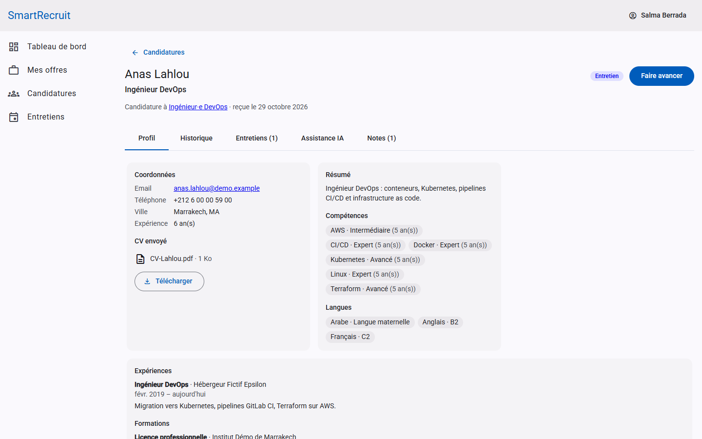
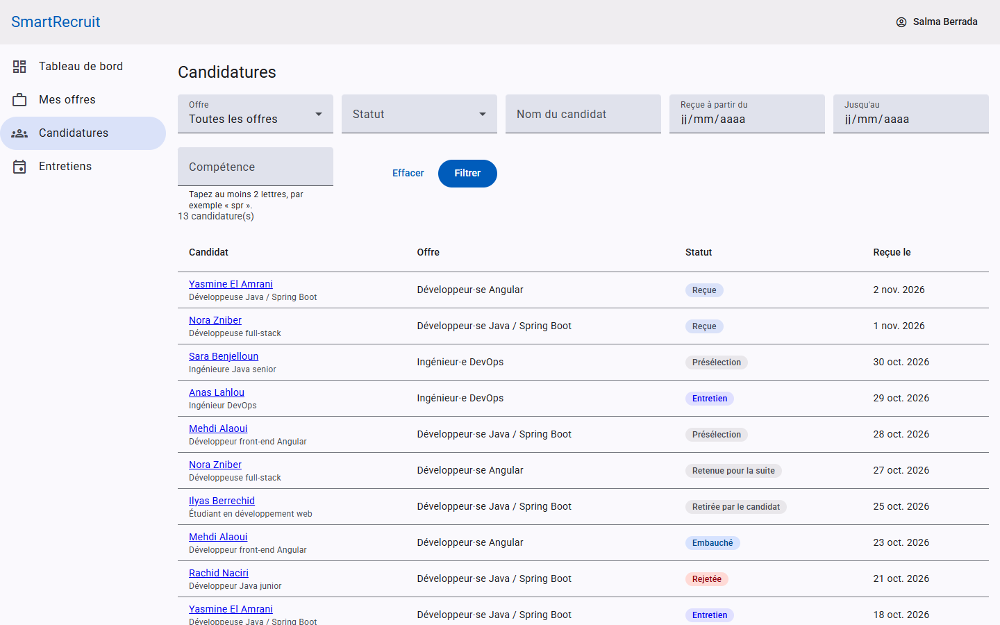
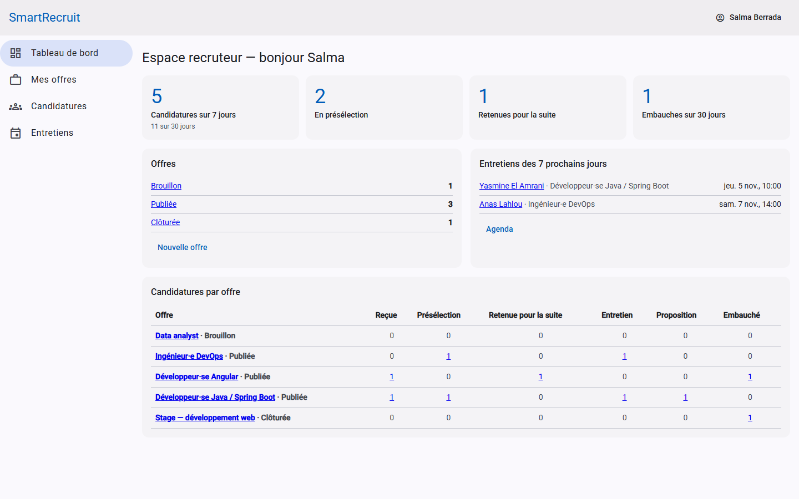
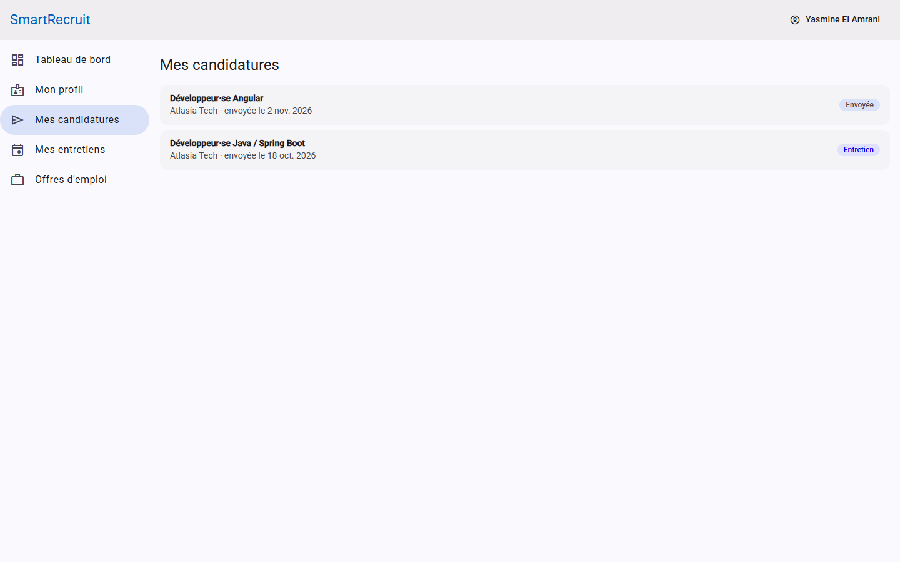
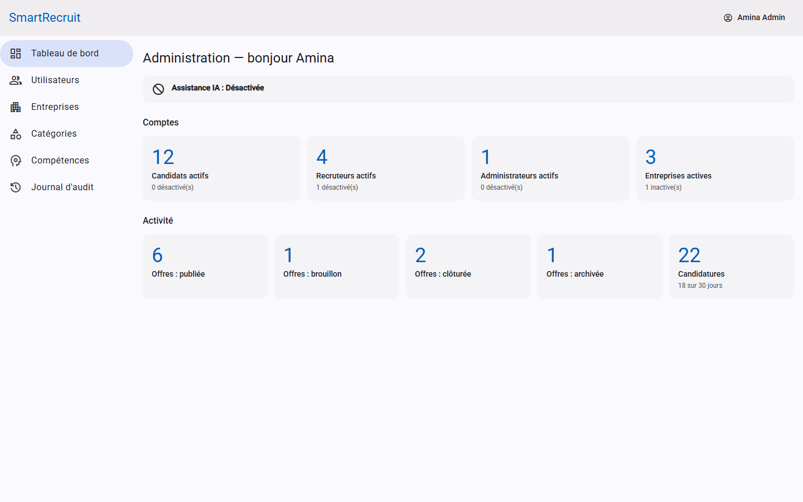
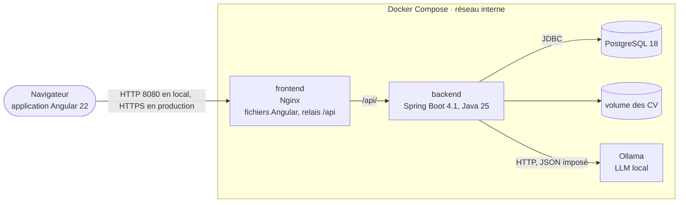

# SmartRecruit

Logiciel de suivi des candidatures (ATS) multi-entreprises, avec une assistance IA locale : Spring Boot 4.1, Angular 22, PostgreSQL 18, Ollama.

Projet portfolio conçu puis développé story par story. Les dix documents de conception, les décisions d'architecture et une note par story sont dans [`docs/`](docs/).

| | |
| --- | --- |
| **Essayer** | `cp .env.example .env && docker compose up --build`, puis http://localhost:8080 ([détails](#essayer-en-une-commande)) |
| **Comprendre** | [Architecture](#architecture), [choix d'architecture](#choix-darchitecture), [fiches ADR](docs/adr/README.md) |
| **Explorer l'API** | Swagger UI sur http://localhost:8080/api/docs/swagger-ui.html (profils `dev` et `demo`), contrat complet dans [docs/api.md](docs/api.md) |

## Sommaire

- [Présentation](#présentation)
- [Fonctionnalités](#fonctionnalités)
- [Captures d'écran](#captures-décran)
- [Essayer en une commande](#essayer-en-une-commande)
- [Architecture](#architecture)
- [Technologies](#technologies)
- [Fonctionnement de l'IA](#fonctionnement-de-lia)
- [API](#api)
- [Tests et qualité](#tests-et-qualité)
- [Choix d'architecture](#choix-darchitecture)
- [Développer](#développer)
- [État du projet](#état-du-projet)
- [Améliorations futures](#améliorations-futures)
- [Documentation](#documentation)
- [Historique du développement](#historique-du-développement)

## Présentation

SmartRecruit permet à plusieurs entreprises clientes de gérer leurs recrutements sur une même plateforme, chacune ne voyant que ses propres données :

- les **candidats** construisent un profil, déposent leur CV et postulent aux offres publiées ;
- les **recruteurs** publient des offres, font avancer chaque candidature dans un workflow contrôlé, planifient les entretiens et s'aident d'une IA qui analyse les CV ;
- les **administrateurs** gèrent comptes, entreprises et référentiels, et consultent un journal d'audit immuable.

Ce qui le distingue d'un simple CRUD :

- un **workflow à 8 statuts** garanti par le serveur ;
- une **isolation stricte entre entreprises**, vérifiée à chaque requête ;
- un **score de matching calculé par une formule** et non par le LLM : reproductible, explicable, insensible aux CV piégés ;
- une **IA locale et facultative** : les données des candidats ne quittent pas l'infrastructure, et l'application fonctionne entièrement sans elle.

## Fonctionnalités

| Rôle | Ce qu'il peut faire |
| --- | --- |
| Visiteur | Rechercher des offres (plein texte sans accents, filtres combinés, pagination), consulter une offre, créer un compte candidat |
| Candidat | Profil structuré (expériences, formations, compétences du référentiel, langues, liens) ; CV PDF téléversé, contrôlé et versionné ; postuler en un clic ; suivre ses candidatures avec un statut simplifié ; se retirer ; voir ses entretiens ; tableau de bord |
| Recruteur | Offres en brouillon, publiées, clôturées, archivées ; liste des candidatures filtrable (offre, statut, compétence, période, nom) ; dossier complet avec CV et historique ; faire avancer ou rejeter (motif obligatoire) ; entretiens planifiés, reprogrammés, clôturés avec avis ; notes internes ; analyse de CV et score de matching par l'IA ; tableau de bord |
| Administrateur | Comptes recruteur et admin (mot de passe temporaire), désactivation qui coupe les sessions immédiatement ; entreprises avec désactivation en cascade ; catégories ; fusion de compétences ; journal d'audit filtrable ; tableau de bord de la plateforme, dont l'état de l'IA |

Sous le capot :

- session JWT de 15 minutes avec refresh token en cookie HttpOnly et rotation, détection du vol de jeton ;
- limitation des tentatives de connexion ;
- verrouillage optimiste contre les modifications concurrentes ;
- historique de candidature et journal d'audit rendus immuables par des déclencheurs PostgreSQL ;
- dates stockées en UTC et affichées dans le fuseau du navigateur.

## Captures d'écran

Prises sur l'application avec les données de démonstration (`npm run screenshots` dans `frontend/`).

**Dossier de candidature** (recruteur) : profil, CV figé au moment de la candidature, onglets historique, entretiens, assistance IA et notes.



**Candidatures reçues**, filtrables par offre, statut, nom, période et compétence.



**Tableau de bord du recruteur** : indicateurs, offres par statut, entretiens à venir, entonnoir par offre.



<details>
<summary>Espace candidat et administration</summary>

**Espace candidat** : ses candidatures et leur statut.



**Administration** : état de l'assistance IA, comptes et activité de la plateforme.



</details>

## Essayer en une commande

Avec Docker (Docker Desktop sous Windows et macOS) :

```bash
cp .env.example .env
docker compose up --build
```

Puis ouvrir **http://localhost:8080**.

- Le premier démarrage construit les images (quelques minutes), crée la base et charge les données de démonstration.
- En parallèle, le service `ollama-model` télécharge le modèle d'IA (environ 6,6 Go, une seule fois). L'application est utilisable tout de suite ; l'assistance IA devient disponible quand le téléchargement est terminé. Pour s'en passer : `AI_ENABLED=false` dans `.env`.
- Ollama avec un modèle de 9 milliards de paramètres demande de la mémoire : 16 Go de RAM sont recommandés sur le poste.

### Comptes de démonstration

Toutes les données sont fictives (entreprises inventées, adresses en `.example`). Mot de passe commun : **`Demo-SmartRecruit-2026`** (variable `DEMO_PASSWORD`).

| Rôle | Email | Ce qu'il y a à voir |
| --- | --- | --- |
| Administrateur | `admin@smartrecruit.example` | Tableau de bord de la plateforme, comptes, entreprises (dont une désactivée), référentiels, journal d'audit |
| Recruteur | `recruteur@atlasia.example` | Offres d'Atlasia Tech, candidatures à tous les statuts, entretiens à venir, notes, dossier complet |
| Candidat | `candidat@demo.example` | Profil complet avec CV, candidatures en cours, un entretien prévu dans deux jours |

Autres comptes : `yassine.tahiri@atlasia.example`, `recruteur@novaterra.example`, `recruteur@riad-logistique.example` (recruteurs), et onze candidats en `prenom.nom@demo.example`.

### Ce que lance `docker compose`

| Service | Image | Rôle |
| --- | --- | --- |
| `frontend` | Nginx non privilégié | Fichiers Angular, relais `/api` vers le backend (même origine), en-têtes de sécurité ; seul port publié (8080) |
| `backend` | JRE 25, utilisateur non root | API Spring Boot, profils `prod,demo` ; attend que PostgreSQL soit sain |
| `postgres` | PostgreSQL 18 | Base, volume `pgdata` |
| `ollama` (+ `ollama-model`) | Ollama | Modèle d'IA local, volume `ollama-models` ; facultatif |

Les CV sont dans le volume `resumes`. `docker compose down -v` remet tout à zéro : les données de démonstration seront rechargées au prochain démarrage.

## Architecture

Un **monolithe modulaire** : une seule application Spring Boot, découpée en 12 modules dont les frontières sont vérifiées à chaque build par Spring Modulith. Nginx sert l'application Angular et relaie l'API sur la même origine ; seul le backend parle à la base, aux fichiers et à Ollama.



| Module | Rôle |
| --- | --- |
| `identity` | Comptes, authentification, sessions, rôles |
| `company` | Entreprises clientes et recruteurs |
| `referential` | Compétences (avec alias) et catégories d'offres |
| `candidate` | Profil candidat et CV |
| `job` | Offres d'emploi, cycle de vie, recherche |
| `application` | Candidatures, workflow, historique, notes |
| `interview` | Entretiens |
| `ai` | Analyse de CV et matching, derrière l'interface `AIService` |
| `audit` | Journal d'audit transactionnel et immuable |
| `reporting` | Tableaux de bord (lectures SQL agrégées) |
| `shared` | Noyau commun : sécurité, erreurs, stockage, horloge |
| `demo` | Données de démonstration (profil `demo`) |

Chaque module expose une API publique dans un paquet `api` ; les modules se référencent par identifiant et réagissent les uns aux autres par événements. Détails : [architecture globale](docs/architecture.md), [backend](docs/architecture-backend.md), [frontend](docs/architecture-frontend.md).

## Technologies

| Domaine | Choix |
| --- | --- |
| Backend | Java 25, Spring Boot 4.1 (Web MVC, Security, Data JPA, Validation, Actuator), Spring Modulith 2.1, MapStruct, Apache PDFBox, springdoc-openapi |
| Données | PostgreSQL 18 (UUID v7, recherche plein texte, JSONB, déclencheurs), Flyway |
| Frontend | Angular 22 (composants autonomes, signaux, OnPush), Angular Material 3, TypeScript 6 |
| IA | Ollama, modèle open source de 7 à 9 milliards de paramètres, appelé par `RestClient` |
| Tests | JUnit 5, Mockito, AssertJ, Testcontainers, Vitest, Playwright |
| Qualité et sécurité | JaCoCo (seuil bloquant), SpotBugs, ESLint, Prettier, Trivy, `npm audit` |
| Livraison | Docker (images multi-étapes, non root), Docker Compose, Nginx, GitHub Actions |

Pourquoi ces versions : [ADR-002](docs/adr/002-versions-de-la-stack.md).

## Fonctionnement de l'IA

L'IA aide le recruteur ; elle ne décide jamais. Aucun code ne relie un résultat d'IA à un changement de statut, et le score ne sert ni à trier ni à filtrer.

1. **Lancement** : le recruteur demande une analyse depuis le dossier. L'API répond **202** avec une tâche, et l'écran suit sa progression toutes les 3 secondes. Le traitement est asynchrone parce qu'un modèle local sur CPU peut dépasser une minute.
2. **Extraction** : le texte du PDF est extrait (PDFBox), **pseudonymisé** (ni nom ni coordonnées), puis envoyé au modèle local avec un **schéma JSON imposé** et une température de 0. Chaque compétence extraite doit citer l'extrait du CV qui la justifie ; une réponse hors schéma est retentée une fois, puis la tâche échoue avec un code explicite.
3. **Score** : le backend calcule le score avec une formule, `round(100 × (0,60 C_req + 0,20 C_souh + 0,20 A))`, sur les compétences requises et souhaitées de l'offre et sur l'expérience. Un score renvoyé par le modèle est ignoré.
4. **Explication** : le modèle rédige points forts et points faibles à partir de la décomposition du score, sans jamais recevoir l'identité du candidat.

Garde-fous testés : pseudonymisation sur 10 CV, CV piégé contenant une consigne cachée, aucun statut modifié, chaque analyse auditée avec le modèle et la version du prompt.

Ollama arrêté ou IA désactivée : l'application reste entièrement utilisable ; le tableau de bord de l'admin affiche l'IA « indisponible ».

Le modèle par défaut, `qwen3.5:9b`, est **provisoire** : il sera choisi et épinglé par un banc d'essai mesuré (précision et rappel des compétences, temps par CV), prêt dans `backend/scripts/ai-benchmark/` ([protocole](docs/ai-model-benchmark.md)). Décisions : [ADR-008](docs/adr/008-score-par-formule.md), [ADR-009](docs/adr/009-ia-asynchrone-par-table-de-taches.md), [ADR-010](docs/adr/010-ollama-restclient-aiservice.md).

## API

- API REST JSON sous `/api/v1`, erreurs au format Problem Details (RFC 9457) avec un code métier et un identifiant de corrélation.
- **Swagger UI** : http://localhost:8080/api/docs/swagger-ui.html ; description OpenAPI sur `/api/docs/openapi`. Disponibles dans les profils `dev` et `demo`, absents en production. Pour essayer un endpoint protégé, se connecter par `POST /api/v1/auth/login` et coller l'`accessToken` reçu dans « Authorize ».
- **Contrat complet** : [docs/api.md](docs/api.md), avec les règles, le catalogue des erreurs et la matrice d'accès par rôle.

## Tests et qualité

| Mesure | Valeur |
| --- | --- |
| Tests backend | 325 tests unitaires, 225 tests d'intégration sur un vrai PostgreSQL 18 (Testcontainers) |
| Couverture des services et règles métier | 95,0 % (JaCoCo), seuil bloquant à 70 % |
| Tests frontend | 160 tests Vitest, 5 parcours Playwright sur la pile réelle derrière Nginx |
| Analyse statique | SpotBugs sans constat ; ESLint avec règles de frontières entre dossiers |
| Recherche d'offres | p95 de 20,4 ms sur 2 000 offres ([US-25](docs/stories/US-25.md)) |
| Tableaux de bord | 14,47 ms sur 10 000 candidatures ([US-44](docs/stories/US-44.md)) |

Chiffres mesurés le 3 novembre 2026, phase 12 comprise.

Quelques tests représentatifs :

- les 64 couples de statuts du workflow, contre une table écrite à la main ;
- une candidature envoyée par quatre threads simultanés ne crée qu'une ligne ;
- les requêtes SQL sont comptées pour prouver l'absence de N+1 ;
- la réponse brute du candidat est fouillée pour prouver qu'aucune donnée interne ne fuit ;
- les tests Playwright échouent à la moindre violation de la politique CSP.

La pipeline GitHub Actions ([ci.yml](.github/workflows/ci.yml)) enchaîne :

- backend : tests, couverture et SpotBugs ;
- frontend : lint, formatage, tests, build et `npm audit` ;
- Trivy sur les dépendances et les secrets ;
- tests Playwright sur l'application lancée par Docker Compose ;
- construction, analyse et publication des images sur `main`.

## Choix d'architecture

| Décision | Plutôt que | Pourquoi |
| --- | --- | --- |
| [Monolithe modulaire vérifié par Spring Modulith](docs/adr/001-monolithe-modulaire.md) | Microservices | Un domaine, une équipe, un volume modeste : des frontières nettes sans coût distribué |
| [JWT court et refresh token en cookie avec rotation](docs/adr/003-jwt-et-refresh-token.md) | Jetons dans le `localStorage` | Rien de lisible par un script injecté ; un jeton volé ne sert qu'une fois |
| [Même origine via Nginx](docs/adr/004-meme-origine-via-nginx.md) | Deux domaines et CORS | Cookie `SameSite=Strict`, pas de CORS, CSP limitée à `'self'` |
| [Clés UUID v7](docs/adr/005-cles-uuid-v7.md) | Entiers séquentiels | Non devinables, mais ordonnés dans l'index |
| [Références par identifiant entre agrégats](docs/adr/006-references-par-identifiant.md) | Associations JPA partout | Pas de chargement en chaîne, modules découplés |
| [Workflow dans l'énumération des statuts](docs/adr/007-workflow-dans-application-status.md) | Spring Statemachine | 15 transitions lisibles et testées de façon exhaustive |
| [Score par formule, LLM pour l'extraction](docs/adr/008-score-par-formule.md) | Score donné par le LLM | Reproductible, explicable, résistant aux consignes cachées |
| [IA asynchrone par table de tâches](docs/adr/009-ia-asynchrone-par-table-de-taches.md) | Bus de messages | Un seul traitement asynchrone, faible volume |

Les douze fiches : [docs/adr/](docs/adr/README.md).

## Développer

### Prérequis

- JDK 25
- Node.js 24 LTS, 24.15 ou plus (ou 22.22.3+)
- Docker (Docker Desktop sous Windows et macOS) : base de développement et tests d'intégration

Maven n'est pas nécessaire : le wrapper `./mvnw` (ou `mvnw.cmd` sous Windows) télécharge Maven 3.9.14 au premier lancement.

Variables à définir en production (voir `.env.example`, sans le profil `demo`) : `DB_URL`, `DB_USERNAME`, `DB_PASSWORD`, `PUBLIC_URL`, `JWT_SECRET` (32 caractères minimum), `STORAGE_ROOT` (dossier des CV, sur un volume persistant), et pour le premier démarrage `INITIAL_ADMIN_EMAIL`, `INITIAL_ADMIN_PASSWORD`.

### Démarrer

```bash
docker compose -f docker-compose.dev.yml up -d   # PostgreSQL 18 sur localhost:5432, Ollama sur 11434

# Backend
cd backend
./mvnw verify                 # tests unitaires (*Test) puis d'intégration (*IT, Docker requis)
./mvnw spring-boot:run        # http://localhost:8080 ; Flyway applique les migrations au démarrage
# avec les données de démonstration : ./mvnw spring-boot:run -Dspring-boot.run.profiles=dev,demo

# Frontend (autre terminal)
cd frontend
npm ci
npm start                     # http://localhost:4200 ; /api est relayé vers le backend
```

En profil `dev` sans données de démonstration, un admin initial est créé au premier démarrage : `admin@smartrecruit.local` / `admin-temporaire-2026`, à changer à la première connexion.

Pour l'IA en développement :

```bash
docker compose -f docker-compose.dev.yml exec ollama ollama pull qwen3.5:9b   # environ 6,6 Go, une fois
```

Variables : `AI_ENABLED` (vrai en `dev`, faux par défaut ailleurs), `AI_OLLAMA_URL`, `AI_MODEL`.

### Tests

| Commande | Contenu |
| --- | --- |
| `./mvnw verify` (backend) | Tests unitaires, tests d'intégration sur PostgreSQL (Testcontainers), couverture JaCoCo avec seuil de 70 % sur les services et règles métier (rapport : `target/site/jacoco/index.html`) |
| `./mvnw spotbugs:check` (backend) | Analyse statique |
| `npm run lint`, `npm run format:check`, `npm run test:ci`, `npm run build` (frontend) | ESLint, Prettier, tests unitaires Vitest, build de production |
| `npm run e2e` (frontend) | Tests de bout en bout Playwright contre l'application lancée (`E2E_BASE_URL`, par défaut http://localhost:8080) ; une fois : `npx playwright install chromium` |

### Tests d'intégration sans Docker

Les tests `*IT` démarrent PostgreSQL avec Testcontainers. Sans Docker, ils peuvent viser une base PostgreSQL 18 existante (vide, avec l'extension `unaccent` disponible) :

```bash
./mvnw verify -Dsmartrecruit.test.external-database=true \
  -Dspring.datasource.url=jdbc:postgresql://localhost:5432/smartrecruit_it \
  -Dspring.datasource.username=postgres -Dspring.datasource.password=postgres
```

### Fuseau horaire marocain

Les entreprises ont `Africa/Casablanca` par défaut. Avec la tzdata 2026e livrée dans le JDK 25, ce fuseau est en UTC+0 permanent depuis fin 2026 ; les tests d'expiration utilisent un décalage fixe pour ne pas dépendre de la version des données de fuseau.

### Structure

```
smart-recruit/
├── backend/                 # Spring Boot 4.1 (Java 25), un module Maven, 12 modules Spring Modulith
├── frontend/                # Angular 22, Angular Material ; e2e/ : tests Playwright
├── docs/                    # conception, ADR, préparation à l'entretien, notes de story (docs/stories/)
├── docker-compose.yml       # application complète (frontend, backend, PostgreSQL, Ollama)
├── docker-compose.dev.yml   # dépendances de développement
├── .env.example             # variables d'environnement documentées (valeurs fictives)
└── .github/workflows/ci.yml # CI/CD : tests, couverture, analyses, bout en bout, images
```

## État du projet

Les 12 phases sont livrées et en revue : les 58 stories, dont US-58 (documentation et portfolio), terminée le 3 novembre 2026.

**Jalon J4 atteint le 3 novembre 2026** : pipeline CI/CD entièrement verte sur `main`, avec les tests, le build, Playwright sur la pile `docker compose`, et la construction, l'analyse et la publication des images.

Reste à vérifier ou à faire, sans le présenter comme acquis :

- banc d'essai de l'IA, puis épinglage du modèle et de la version de l'image Ollama.

Détail et bilan de chaque phase : [docs/roadmap.md](docs/roadmap.md).

## Améliorations futures

Fonctionnelles, notées dans les user stories (« WON'T pour la V1 ») :

- **V2** : mot de passe oublié et vérification de l'email par courriel ; notifications de changement de statut ; invitation d'entretien avec fichier .ics ; profil prérempli depuis l'analyse du CV ; suppression du compte ; vue Kanban des candidatures ; lettre de motivation et questions de présélection ; clôture automatique des offres expirées ; classement optionnel par score ; anonymisation des candidats inactifs.
- **V3** : plusieurs CV ciblés, synchronisation des agendas, double authentification, fournisseur LLM cloud au choix.

Techniques, chacune attendant un déclencheur mesuré ([architecture §9](docs/architecture.md)) :

- compteur de tentatives partagé dès la deuxième instance ;
- stockage objet compatible S3 derrière l'interface de stockage ;
- module IA extrait sur une machine avec GPU ;
- publication fiable d'événements vers l'extérieur ;
- Prometheus et Grafana, que Micrometer sait déjà alimenter.

## Documentation

| Document | Contenu |
| --- | --- |
| [Cahier des charges](docs/cahier-des-charges.md) | Besoins, règles métier RG-xx, contraintes, décisions validées |
| [Analyse fonctionnelle](docs/analyse-fonctionnelle.md) | 34 cas d'utilisation, séquences, machines à états, algorithme de matching chiffré |
| [User stories](docs/user-stories.md) | 58 stories en 10 épopées, critères Gherkin, statuts |
| [Modèle de données](docs/modele-de-donnees.md) | 25 tables, ERD, index, migrations |
| [Diagramme de classes](docs/diagrams/classes.md) | Agrégats, événements, énumérations |
| [Architecture globale](docs/architecture.md) | C4, modules, sécurité, IA, déploiement, observabilité, évolution |
| [Architecture Spring Boot](docs/architecture-backend.md) | Paquets, couches, transactions, tests |
| [Architecture Angular](docs/architecture-frontend.md) | Structure, état, sécurité, formulaires |
| [API REST](docs/api.md) | Endpoints, erreurs, matrice d'accès |
| [Décisions d'architecture (ADR)](docs/adr/README.md) | Douze fiches : contexte, décision, alternatives, conséquences |
| [Banc d'essai des modèles d'IA](docs/ai-model-benchmark.md) | Protocole et résultats |
| [Roadmap](docs/roadmap.md) | Phases, jalons, rituel par story, bilans |
| [Guide de reprise](docs/guide-de-reprise.md) | Préparer le poste, lancer, vérifier, tâches restantes pas à pas, problèmes connus |
| [Préparation à l'entretien technique](docs/preparation-entretien.md) | Questions et réponses par thème, points faibles assumés |
| [Notes de story](docs/stories/) | Pour chaque story : critères et preuves, fichiers, choix, commandes, questions |

## Historique du développement

Chaque story a sa note dans [`docs/stories/`](docs/stories/) ; le tableau ci-dessous les reprend phase par phase.

<details>
<summary>Stories livrées, de la phase 11 à la phase 2</summary>

### Phase 11 — Industrialisation

| Story | Contenu | Notes |
| --- | --- | --- |
| US-54 | `docker compose up` lance frontend (Nginx), backend, PostgreSQL et Ollama, avec health checks ; images non root, CSP stricte | [US-54](docs/stories/US-54.md) |
| US-55 | Pipeline : tests, couverture JaCoCo (seuil 70 % sur les services, mesurée à 94,9 %), SpotBugs, Trivy (dépendances, secrets, images), publication des images sur `main` | [US-55](docs/stories/US-55.md) |
| US-56 | Profil `demo` : entreprises, recruteurs, candidats, offres et candidatures fictifs à tous les statuts, CV PDF lisibles | [US-56](docs/stories/US-56.md) |
| US-57 | Tests Playwright des trois parcours critiques, sur la pile réelle, avec contrôle des violations CSP | [US-57](docs/stories/US-57.md) |

### Phase 10 — Administration et audit

| Story | Contenu | Notes |
| --- | --- | --- |
| US-46 | Tableau de bord admin : comptes par rôle, entreprises, offres, candidatures, état de l'IA (« indisponible » si Ollama est arrêté) | [US-46](docs/stories/US-46.md) |
| US-48 | Comptes : recherche filtrée, modification sans changement de rôle, désactivation qui coupe les sessions dès la requête suivante, dernier admin protégé | [US-48](docs/stories/US-48.md) |
| US-49 | Entreprises : modification, désactivation en cascade (offres clôturées, recruteurs désactivés) dans une seule transaction, réactivation | [US-49](docs/stories/US-49.md) |
| US-50 | Catégories : création, renommage, désactivation ; suppression refusée si une offre l'utilise | [US-50](docs/stories/US-50.md) |
| US-51 | Fusion de compétences : profils et offres reportés au niveau le plus élevé, ancien nom gardé comme alias | [US-51](docs/stories/US-51.md) |
| US-53 | Journal d'audit filtré (période, auteur, action, résultat), en lecture seule et protégé en base | [US-53](docs/stories/US-53.md) |

Migration `V14__administration.sql` : version de session des comptes, déclencheur qui rend le journal d'audit immuable, index des nouveaux filtres.

### Phase 9 — Tableaux de bord (jalon J3, MVP complet)

| Story | Contenu | Notes |
| --- | --- | --- |
| US-44 | Tableau de bord recruteur : offres par statut, candidatures sur 7 et 30 jours, présélection, retenues, embauches, entretiens à venir, tableau par offre ; chaque chiffre mène à la liste filtrée | [US-44](docs/stories/US-44.md) |
| US-45 | Tableau de bord candidat : candidatures par libellé simplifié, prochains entretiens, complétude du profil, appel à l'action s'il manque le CV | [US-45](docs/stories/US-45.md) |

Indicateurs calculés à la volée en SQL agrégé : **14,47 ms** sur 10 000 candidatures (`backend/scripts/perf/measure-dashboard.sh`), sans table de statistiques.

### Phase 8 — Assistance IA

| Story | Contenu | Notes |
| --- | --- | --- |
| US-40 | `AIService` et adaptateur Ollama (schéma JSON imposé, température 0) ; IA désactivable ; santé « indisponible » sans rendre l'application DOWN | [US-40](docs/stories/US-40.md) |
| US-41 | Analyse de CV asynchrone (202, suivi toutes les 3 s) : texte PDF, pseudonymisation, extraction avec extraits justificatifs, traçabilité | [US-41](docs/stories/US-41.md) |
| US-42 | Score de matching calculé par le backend (exemple chiffré : 81), décomposition, compétences manquantes, explication rédigée par le modèle | [US-42](docs/stories/US-42.md) |
| US-43 | Garde-fous : pseudonymisation testée sur 10 CV, CV piégé sans effet, aucun statut modifié, audit | [US-43](docs/stories/US-43.md) |

**Banc d'essai du modèle** : jeu de CV, attentes et script prêts dans `backend/scripts/ai-benchmark/` ; à exécuter sur un poste avec Ollama, puis épingler le modèle ([docs/ai-model-benchmark.md](docs/ai-model-benchmark.md)). Modèle provisoire : `qwen3.5:9b`.

### Phase 7 — Entretiens et notes

| Story | Contenu | Notes |
| --- | --- | --- |
| US-35 | Planifier un entretien : statut Entretien obligatoire, lien ou adresse selon le type, participants de l'entreprise, heure stockée en UTC | [US-35](docs/stories/US-35.md) |
| US-36 | Reprogrammer (ancienne et nouvelle date dans l'historique) ou annuler | [US-36](docs/stories/US-36.md) |
| US-37 | Clôturer avec un avis interne, après l'heure de début ; débloque la proposition puis l'embauche | [US-37](docs/stories/US-37.md) |
| US-38 | Mes entretiens côté candidat, sans avis ni participants | [US-38](docs/stories/US-38.md) |
| US-39 | Notes internes partagées, modifiables par leur seul auteur, jamais visibles du candidat | [US-39](docs/stories/US-39.md) |

Le workflow est désormais complet : une candidature peut aller de « Reçue » à « Embauché », et ses entretiens planifiés sont annulés automatiquement si elle est rejetée ou retirée.

### Phase 6 — Candidatures et workflow

| Story | Contenu | Notes |
| --- | --- | --- |
| US-27 | Postuler en un clic après un récapitulatif ; CV figé ; doublon concurrent arrêté par l'index unique | [US-27](docs/stories/US-27.md) |
| US-28 | Mes candidatures : statut simplifié calculé par le serveur, aucune donnée interne dans la réponse | [US-28](docs/stories/US-28.md) |
| US-29 | Retrait définitif avec message au recruteur | [US-29](docs/stories/US-29.md) |
| US-30 | Liste recruteur filtrable (offre, statut, compétence, période, nom), filtres dans l'URL, nombre de requêtes fixe | [US-30](docs/stories/US-30.md) |
| US-31 | Dossier : profil, CV envoyé (téléchargement audité), historique | [US-31](docs/stories/US-31.md) |
| US-32 | Workflow à 8 statuts : 64 couples testés, transitions proposées par le serveur, verrou optimiste | [US-32](docs/stories/US-32.md) |
| US-33 | Rejet avec motif obligatoire, confirmé, jamais visible du candidat | [US-33](docs/stories/US-33.md) |
| US-34 | Historique immuable (déclencheur PostgreSQL), écrit dans la transaction de l'action | [US-34](docs/stories/US-34.md) |
| US-19 | Suppression du CV : effacé, ou seulement désactivé s'il a été envoyé | [US-19](docs/stories/US-19.md) |

### Phase 5 — Offres d'emploi

| Story | Contenu | Notes |
| --- | --- | --- |
| US-47 | Création par l'admin des comptes recruteur et admin, mot de passe temporaire affiché une fois ; entreprises clientes (US-49 en partie : création et liste) | [US-47](docs/stories/US-47.md) |
| US-21 | Création d'une offre en brouillon, entreprise imposée par le token, compétences requises et souhaitées | [US-21](docs/stories/US-21.md) |
| US-22 | Modification avec verrou optimiste, lecture seule après clôture, audit des offres publiées | [US-22](docs/stories/US-22.md) |
| US-23 | Cycle de vie (publier, dépublier, clôturer, rouvrir, archiver, supprimer) : 24 transitions testées, expiration en fin de journée dans le fuseau de l'entreprise | [US-23](docs/stories/US-23.md) |
| US-24 | Offres de l'entreprise, filtre de statut, archives masquées par défaut | [US-24](docs/stories/US-24.md) |
| US-25 | Recherche plein texte PostgreSQL sans accents, filtres combinés dans l'URL, pagination plafonnée, tri en liste blanche | [US-25](docs/stories/US-25.md) |
| US-26 | Détail public d'une offre, salaire seulement s'il est public, 404 pour un brouillon ou une offre expirée | [US-26](docs/stories/US-26.md) |

**Mesure de la recherche** (API réelle, PostgreSQL 18, 2 000 offres, 200 requêtes filtrées) : médiane 10,4 ms, **p95 20,4 ms**, p99 31,2 ms, pour un objectif de 800 ms. Scripts : `backend/scripts/perf/seed-2000-jobs.sql` puis `backend/scripts/perf/measure-search.sh http://localhost:8080 200`.

**Correctif de la phase 3** : la migration V8 enregistre la cause de révocation des refresh tokens ; seul un jeton déjà tourné qui revient est traité comme un vol (détails dans [US-08](docs/stories/US-08.md)).

### Phase 4 — Profil candidat et CV

| Story | Contenu | Notes |
| --- | --- | --- |
| US-13 | Informations de base, verrouillage optimiste, aucun champ discriminant | [US-13](docs/stories/US-13.md) |
| US-14 | Expériences et formations, triées de la plus récente à la plus ancienne | [US-14](docs/stories/US-14.md) |
| US-15 | Compétences du référentiel : autocomplétion, « obtenir ou créer » sans doublon, données de départ | [US-15](docs/stories/US-15.md) |
| US-16 | Langues (A1 à C2, langue maternelle) et 5 liens https | [US-16](docs/stories/US-16.md) |
| US-17 | Téléversement du CV : signature PDF, 5 Mo, PDFBox, nom UUID, compensation disque/base | [US-17](docs/stories/US-17.md) |
| US-18 | Téléchargement authentifié et forcé du CV | [US-18](docs/stories/US-18.md) |
| US-20 | Complétude du profil selon la grille de l'analyse fonctionnelle | [US-20](docs/stories/US-20.md) |

US-19 (supprimer son CV) attend les candidatures (US-27), dont elle dépend.

### Phase 3 — Authentification et rôles

| Story | Contenu | Notes |
| --- | --- | --- |
| US-06 | Inscription candidat : rôle imposé, profil vide créé par événement, email unique sans casse, mots de passe courants refusés | [US-06](docs/stories/US-06.md) |
| US-07 | Connexion : JWT 15 min + refresh token 7 jours en cookie HttpOnly, audit de chaque tentative, admin initial | [US-07](docs/stories/US-07.md) |
| US-08 | Session prolongée : rotation du refresh token, détection de réutilisation, renouvellement unique côté Angular | [US-08](docs/stories/US-08.md) |
| US-09 | Déconnexion idempotente, locale même sans réseau | [US-09](docs/stories/US-09.md) |
| US-10 | Matrice d'accès Spring Security (refus par défaut), guards `canMatch`, navigation par rôle | [US-10](docs/stories/US-10.md) |
| US-11 | Changement de mot de passe, mot de passe temporaire obligatoire à changer | [US-11](docs/stories/US-11.md) |
| US-12 | Limitation des tentatives de connexion (5 / 15 min par email) et d'inscription (10 / h par IP) | [US-12](docs/stories/US-12.md) |

Compte de démonstration en développement : `admin@smartrecruit.local` / `admin-temporaire-2026` (à changer à la première connexion), créé au démarrage s'il n'existe aucun admin.

### Phase 2 — Socle technique

| Story | Contenu | Notes |
| --- | --- | --- |
| US-01 | Squelette backend modulaire : 11 modules vérifiés par Spring Modulith, health check, configuration validée au démarrage | — |
| US-02 | PostgreSQL 18, migrations Flyway, tests d'intégration sur Testcontainers, Hibernate en validation seule | [US-02](docs/stories/US-02.md) |
| US-03 | Erreurs uniformes au format Problem Details, identifiant de corrélation dans les réponses et les logs | [US-03](docs/stories/US-03.md) |
| US-52 | Journal d'audit transactionnel (`AuditRecorder`) | [US-52](docs/stories/US-52.md) |
| US-04 | Frontend Angular 22 : structure core/shared/layouts/features, Material, intercepteurs, page introuvable | [US-04](docs/stories/US-04.md) |
| US-05 | Pipeline GitHub Actions : backend et frontend compilés et testés à chaque push | [US-05](docs/stories/US-05.md) |

</details>
