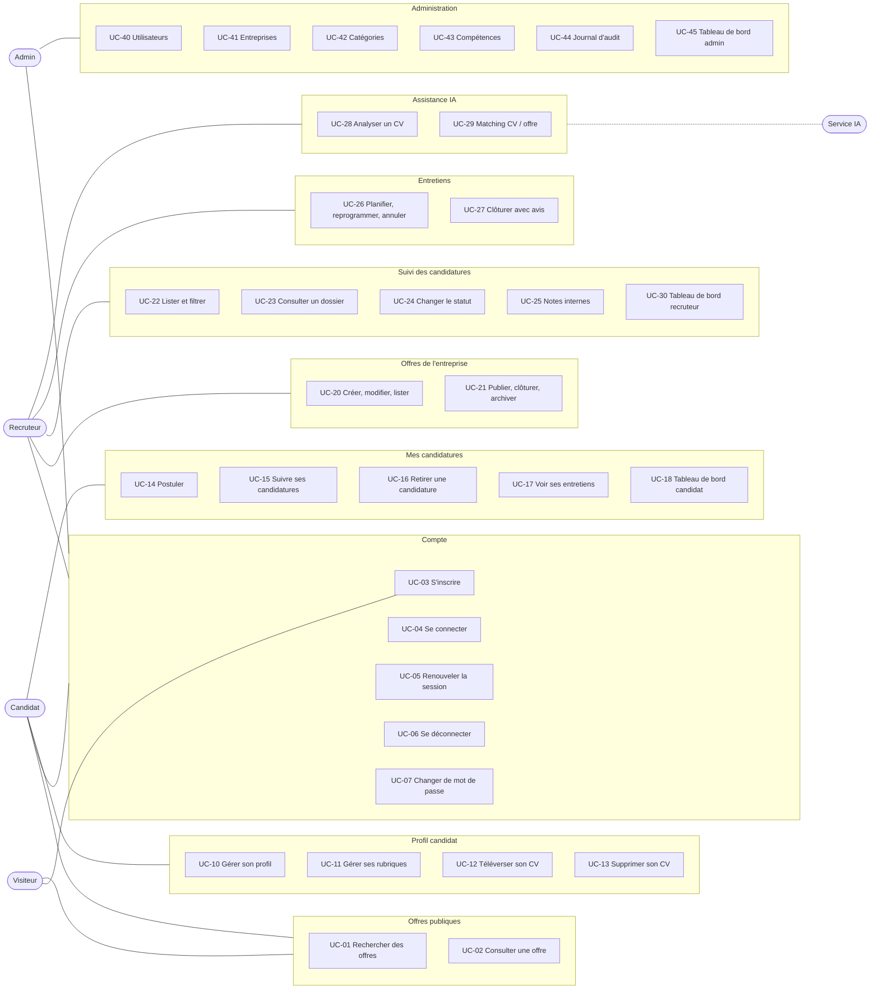
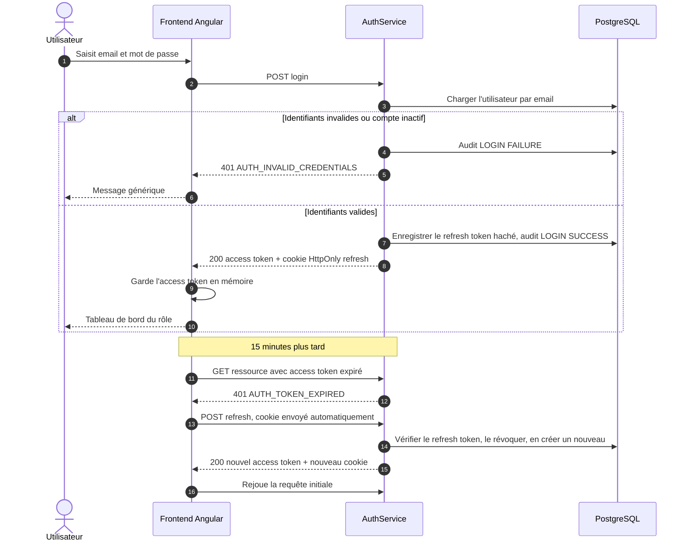
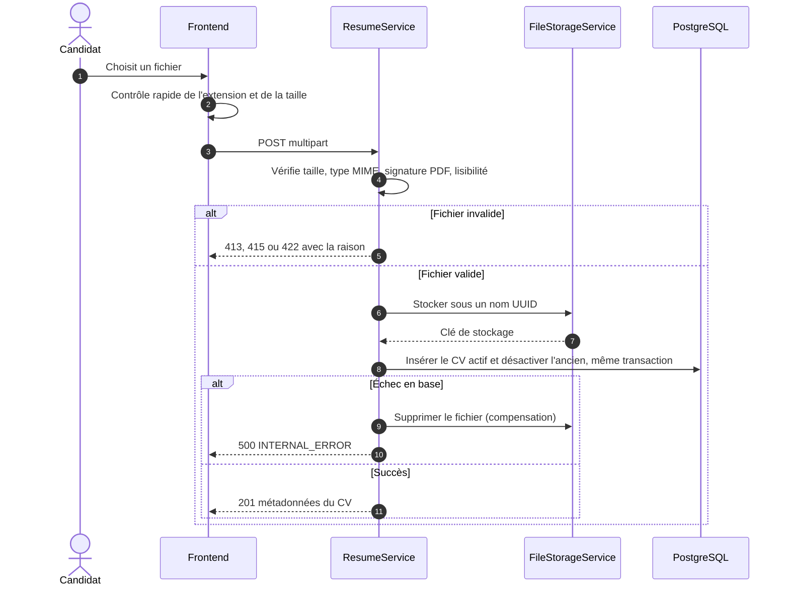
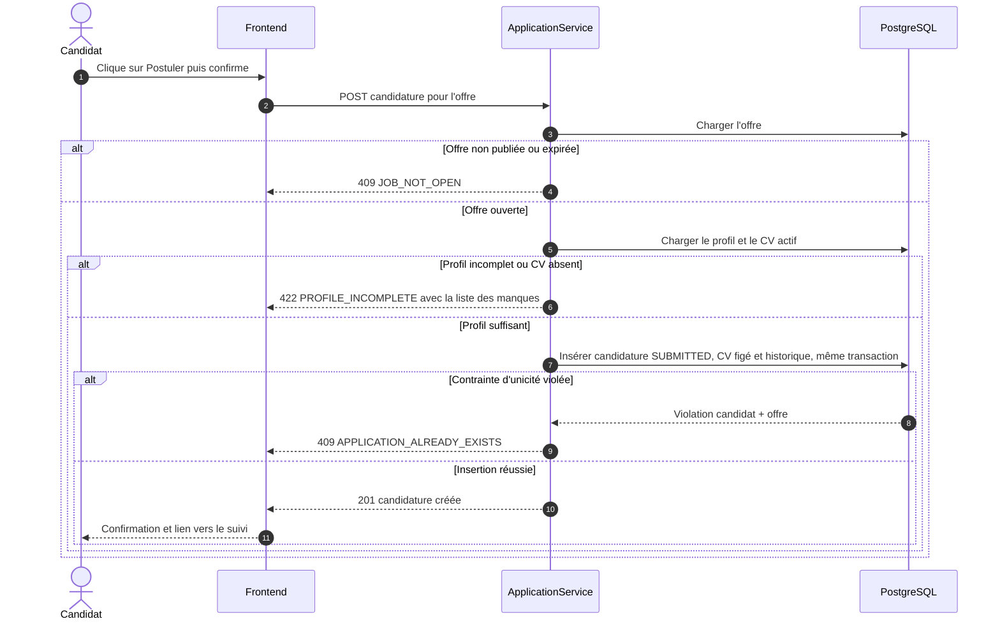
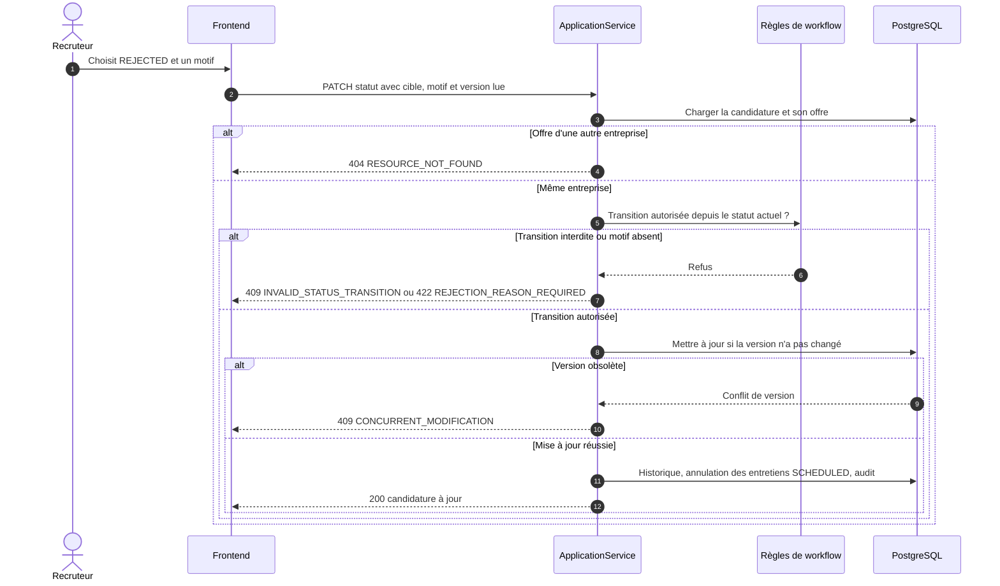
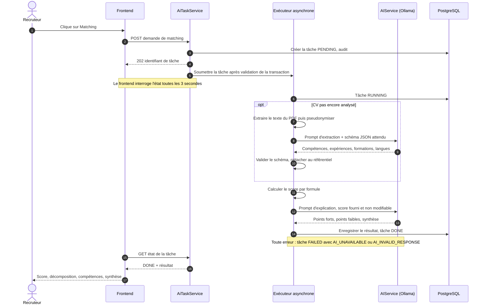
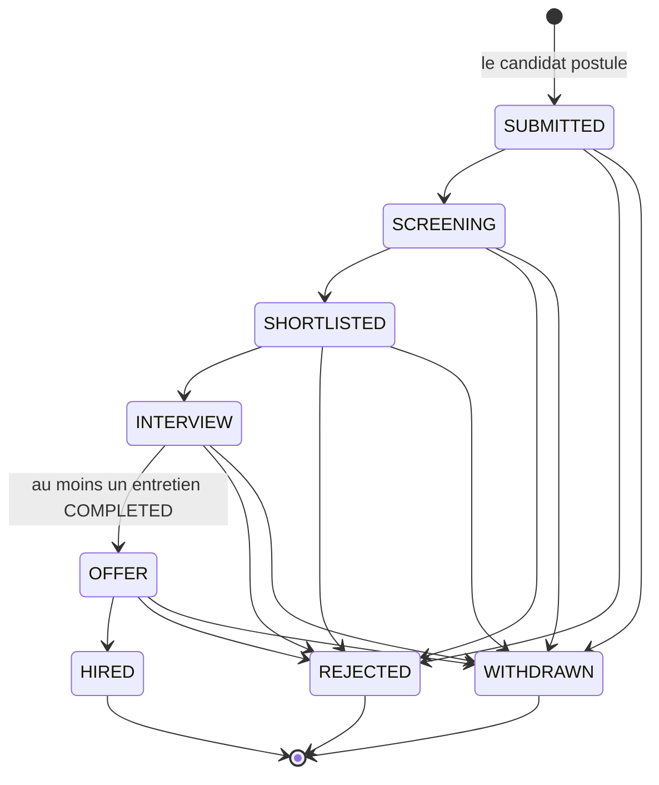
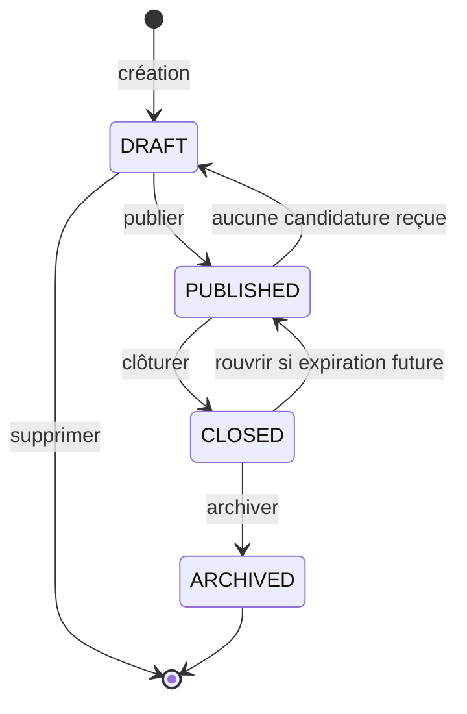
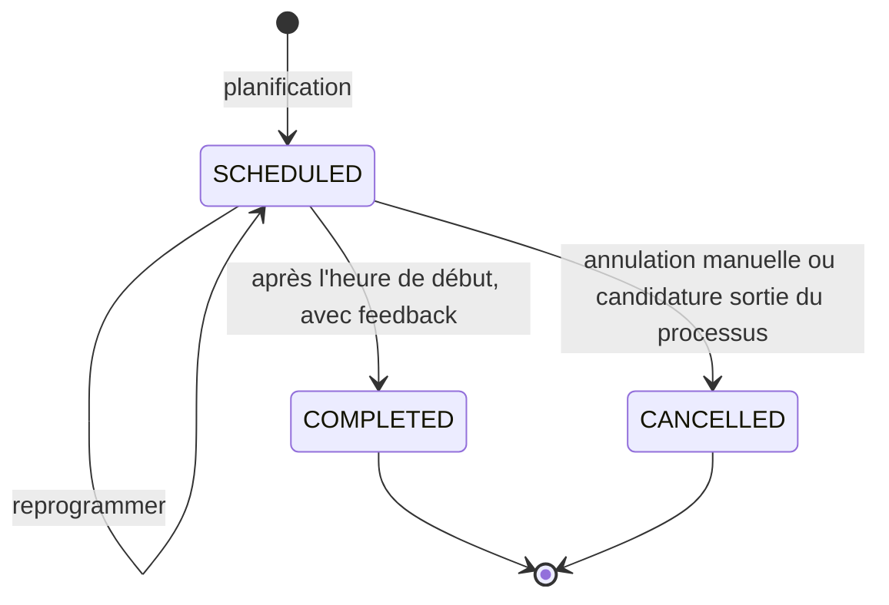
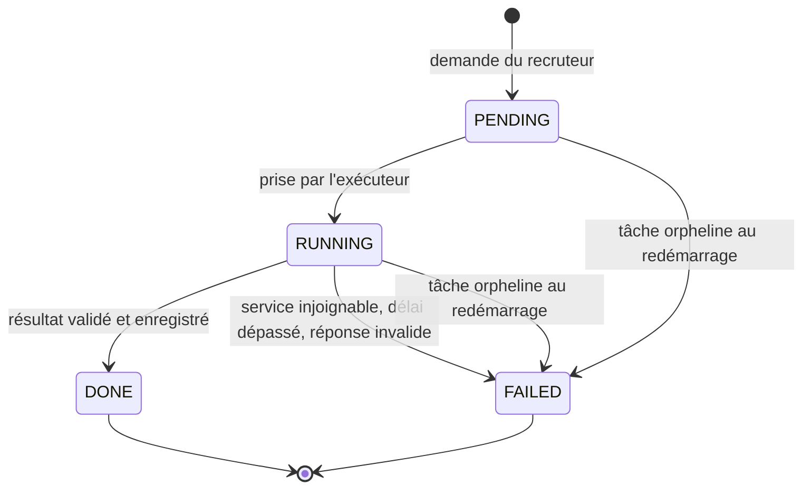

# SmartRecruit — Analyse fonctionnelle

Oct 19, 2026 · @Hajar

## 0. Objet

L'analyse fonctionnelle traduit les exigences du cahier des charges en 34 cas d'utilisation, 5 scénarios de séquence, 4 machines à états et un algorithme de matching chiffré ; c'est la base directe des user stories (Étape 3) et du modèle de données (Étape 4).

- **Référence** : cahier des charges v1.0 validé le 19 octobre 2026 ; les identifiants F-xx et RG-xx renvoient à ce document.
- **Identifiants** : UC-xx pour les cas d'utilisation, ERR pour les codes d'erreur métier.
- **Notation** : les diagrammes de séquence et d'états sont écrits en Mermaid. GitHub les affiche directement dans les fichiers Markdown, donc ils iront tels quels dans `docs/diagrams/` et resteront modifiables comme du code.
- **Hors périmètre** : le modèle de données (Étape 4), les classes (Étape 5) et les endpoints exacts (Étape 7). Les séquences nomment des composants logiques (contrôleur, service, dépôt), pas encore des classes.

## 1. Diagramme de cas d'utilisation

Les 34 cas sont regroupés en 9 paquets ; chaque acteur n'est relié qu'aux paquets de son espace, ce qui reflète directement la matrice des droits du cahier des charges.



*(Phase 12)* Diagramme redessiné en Mermaid, qui n'a pas de notation UML des cas d'utilisation : les acteurs sont reliés aux paquets de leur espace. Le regroupement en paquets suit les espaces de l'application.

Le trait pointillé marque le Service IA comme acteur secondaire : il ne déclenche rien, il répond aux demandes du système. Les rôles ne se cumulent pas (G-3), d'où l'absence de lien entre un recruteur et l'espace candidat.

## 2. Catalogue des cas d'utilisation et traçabilité

Chaque exigence F-xx du cahier des charges est couverte par au moins un cas d'utilisation ; cette table sert aussi de matrice de traçabilité pour les tests.

| UC | Cas d'utilisation | Acteur principal | Exigences | Règles clés | Priorité |
| --- | --- | --- | --- | --- | --- |
| UC-01 | Rechercher des offres | Visiteur, tout utilisateur | F-JOB-04 | RG-11, RG-19 | MUST |
| UC-02 | Consulter une offre | Visiteur, tout utilisateur | F-JOB-05 | RG-19 | MUST |
| UC-03 | S'inscrire | Visiteur | F-AUTH-01 | RG-01, RG-04 | MUST |
| UC-04 | Se connecter | Tout utilisateur | F-AUTH-02 | RG-03 | MUST |
| UC-05 | Renouveler la session | Frontend (système) | F-AUTH-03 | RG-03 | MUST |
| UC-06 | Se déconnecter | Tout utilisateur connecté | F-AUTH-04 | — | MUST |
| UC-07 | Changer de mot de passe | Tout utilisateur connecté | F-AUTH-05, F-AUTH-06 | — | SHOULD |
| UC-10 | Gérer son profil | Candidat | F-CAND-01 | RG-06 | MUST |
| UC-11 | Gérer ses rubriques (expériences, formations, compétences, langues) | Candidat | F-CAND-02 | RG-06 | MUST |
| UC-12 | Téléverser ou remplacer son CV | Candidat | F-CAND-03 | RG-07, RG-08 | MUST |
| UC-13 | Supprimer son CV | Candidat | F-CAND-04 | RG-08, RG-12 | SHOULD |
| UC-14 | Postuler | Candidat | F-APP-01, F-CAND-06 | RG-09 à RG-12 | MUST |
| UC-15 | Suivre ses candidatures | Candidat | F-APP-02 | RG-06, RG-23 | MUST |
| UC-16 | Retirer une candidature | Candidat | F-APP-03 | RG-15, RG-22 | MUST |
| UC-17 | Voir ses entretiens | Candidat | F-INT-05 | RG-23 | SHOULD |
| UC-18 | Tableau de bord candidat | Candidat | D8 | RG-06 | MUST |
| UC-20 | Créer, modifier, lister les offres | Recruteur | F-JOB-01, F-JOB-02, F-JOB-06 | RG-05, RG-17, RG-20 | MUST |
| UC-21 | Publier, clôturer, archiver une offre | Recruteur | F-JOB-03 | RG-18, RG-19 | MUST |
| UC-22 | Lister et filtrer les candidatures | Recruteur | F-APP-04 | RG-05 | MUST |
| UC-23 | Consulter un dossier de candidature | Recruteur | F-APP-05, F-CAND-05 | RG-05, RG-12 | MUST |
| UC-24 | Changer le statut d'une candidature | Recruteur | F-APP-06, F-HIST-01 | RG-13, RG-14, RG-16, RG-22, RG-33 | MUST |
| UC-25 | Gérer les notes internes | Recruteur | F-NOTE-01 | RG-23 | SHOULD |
| UC-26 | Planifier, reprogrammer, annuler un entretien | Recruteur | F-INT-01 à F-INT-03 | RG-21, RG-32 | SHOULD |
| UC-27 | Clôturer un entretien avec feedback | Recruteur | F-INT-04 | RG-23 | SHOULD |
| UC-28 | Analyser un CV | Recruteur | F-AI-01, F-AI-02 | RG-25 à RG-28 | MUST |
| UC-29 | Matching CV / offre | Recruteur | F-AI-03 | RG-25 à RG-28 | MUST |
| UC-30 | Tableau de bord recruteur | Recruteur | D8 | RG-05 | MUST |
| UC-40 | Gérer les utilisateurs | Admin | F-ADM-01, F-ADM-02, F-AUTH-05 | RG-02, RG-04, RG-29 | MUST |
| UC-41 | Gérer les entreprises | Admin | F-ADM-03 | RG-31 | MUST |
| UC-42 | Gérer les catégories | Admin | F-ADM-04 | RG-30 | MUST |
| UC-43 | Gérer les compétences | Admin | F-ADM-05 | RG-30 | SHOULD |
| UC-44 | Consulter le journal d'audit | Admin | F-ADM-06, F-AUDIT-01 | RG-24 | MUST |
| UC-45 | Tableau de bord admin | Admin | D8 | — | MUST |

Les numéros sautent par dizaine entre acteurs (UC-1x candidat, UC-2x recruteur, UC-4x admin) pour pouvoir en insérer sans renuméroter.

### Relations entre cas

| Cas | Relation | Cas lié | Signification |
| --- | --- | --- | --- |
| UC-14 Postuler | «include» | Vérifier le profil minimal | Toujours exécuté avant la création (RG-09) |
| UC-14, UC-16, UC-24, UC-25, UC-26 | «include» | Écrire l'historique | Chaque événement métier laisse une trace (F-HIST-01) |
| UC-16, UC-24 | «extend» | Annuler les entretiens planifiés | Seulement si le nouveau statut est REJECTED ou WITHDRAWN (RG-22) |
| UC-23 Consulter un dossier | «extend» | Télécharger le CV | À la demande du recruteur ; audité |
| UC-29 Matching | «include» | UC-28 Analyser un CV | Lancé automatiquement si le CV n'a pas encore été analysé |
| UC-04 Se connecter | «extend» | UC-07 Changer de mot de passe | Imposé à la première connexion d'un compte créé par l'admin |

Rappel de vocabulaire UML : «include» = le cas lié est toujours exécuté ; «extend» = il ne l'est que sous condition.

## 3. Diagrammes de séquence

Cinq scénarios concentrent les risques techniques du projet : sécurité de session, fichiers, unicité, concurrence et traitement asynchrone. Chacun montre le cas nominal et les erreurs qui comptent.

### 3.1 Connexion et renouvellement de session (UC-04, UC-05)



À retenir : le renouvellement est invisible pour l'utilisateur, géré par un intercepteur HTTP côté Angular. Si plusieurs requêtes expirent en même temps, l'intercepteur ne doit lancer qu'un seul renouvellement et faire attendre les autres, sinon la rotation invaliderait les jetons en vol.

### 3.2 Téléversement du CV (UC-12)



À retenir : le disque et la base ne partagent pas de transaction. On écrit d'abord le fichier, puis la base ; si la base échoue, on supprime le fichier. Un nettoyage périodique des fichiers orphelins couvre le cas où la suppression elle-même échoue (V2).

### 3.3 Postuler (UC-14)



À retenir : vérifier « a-t-il déjà postulé ? » avant d'insérer ne suffit pas, car deux requêtes simultanées peuvent passer la vérification toutes les deux. C'est la contrainte d'unicité en base qui garantit RG-10 ; le service traduit la violation en erreur métier lisible.

### 3.4 Changer le statut d'une candidature (UC-24)



À retenir : les règles de transition vivent dans un composant dédié, testable sans base ni Spring. Le service orchestre (droits, chargement, persistance) ; il ne contient pas de longue suite de `if` sur les statuts.

### 3.5 Analyse IA et matching (UC-28, UC-29)



À retenir : la tâche n'est soumise à l'exécuteur qu'après validation de la transaction qui l'a créée ; sinon le thread d'arrière-plan pourrait chercher une tâche pas encore visible en base. Le LLM intervient deux fois, jamais pour le score.

## 4. Diagrammes d'états

Quatre objets ont un cycle de vie contrôlé ; dans chacun, une transition absente du diagramme est une erreur métier, jamais un cas à gérer « au cas où ».

### 4.1 Candidature



REJECTED est déclenché par le recruteur avec un motif, WITHDRAWN par le candidat.

### 4.2 Offre d'emploi



L'expiration n'est pas un état en V1 : c'est une condition calculée (date dépassée), qui masque l'offre sans changer son statut. La V2 ajoutera une tâche planifiée qui la passe en CLOSED.

### 4.3 Entretien



### 4.4 Tâche IA



Au démarrage, l'application passe en FAILED toute tâche restée PENDING ou RUNNING : sans ce rattrapage, un redémarrage pendant une analyse laisserait l'interface attendre indéfiniment. Relancer une analyse crée une nouvelle tâche ; une tâche terminée n'est jamais réutilisée.

## 5. Algorithme de matching

Le score est une moyenne pondérée de trois sous-scores entre 0 et 1, calculée par le backend : compétences requises (60 %), compétences souhaitées (20 %), expérience (20 %). Le LLM ne fournit que des données d'entrée et l'explication.

### 5.1 Entrées

| Donnée | Source | Remarque |
| --- | --- | --- |
| Compétences requises de l'offre, avec niveau minimal | Offre | Au moins une (RG-20) |
| Compétences souhaitées de l'offre | Offre | Peut être vide |
| Années d'expérience minimales | Offre | 0 accepté |
| Compétences du candidat, avec niveau | Profil saisi | Source prioritaire |
| Compétences extraites du CV, avec extrait justificatif | Analyse IA (UC-28) | Complètent le profil ; niveau inconnu |
| Années d'expérience du candidat | Profil (champ déclaré), sinon somme des expériences sans chevauchement | Extraction IA en dernier recours |

Les compétences sont comparées par leur identifiant dans le référentiel, après passage par une table d'alias (« springboot », « spring-boot » → Spring Boot). Aucune déduction implicite en V1 : connaître Spring Boot ne compte pas comme connaître Java. C'est plus strict, mais jamais faux.

### 5.2 Formule

```latex
\text{score} = \operatorname{round}\left(100 \times \left(0{,}60\,C_{req} + 0{,}20\,C_{souh} + 0{,}20\,A\right)\right)
```

- **C\_req** = moyenne, sur les compétences requises, de : 1 si le candidat l'a au niveau demandé ou à un niveau inconnu ; 0,5 s'il l'a à un niveau déclaré inférieur ; 0 s'il ne l'a pas. Ordre des niveaux : BEGINNER < INTERMEDIATE < ADVANCED < EXPERT.
- **C\_souh** = part des compétences souhaitées présentes, niveau ignoré.
- **A** = années du candidat ÷ années demandées, plafonné à 1 ; vaut 1 si l'offre demande 0 an.

### 5.3 Cas limites

| Cas | Traitement |
| --- | --- |
| Aucune compétence souhaitée | Leur poids est redistribué : 75 % requises, 25 % expérience |
| Années du candidat inconnues | A = 0 et la mention « expérience non renseignée » est affichée, pour ne pas inventer de donnée |
| CV non analysable (scan) | Matching calculé sur le seul profil, avec un avertissement |
| Même compétence dans le profil et le CV | Comptée une fois ; le niveau déclaré dans le profil prime |

### 5.4 Libellés d'affichage

Le score est accompagné d'un libellé : 75 et plus « Forte adéquation », 50 à 74 « Adéquation partielle », moins de 50 « Faible adéquation ». Ces seuils servent à la lecture, jamais à un tri ou un filtrage automatique (RG-25).

### 5.5 Exemple chiffré

Offre « Développeur backend Java » : requises Java (ADVANCED), Spring Boot (INTERMEDIATE), PostgreSQL, REST API, Git ; souhaitées Docker, Kubernetes, Kafka ; 3 ans minimum.

Candidat : Java (ADVANCED), Spring Boot (BEGINNER), PostgreSQL et Git dans le profil ; REST API trouvée dans le CV par l'IA ; Docker ; 4 ans d'expérience.

| Sous-score | Détail | Valeur |
| --- | --- | --- |
| C\_req | Java 1 + Spring Boot 0,5 + PostgreSQL 1 + REST API 1 + Git 1, sur 5 | 0,90 |
| C\_souh | Docker présent ; Kubernetes et Kafka absents : 1 sur 3 | 0,33 |
| A | 4 ans ÷ 3 ans, plafonné | 1,00 |
| Score | 100 × (0,60 × 0,90 + 0,20 × 0,33 + 0,20 × 1) = 80,7 | **81 — Forte adéquation** |

Résultat présenté au recruteur : compétences correspondantes Java, PostgreSQL, REST API (source : CV), Git ; Spring Boot présent mais sous le niveau demandé ; aucune compétence requise manquante ; compétences souhaitées manquantes Kubernetes et Kafka. Le LLM reçoit cette décomposition et rédige points forts, points faibles et synthèse, sans pouvoir modifier le chiffre.

Cet exemple deviendra un test unitaire du calcul : mêmes entrées, résultat attendu 81.

## 6. Calculs métier

Trois calculs doivent être définis sans ambiguïté avant de coder, car frontend, backend et tests doivent donner le même résultat.

### 6.1 Complétude du profil

Pourcentage affiché au candidat, somme des critères remplis :

| Critère | Points |
| --- | --- |
| Prénom et nom | 10 |
| Titre professionnel | 15 |
| Résumé | 10 |
| Au moins une expérience | 20 |
| Au moins une formation | 10 |
| Au moins 3 compétences | 15 |
| Au moins une langue | 5 |
| CV actif | 15 |
| **Total** | **100** |

La complétude informe ; elle ne bloque rien. Seul le profil minimal de RG-09 conditionne la candidature.

### 6.2 Expiration d'une offre

Le recruteur choisit une date. L'offre reste ouverte jusqu'à 23:59:59 ce jour-là, dans le fuseau de l'entreprise (Africa/Casablanca par défaut), puis l'instant est stocké en UTC (RG-32). Une offre est visible et ouverte si son statut est PUBLISHED et que l'instant présent est antérieur à cet instant d'expiration.

### 6.3 Indicateurs des tableaux de bord

| Indicateur | Définition exacte |
| --- | --- |
| Candidatures reçues (7 j, 30 j) | Candidatures créées dans la période, sur les offres de l'entreprise |
| En screening / shortlistées | Candidatures dont le statut actuel est SCREENING / SHORTLISTED |
| Entretiens à venir | Entretiens SCHEDULED qui commencent dans les 7 prochains jours |
| Embauches de la période | Passages au statut HIRED dans la période, lus dans l'historique (pas dans le statut actuel) |
| Candidatures par offre | Nombre de candidatures par statut actuel, pour chaque offre non archivée |
| Complétude du profil | Calcul 6.1 |
| Utilisateurs par rôle | Comptes par rôle, séparés en actifs et désactivés |
| État du service IA | Résultat du dernier contrôle de santé d'Ollama : disponible, indisponible ou désactivé |

Les indicateurs fondés sur une période se calculent depuis l'historique, car le statut actuel ne dit pas quand il a été atteint. C'est une des raisons pour lesquelles l'historique est stocké comme des lignes requêtables, pas comme du texte libre.

## 7. Catalogue des erreurs métier

Toutes les erreurs suivent le format standard « Problem Details » (RFC 9457, pris en charge nativement par Spring), avec un champ `code` stable que le frontend utilise pour choisir son message.

Convention des statuts HTTP : **400** requête mal formée ou champ invalide · **401** non authentifié · **403** authentifié mais rôle insuffisant · **404** inexistant ou hors périmètre · **409** conflit avec l'état actuel de la ressource · **422** requête valide mais refusée par une règle métier · **429** trop de requêtes · **503** dépendance indisponible.

| Code | HTTP | Déclencheur |
| --- | --- | --- |
| VALIDATION\_FAILED | 400 | Un ou plusieurs champs invalides ; la réponse liste les champs et leurs erreurs |
| AUTHENTICATION\_REQUIRED | 401 | Endpoint protégé appelé sans token, ou avec un token invalide (signature, émetteur) : retour à la connexion *(ajouté en phase 3)* |
| AUTH\_INVALID\_CREDENTIALS | 401 | Email ou mot de passe faux, ou compte désactivé (message identique) |
| AUTH\_TOKEN\_EXPIRED | 401 | Access token expiré : le frontend tente un renouvellement |
| AUTH\_REFRESH\_INVALID | 401 | Refresh token absent, expiré, révoqué ou réutilisé |
| PASSWORD\_CHANGE\_REQUIRED | 403 | Compte créé par l'admin, premier mot de passe pas encore changé |
| ACCESS\_DENIED | 403 | Rôle insuffisant pour l'action |
| RESOURCE\_NOT\_FOUND | 404 | Ressource inexistante, ou appartenant à un autre candidat ou une autre entreprise |
| METHOD\_NOT\_ALLOWED | 405 | Méthode HTTP non prise en charge par l'endpoint (erreur technique, en-tête `Allow` renvoyé) |
| NOT\_ACCEPTABLE | 406 | Format de réponse demandé indisponible (erreur technique) |
| UNSUPPORTED\_MEDIA\_TYPE | 415 | Format du corps de requête non pris en charge (erreur technique) |
| EMAIL\_ALREADY\_USED | 409 | Inscription ou création de compte avec un email existant |
| APPLICATION\_ALREADY\_EXISTS | 409 | Deuxième candidature à la même offre (RG-10) |
| JOB\_NOT\_OPEN | 409 | Candidature à une offre non publiée ou expirée (RG-11) |
| INVALID\_STATUS\_TRANSITION | 409 | Transition absente des diagrammes d'états |
| INVALID\_STATE | 409 | Action impossible dans l'état actuel, hors changement de statut (modifier une offre CLOSED, clôturer un entretien non commencé) |
| OFFER\_REQUIRES\_COMPLETED\_INTERVIEW | 409 | Passage à OFFER sans entretien terminé (RG-33) |
| INTERVIEW\_NOT\_ALLOWED | 409 | Entretien sur une candidature qui n'est pas en INTERVIEW (RG-21) |
| CONCURRENT\_MODIFICATION | 409 | Ressource modifiée par quelqu'un d'autre depuis sa lecture |
| RESOURCE\_IN\_USE | 409 | Suppression d'une catégorie ou compétence utilisée (RG-30), d'une offre non DRAFT (RG-18) |
| LAST\_ADMIN | 409 | Désactivation du dernier admin actif ou de soi-même (RG-29) |
| PROFILE\_INCOMPLETE | 422 | Profil minimal ou CV manquant pour postuler ; la réponse liste les manques |
| REJECTION\_REASON\_REQUIRED | 422 | Rejet sans motif (RG-14) |
| INVALID\_CURRENT\_PASSWORD | 422 | Ancien mot de passe incorrect lors d'un changement |
| JOB\_NOT\_PUBLISHABLE | 422 | Publication refusée ; la réponse liste les raisons |
| FILE\_TOO\_LARGE | 413 | CV de plus de 5 Mo |
| FILE\_INVALID\_TYPE | 415 | Fichier qui n'est pas un PDF (extension, type ou signature) |
| FILE\_UNREADABLE | 422 | PDF corrompu ou chiffré |
| RATE\_LIMITED | 429 | Trop de tentatives de connexion, d'inscription ou de demandes IA |
| AI\_DISABLED | 503 | Module IA désactivé par configuration |
| AI\_UNAVAILABLE | 503 | Ollama injoignable ou délai dépassé (porté par la tâche FAILED) |
| AI\_INVALID\_RESPONSE | 502 | Réponse du modèle non conforme au schéma après une nouvelle tentative |
| INTERNAL\_ERROR | 500 | Erreur imprévue ; détail uniquement dans les logs, avec l'identifiant de corrélation renvoyé au client |

Une transition interdite est un 409 et non un 400 : la requête est correcte, c'est l'état actuel de la candidature qui l'empêche.

## 8. Inventaire des écrans

Le frontend V1 compte 26 écrans répartis en quatre espaces ; chaque espace correspondra à une feature Angular protégée par un guard de rôle (Étape 8). Les routes sont en anglais, comme le code ; les libellés affichés restent en français.

| Espace | Écran | Route | Cas couverts |
| --- | --- | --- | --- |
| Public | Liste et recherche des offres | `/jobs` | UC-01 |
| Public | Détail d'une offre (+ dialogue « Postuler ») | `/jobs/:id` | UC-02, UC-14 |
| Public | Inscription | `/register` | UC-03 |
| Public | Connexion | `/login` | UC-04 |
| Public | Page introuvable / accès refusé | `/not-found`, `/forbidden` | — |
| Commun | Changer de mot de passe (forcé à la première connexion) | `/account/password` | UC-07 |
| Candidat | Tableau de bord | `/candidate` | UC-18 |
| Candidat | Mon profil (onglets : informations, expériences, formations, compétences, langues, CV) | `/candidate/profile` | UC-10 à UC-13 |
| Candidat | Mes candidatures | `/candidate/applications` | UC-15 |
| Candidat | Détail d'une candidature (chronologie, retrait) | `/candidate/applications/:id` | UC-15, UC-16 |
| Candidat | Mes entretiens | `/candidate/interviews` | UC-17 |
| Recruteur | Tableau de bord | `/recruiter` | UC-30 |
| Recruteur | Offres de l'entreprise | `/recruiter/jobs` | UC-20, UC-21 |
| Recruteur | Créer une offre | `/recruiter/jobs/new` | UC-20 |
| Recruteur | Modifier une offre | `/recruiter/jobs/:id/edit` | UC-20, UC-21 |
| Recruteur | Candidatures (filtres, tri, pagination) | `/recruiter/applications` | UC-22 |
| Recruteur | Dossier de candidature (onglets : profil, CV, historique, notes, entretiens, IA) | `/recruiter/applications/:id` | UC-23 à UC-29 |
| Recruteur | Agenda des entretiens | `/recruiter/interviews` | UC-26, UC-27 |
| Admin | Tableau de bord | `/admin` | UC-45 |
| Admin | Utilisateurs | `/admin/users` | UC-40 |
| Admin | Créer un utilisateur | `/admin/users/new` | UC-40 |
| Admin | Entreprises | `/admin/companies` | UC-41 |
| Admin | Catégories | `/admin/categories` | UC-42 |
| Admin | Compétences (recherche, fusion) | `/admin/skills` | UC-43 |
| Admin | Journal d'audit | `/admin/audit` | UC-44 |

Le dossier de candidature est l'écran le plus riche du projet : c'est là que se concentrent le workflow, les notes, les entretiens et l'IA. C'est aussi celui à montrer en premier dans une démo ou en capture d'écran du README.

## 9. Ce que tu dois savoir défendre

**« Quelle différence entre «include» et «extend» ? »** «include» : le cas lié s'exécute toujours (postuler inclut toujours la vérification du profil). «extend» : il s'exécute sous condition (le rejet n'annule les entretiens que s'il y en a de planifiés).

**« Comment évites-tu les doublons de candidature ? »** Par une contrainte d'unicité en base sur le couple candidat + offre. Une vérification applicative seule laisse passer deux requêtes simultanées ; la base est le seul endroit où l'unicité est garantie.

**« Deux recruteurs changent le même statut en même temps : que se passe-t-il ? »** Verrouillage optimiste : la candidature porte un numéro de version. Le second enregistrement constate que la version a changé et reçoit un 409 ; il recharge et décide en connaissant le nouvel état. Pas de verrou bloquant en base, donc pas d'attente.

**« Pourquoi l'analyse IA est-elle asynchrone ? »** Un modèle local sur CPU peut mettre plus d'une minute. Une requête HTTP bloquée aussi longtemps est fragile (délais des proxys, onglet fermé). La tâche en base rend le traitement observable, relançable et récupérable après un redémarrage.

**« Pourquoi soumettre la tâche après la validation de la transaction ? »** Le thread d'arrière-plan lit la tâche avec sa propre connexion. Si on la lui confie avant la validation, il peut ne pas la trouver, ou trouver un état incohérent.

**« 404 ou 403 pour une ressource d'une autre entreprise ? »** 404 : un 403 confirmerait que la ressource existe, ce qui permet d'énumérer les identifiants. Le 403 est réservé au cas où le rôle lui-même ne permet pas l'action.

**« Comment garantis-tu que ton score est juste ? »** Il n'est pas « juste » au sens absolu : c'est un indicateur. Mais il est déterministe, documenté (section 5) et couvert par des tests avec des exemples chiffrés. Le recruteur voit la décomposition et peut la contester.
