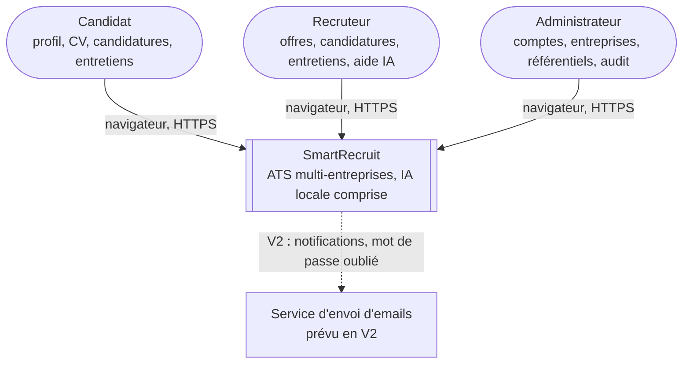
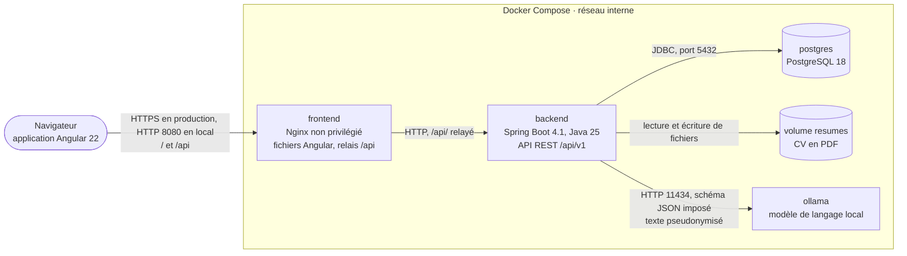
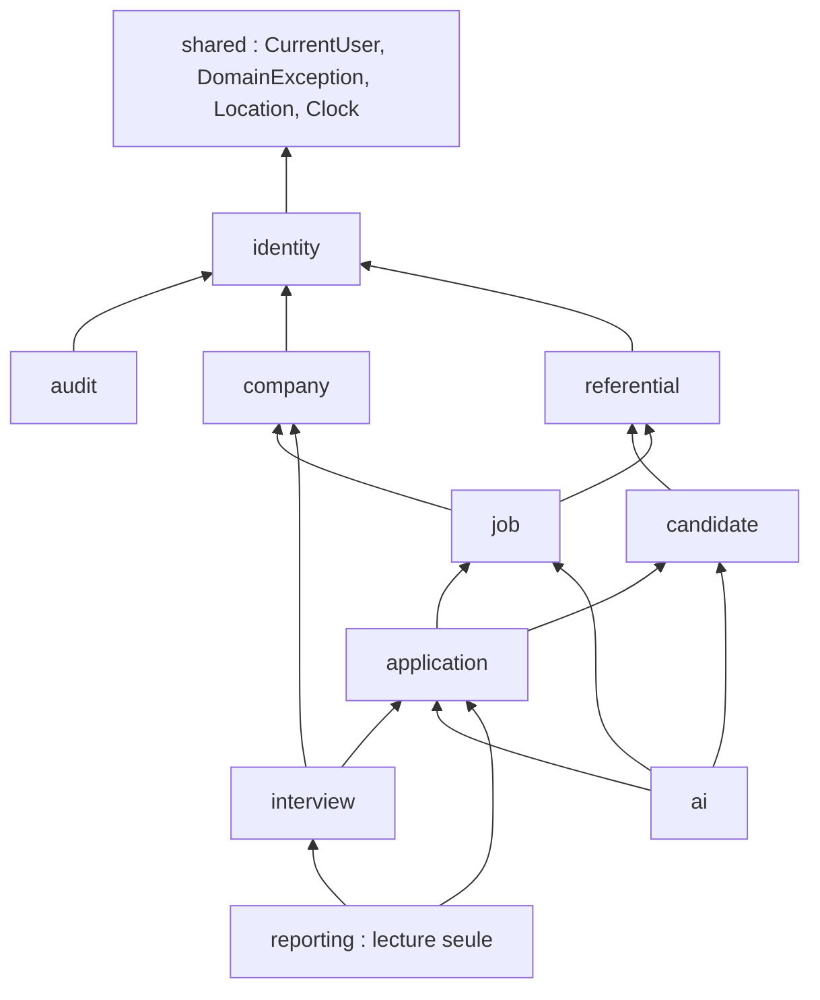

# SmartRecruit — Architecture globale

Oct 19, 2026 · @Hajar

## 0. Décisions d'architecture

SmartRecruit est un monolithe modulaire Spring Boot sans état, servi avec son frontend Angular derrière un même Nginx, appuyé sur PostgreSQL et un Ollama local, le tout lancé par Docker Compose.

| Sujet | Décision | Alternative écartée | Raison |
| --- | --- | --- | --- |
| Style | Monolithe modulaire : une application, 9 modules à frontières vérifiées | Microservices | Une développeuse, un domaine, un volume modeste : les microservices ajouteraient réseau, déploiements et cohérence distribuée sans gain |
| Frontend | Application monopage (SPA) Angular, fichiers statiques servis par Nginx | Rendu serveur (SSR) | Aucun besoin de référencement sur les écrans connectés ; plus simple à déployer |
| Communication | API REST JSON, versionnée sous `/api/v1` | GraphQL | Ressources classiques, cache HTTP simple, outillage OpenAPI |
| Session | Backend sans état : JWT court + refresh token en cookie | Session serveur | Plusieurs instances possibles sans session partagée |
| Origine | Frontend et API sur la même origine via Nginx (`/` et `/api`) | Deux domaines + CORS | Le cookie SameSite=Strict fonctionne, et CORS n'est plus nécessaire en production |
| Données | Une base PostgreSQL, un schéma par application | Une base par module | La transaction couvre plusieurs modules quand il le faut (RG-31) ; les frontières restent dans le code |
| Asynchrone | Table de tâches + pool de threads dans l'API | Bus de messages (Kafka, RabbitMQ) | Un seul type de traitement asynchrone, faible volume |
| IA | Ollama dans son propre conteneur, appelé en HTTP derrière `AIService` | API cloud payante | Gratuit, données qui ne quittent pas l'infrastructure |
| Fichiers | Volume Docker derrière `FileStorageService` | Stockage objet S3 dès la V1 | Inutile pour une démo ; l'abstraction prépare la migration |
| Déploiement | Docker Compose, une machine | Kubernetes | Quatre conteneurs ne justifient pas un orchestrateur |

Ces décisions reprennent les validations du cahier des charges (G-1 à G-11) ; la même origine via Nginx et le préfixe de version `/api/v1` sont nouveaux.

## 1. Contexte (C4 niveau 1)

Trois rôles utilisent SmartRecruit depuis un navigateur ; en V1, le système ne dépend d'aucun service externe, car l'IA tourne dans sa propre infrastructure.

Le seul système externe prévu est un service d'envoi d'emails, en V2 (notifications, mot de passe oublié). GitHub n'apparaît pas : il sert à construire le projet, pas à le faire fonctionner.

## 2. Conteneurs (C4 niveau 2)

Quatre conteneurs et un volume : Nginx sert l'application Angular et relaie l'API, qui est la seule à parler à la base, aux fichiers et à Ollama.

Le navigateur ne parle jamais directement à l'API, à la base ni à Ollama. Le détail des services, ports et volumes est en section 7.

## 3. Modules du monolithe

Le backend compte 9 modules métier, un noyau partagé et un module de lecture pour les tableaux de bord ; les dépendances ne forment aucun cycle, et un test le vérifie à chaque build. *(Phase 11)* Un douzième module, `demo`, charge les données de démonstration (US-56) : personne ne l'appelle et il n'appelle aucun service métier, il écrit directement en SQL ; il n'apparaît pas dans le schéma.

Une flèche « A → B » signifie : A peut appeler l'API publique de B. Tous les modules dépendent aussi de `shared` et peuvent appeler `audit` ; ces flèches sont omises pour la lisibilité.

### Règles de frontière

| Règle | Concrètement |
| --- | --- |
| Chaque module expose une API publique | Un paquet `api` (interfaces de service, DTO, événements) ; tout le reste est interne |
| Aucun accès aux entités ni aux dépôts d'un autre module | `application` ne voit jamais `JobOfferRepository` ; il appelle `JobOfferQueries.findSummary(id)` |
| Références par identifiant | Voir le diagramme de classes : pas d'association JPA entre modules |
| Pas de cycle | Quand deux modules ont besoin l'un de l'autre, le plus « haut » définit une interface que l'autre implémente (`CompletedInterviewChecker`) |
| Effets de bord par événements | `CompanyDeactivated`, `ApplicationStatusChanged`… plutôt que des appels directs vers les modules réagissants |
| Vérification automatique | Un test Spring Modulith (`ApplicationModules.of(...).verify()`) échoue si une règle est violée |

Spring Modulith accompagne les versions actuelles de Spring Boot : la 2.1.0 est sortie avec Spring Boot 4.1 ([InfoQ](https://infoq.com/news/2026/06/spring-boot-4-1)). Il vérifie les frontières par simple test, sans rien ajouter à l'exécution, et peut générer la documentation des modules.

`reporting` est un cas à part : il ne contient que des requêtes SQL de lecture (projections) pour les tableaux de bord. Il lit plusieurs modules sans en modifier aucun ; c'est un compromis assumé pour éviter de charger des agrégats entiers juste pour compter.

## 4. Couches et parcours d'une requête

Chaque module suit les mêmes quatre couches, et les dépendances pointent toutes vers le domaine : le domaine ne connaît ni HTTP, ni Spring MVC, ni Ollama. Seules les annotations JPA y apparaissent, sur les entités ; c'est un compromis courant et assumé, qui évite de maintenir deux modèles parallèles.

| Couche | Contenu | Dépend de | Paquets du prompt |
| --- | --- | --- | --- |
| web | Contrôleurs REST, DTO de requête et de réponse, mappers MapStruct | application | controller, dto, mapper |
| application | Services de cas d'utilisation : transaction, contrôle de propriété, orchestration | domain | service |
| domain | Entités, objets valeur, énumérations, événements, interfaces (`AIService`, `FileStorageService`, `CompletedInterviewChecker`) | shared uniquement | entity |
| infrastructure | Dépôts Spring Data, adaptateurs Ollama, stockage disque, extraction PDF | domain (implémente ses interfaces) | repository |

Les paquets transverses `security`, `exception` et `config` du prompt vivent dans `shared` et dans la configuration de l'application. L'arborescence exacte sera fixée à l'Étape 9.

### Parcours d'une requête authentifiée

Exemple : un recruteur rejette une candidature (`PATCH /api/v1/applications/{id}/status`).

1. **Nginx** reçoit la requête en HTTPS et la transmet à l'API, car le chemin commence par `/api`.
2. **Filtre de corrélation** : il lit ou génère un identifiant de requête, le place dans le contexte des logs et dans l'en-tête de réponse.
3. **Spring Security** : le filtre JWT vérifie la signature et l'expiration, puis construit le `CurrentUser` (id, rôle, entreprise). Une règle d'URL exige le rôle RECRUITER ; sinon 401 ou 403.
4. **Contrôleur** : il désérialise le corps et le valide avec Bean Validation ; un champ invalide donne 400.
5. **Service applicatif** : il ouvre la transaction, charge la candidature et vérifie que son offre appartient à l'entreprise du `CurrentUser` ; sinon 404.
6. **Domaine** : `Application.reject()` vérifie la transition et le motif, change le statut et enregistre l'événement `ApplicationStatusChanged`.
7. **Persistance** : la sauvegarde vérifie la version (verrouillage optimiste) ; Spring publie l'événement, et les écouteurs écrivent l'historique, annulent les entretiens et écrivent l'audit dans la même transaction.
8. **Validation de la transaction**, puis exécution des écouteurs « après validation » s'il y en a.
9. **Réponse** : le mapper transforme l'agrégat en DTO, le contrôleur renvoie 200.
10. **En cas d'exception** à n'importe quelle étape, le gestionnaire global la traduit en Problem Details avec le code du catalogue et l'identifiant de corrélation.

## 5. Sécurité de l'architecture

Seul Nginx est exposé ; l'API, la base et Ollama vivent sur un réseau Docker interne, et chaque frontière de confiance a son contrôle.

| Zone | Composants | Exposition | Contrôle à l'entrée |
| --- | --- | --- | --- |
| Internet | Navigateur | — | — |
| Bordure | Nginx | Ports 80 et 443 uniquement | HTTPS, en-têtes de sécurité (CSP, HSTS, X-Content-Type-Options), taille maximale des requêtes alignée sur les 5 Mo des CV |
| Application | API Spring Boot | Réseau interne, joignable seulement par Nginx | JWT, rôles, propriété, validation, limitation de débit |
| Données | PostgreSQL, volume des CV | Réseau interne, aucun port publié | Identifiants de base propres à l'application, droits limités au schéma |
| IA | Ollama | Réseau interne, aucun port publié | Joignable seulement par l'API ; ne reçoit que du texte pseudonymisé |

### Pourquoi la même origine

Nginx sert la SPA sur `/` et transmet `/api` à l'API. Pour le navigateur, tout vient du même domaine :

- le cookie du refresh token peut rester `SameSite=Strict` et limité au chemin `/api/v1/auth` ;
- aucune configuration CORS n'est nécessaire en production (elle reste définie pour le profil `dev`, où Angular tourne sur un autre port) ;
- la Content Security Policy peut se limiter à `'self'`.

### Secrets

| Secret | Où il vit | Jamais |
| --- | --- | --- |
| Clé de signature JWT (256 bits minimum) | Variable d'environnement | Dans le dépôt, dans les logs |
| Mot de passe PostgreSQL | Variable d'environnement | Dans `application.yml` |
| Mot de passe de l'admin initial | Variable d'environnement, à changer à la première connexion | En dur dans une migration |

Le fichier `.env.example` liste toutes les variables avec des valeurs factices ; `.env` est ignoré par Git, et une analyse de secrets tourne en CI (ENF-SEC-11).

## 6. Intégration de l'IA

L'API appelle Ollama en HTTP avec un schéma JSON imposé ; le modèle n'est pas figé ici mais choisi par un test comparatif mesuré, puis épinglé dans la configuration.

### Intégration

| Point | Choix | Raison |
| --- | --- | --- |
| Client | `RestClient` de Spring, appel direct à l'API de chat d'Ollama | Un seul appel HTTP, entièrement lisible et testable ; l'interface `AIService` assure déjà la portabilité |
| Format de sortie | Schéma JSON passé dans le paramètre `format` | Ollama accepte un schéma JSON complet depuis sa version 0.5 et contraint le modèle à le respecter ([source](https://www.llmconfigurator.com/en/guides/llm-json-structured-output)) ; le backend revalide quand même |
| Température | 0 pour l'extraction, faible pour l'explication | Résultats aussi reproductibles que possible |
| Délai | 120 s, puis une seule nouvelle tentative | ENF-PERF-05 |
| Parallélisme | Pool de 1 à 2 threads | Sur CPU, deux analyses simultanées se ralentissent l'une l'autre |
| Prompts | Fichiers versionnés dans les ressources (`resume-extraction-v1`), version enregistrée avec chaque résultat | RG-27 |
| Santé | Indicateur Actuator qui interroge Ollama | État visible par l'admin (US-46) |

Alternative écartée pour la V1 : Spring AI, qui fournit sa propre abstraction multi-fournisseurs. Elle ajouterait une seconde couche d'abstraction au-dessus d'`AIService` et masquerait l'appel réel. Elle reste une bonne évolution, à présenter comme telle en entretien.

### Choix du modèle

Candidats à comparer : un modèle open source de 7 à 9 milliards de paramètres, en version « instruct », dans chacune des familles Qwen, Llama, Mistral et Gemma disponibles dans la bibliothèque Ollama au moment du test. Les CV seront souvent en français, donc la qualité multilingue compte autant que le respect du JSON.

Protocole :

1. Constituer 10 CV fictifs (français et anglais, mises en page variées, un CV piégé contenant une instruction cachée).
2. Écrire pour chacun l'extraction attendue à la main : compétences, expériences, formations, langues.
3. Lancer l'extraction avec chaque modèle candidat, sur ton poste, avec le même prompt.
4. Mesurer : précision et rappel des compétences, exactitude des expériences, temps moyen, mémoire utilisée.
5. Retenir le meilleur modèle qui atteint au moins 0,85 de précision et 0,80 de rappel sur les compétences en moins de 120 s par CV.
6. Consigner les résultats dans `docs/ai-model-benchmark.md` et épingler la version exacte du modèle dans la configuration.

Ce protocole est aussi un excellent sujet d'entretien : il montre que le choix d'un LLM se mesure au lieu de se deviner.

## 7. Déploiement et environnements

Quatre services Docker Compose sur un réseau interne, trois volumes persistants, et quatre profils de configuration qui ne diffèrent que par leurs variables.

| Service | Image | Port publié | Dépend de (sain) | Health check |
| --- | --- | --- | --- | --- |
| frontend | Nginx avec la SPA compilée (build multi-étapes) | 80, 443 | backend | Requête sur `/` |
| backend | JRE 25 avec le JAR Spring Boot (build multi-étapes, utilisateur non root) | aucun | postgres | `/actuator/health/readiness` |
| postgres | PostgreSQL 18 officielle | aucun (5432 en `dev` seulement) | — | `pg_isready` |
| ollama | Ollama officielle | aucun (11434 en `dev` seulement) | — | Liste des modèles installés |

| Volume | Contenu | Remarque |
| --- | --- | --- |
| pgdata | Données PostgreSQL | Sauvegarde par `pg_dump`, procédure dans le README |
| resumes | Fichiers des CV | Monté uniquement dans `backend` |
| ollama-models | Modèles téléchargés | Évite de retélécharger plusieurs Go à chaque démarrage |

Le backend ne dépend pas de la santé d'Ollama pour démarrer : l'IA est facultative (RG-28). Le premier lancement télécharge le modèle choisi ; le README l'indique avec la taille attendue.

*(Phase 11, écarts assumés)* Le `docker-compose.yml` livré vise l'essai local : Nginx non privilégié écoute en HTTP sur 8080 (publié sur `HTTP_PORT`), sans HTTPS. En production, TLS est terminé devant (reverse proxy, répartiteur de charge ou Nginx avec certificats) et c'est là qu'on active HSTS, déjà prévu en commentaire dans `security-headers.conf`. Le health check du frontend vise `/healthz`, qui ne dépend pas du backend. Un service ponctuel `ollama-model` télécharge le modèle puis s'arrête. Le profil `demo` charge des données fictives sur une base vide (US-56).

### Profils

| Profil | Usage | Particularités |
| --- | --- | --- |
| dev | Poste de développement | Angular en serveur de développement avec proxy vers l'API, CORS ouvert sur `localhost`, ports PostgreSQL et Ollama publiés, logs lisibles |
| test | Tests automatisés | PostgreSQL éphémère (Testcontainers), `FakeAIService`, horloge fixe |
| demo | Démonstration publique du dépôt | Données de démonstration chargées au premier démarrage (US-56) |
| prod | Déploiement réel | Validation du schéma sans modification, logs JSON, aucun port interne publié, démarrage refusé si un secret manque |

Toute la configuration passe par des variables d'environnement (principe « 12-factor ») : la même image tourne dans tous les environnements.

## 8. Observabilité

La V1 couvre les trois besoins de base (comprendre une erreur, savoir si l'application est saine, mesurer les temps clés) avec Spring Boot Actuator et des logs structurés, sans pile de supervision dédiée.

| Besoin | Moyen V1 | Détail |
| --- | --- | --- |
| Comprendre une erreur | Logs structurés | JSON en `prod`, texte en `dev` ; chaque ligne porte l'identifiant de corrélation et, si connecté, l'identifiant de l'utilisateur ; jamais d'email, de token ni de contenu de CV |
| Relier une erreur à un utilisateur | Identifiant de corrélation | Renvoyé dans l'en-tête de réponse et dans chaque Problem Details ; un utilisateur peut le transmettre au support |
| Savoir si l'application est saine | Actuator health | `liveness` (le processus répond), `readiness` (base joignable) ; composant IA à part, qui signale sans faire échouer |
| Mesurer | Actuator metrics (Micrometer) | Temps des requêtes HTTP par endpoint ; métriques métier : durée des tâches IA, nombre de tâches échouées, candidatures créées |
| Protéger les endpoints techniques | Configuration Actuator | Seul `health` est public ; `metrics` et `info` réservés à l'admin |

V2 possible, sans changer le code : ajouter Prometheus et Grafana au Docker Compose, car Micrometer sait déjà exposer ses métriques au format Prometheus.

## 9. Évolution

Aucune technologie n'est ajoutée « au cas où » : chaque évolution attend un déclencheur mesurable, et l'architecture actuelle a déjà prévu l'endroit où elle se branchera.

| Déclencheur mesuré | Évolution | Point d'entrée déjà prévu |
| --- | --- | --- |
| Plusieurs instances de l'API | Compteur de tentatives de connexion partagé (base ou Redis) | Limitation isolée dans un composant |
| CV stockés sur plusieurs machines ou volume important | Stockage objet compatible S3 | `FileStorageService` |
| Analyses IA trop lentes ou trop nombreuses pour une machine | Extraire le module `ai` en service séparé, avec un GPU | Module `ai` sans dépendance entrante, tâches en base |
| Besoin d'un modèle plus performant | Implémentation `AIService` vers une API cloud | Interface `AIService`, pseudonymisation déjà en place |
| Plusieurs consommateurs d'événements hors de l'application (emails, analytics) | Publication fiable d'événements (table d'événements sortants, puis bus de messages si nécessaire) | Événements de domaine déjà définis |
| Recherche d'offres lente au-delà de quelques centaines de milliers d'offres | Moteur de recherche dédié | Requête de recherche isolée dans un dépôt |
| Plusieurs serveurs à orchestrer | Orchestrateur de conteneurs | Images sans état, configuration par variables |

C'est la réponse à « et si ça devait passer à l'échelle ? » : on sait où couper, et on ne coupe que lorsqu'une mesure le justifie.

## 10. Registre des décisions (ADR)

Chaque décision structurante a sa fiche courte dans [`docs/adr/`](adr/README.md) (contexte, décision, alternatives, conséquences, et ce que le développement a confirmé ou changé) ; ce registre en fixe la liste initiale.

| ADR | Décision | Document source |
| --- | --- | --- |
| 001 | Monolithe modulaire vérifié par Spring Modulith | Architecture §0, §3 |
| 002 | Java 25, Spring Boot 4.1, Angular 22, PostgreSQL 18 | Cahier des charges G-11, F |
| 003 | JWT court + refresh token en cookie HttpOnly avec rotation | Cahier des charges G-8 |
| 004 | Frontend et API sur la même origine via Nginx | Architecture §5 |
| 005 | Clés primaires UUID v7 | Modèle de données §0 |
| 006 | Références par identifiant entre agrégats | Diagramme de classes §0 |
| 007 | Workflow de candidature porté par l'énumération `ApplicationStatus` | Diagramme de classes §5 |
| 008 | Score de matching calculé par formule, LLM pour l'extraction et l'explication | Cahier des charges G-6 |
| 009 | Traitement IA asynchrone par table de tâches | Cahier des charges G-7 |
| 010 | Ollama appelé par `RestClient` derrière `AIService` ; modèle choisi par test comparatif | Architecture §6 |
| 011 | Énumérations stockées en texte avec contrainte CHECK | Modèle de données §0 |
| 012 | Diagrammes en Mermaid versionnés avec le code | Analyse fonctionnelle §0 |

## 11. Ce que tu dois savoir défendre

**« Qu'est-ce qu'un monolithe modulaire, et en quoi est-ce différent d'un monolithe classique ? »** Un seul déploiement, mais des modules aux frontières explicites et vérifiées : chacun a une API publique, ne touche pas aux données internes des autres et communique par appels d'interface ou par événements. Un monolithe classique laisse n'importe quelle classe appeler n'importe quelle autre, ce qui le rend impossible à découper.

**« Pourquoi pas des microservices, puisque c'est ce que demandent les offres d'emploi ? »** Parce que les microservices résolvent des problèmes d'organisation (équipes indépendantes) et d'échelle que ce projet n'a pas. Je sais où je couperais (section 9) et pourquoi je ne le fais pas : c'est plus convaincant qu'une architecture distribuée injustifiée.

**« Qu'est-ce que le modèle C4 ? »** Quatre niveaux de zoom pour décrire une architecture : contexte (le système et ses utilisateurs), conteneurs (applications et bases déployées), composants (modules à l'intérieur), code. Ce document couvre les trois premiers.

**« Comment ton API sait-elle qui fait la requête, sans session ? »** Chaque requête porte un access token signé. Le serveur vérifie la signature avec sa clé secrète et lit l'identifiant, le rôle et l'entreprise dans le token : aucune session à stocker, donc n'importe quelle instance peut répondre.

**« Pourquoi Nginx devant Spring Boot ? »** Il sert les fichiers statiques d'Angular bien plus efficacement que la JVM, termine le HTTPS, ajoute les en-têtes de sécurité et place frontend et API sur la même origine, ce qui supprime CORS et sécurise le cookie de session.

**« Que se passe-t-il si Ollama est arrêté ? »** L'API démarre quand même, car elle ne dépend pas de sa santé. Le health check signale le composant IA indisponible, les tâches d'analyse échouent proprement, et tout le reste fonctionne.
