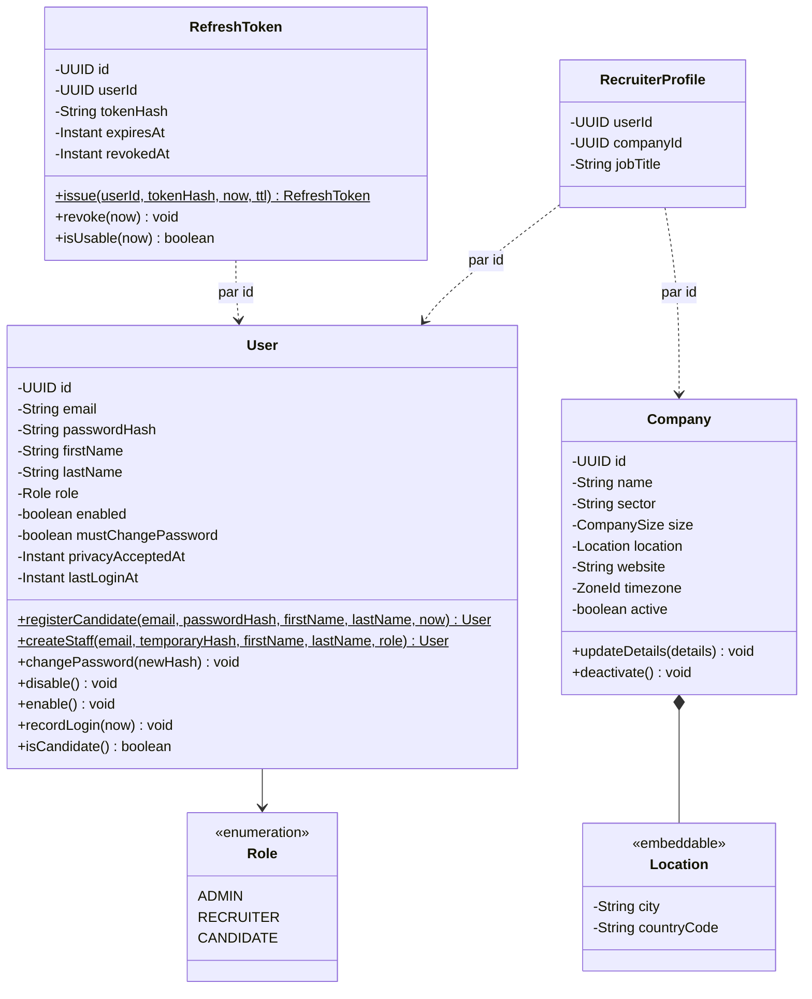
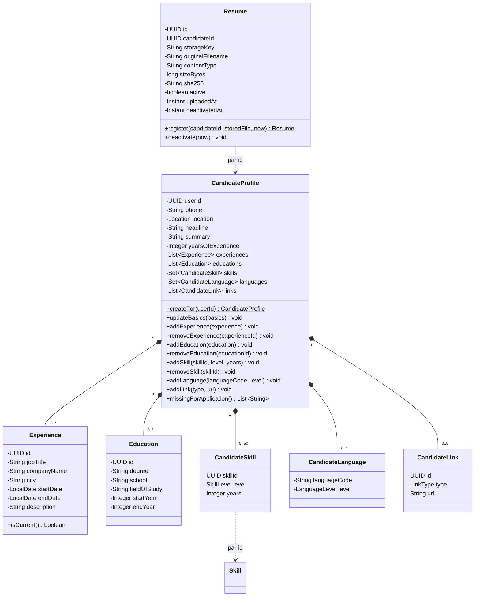
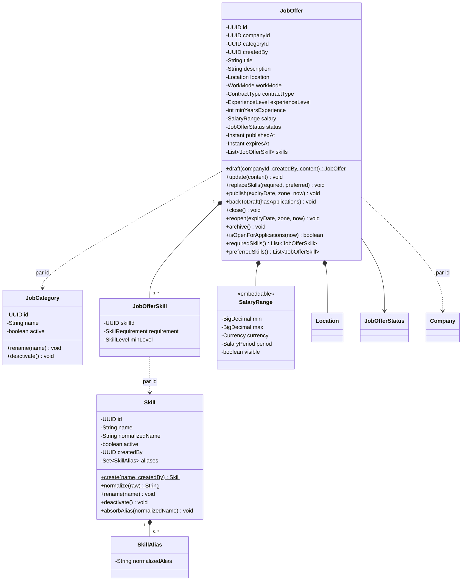
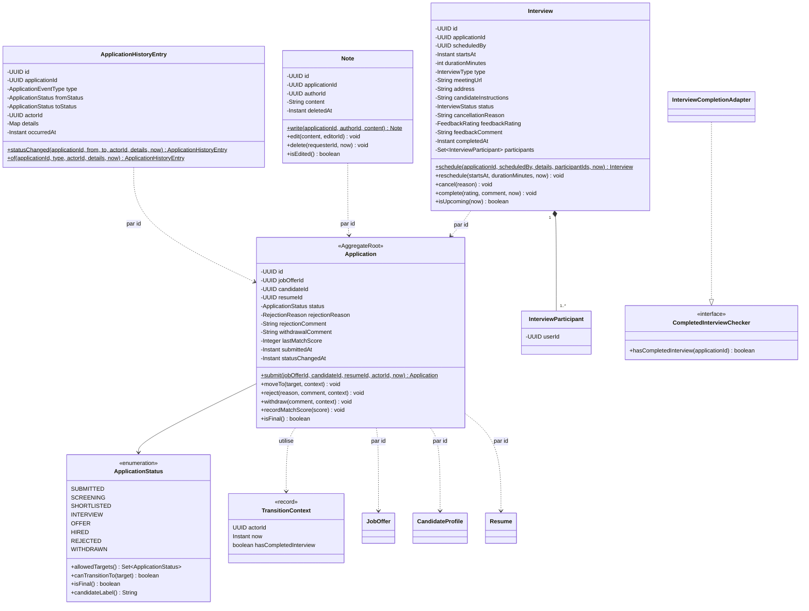
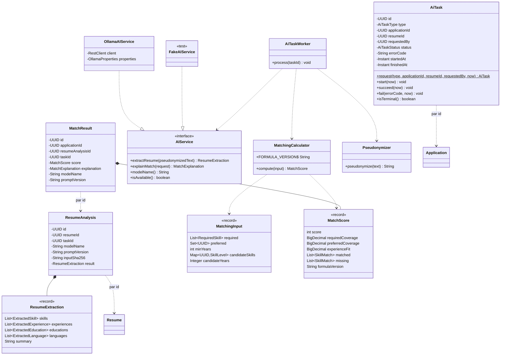
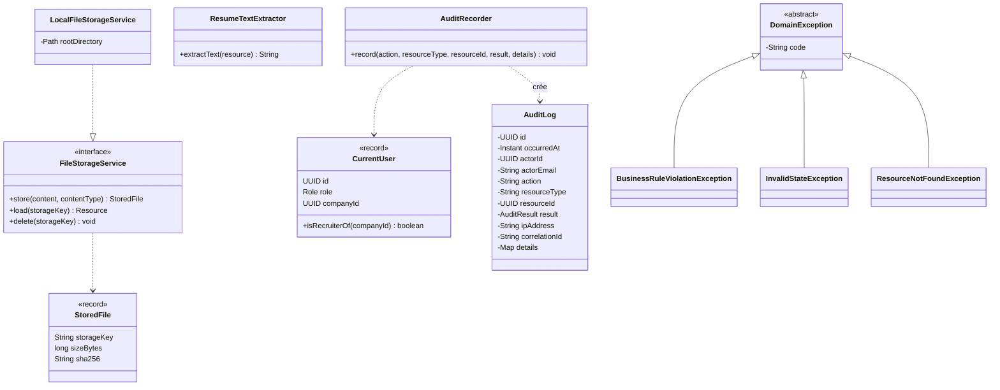

# SmartRecruit — Diagramme de classes

Oct 19, 2026 · @Hajar

## 0. Principes

Les 25 tables deviennent 17 agrégats et 8 entités enfants : des entités qui portent leurs propres règles (une candidature sait vers quels statuts elle peut aller), reliées entre modules par identifiant et non par association JPA.

| Principe | Application dans SmartRecruit | Pourquoi |
| --- | --- | --- |
| Modèle riche | Les règles d'un objet sont des méthodes de cet objet : `JobOffer.publish()`, `Application.moveTo()`, `Interview.complete()`. Pas de setters publics sur les champs métier | Une règle écrite à un seul endroit ne peut pas être contournée par un autre service ; elle se teste sans Spring ni base |
| Agrégat | Un objet racine et ses enfants, modifiés et enregistrés ensemble : `CandidateProfile` et ses expériences, `JobOffer` et ses compétences | Une transaction = un agrégat ; frontière claire de cohérence |
| Référence par identifiant entre agrégats | `Application` connaît `jobOfferId`, pas un objet `JobOffer` | Aucun chargement en chaîne non voulu ; modules découplés, donc découpables plus tard |
| Associations JPA à l'intérieur d'un agrégat | `@OneToMany(cascade = ALL, orphanRemoval = true)` de la racine vers ses enfants, chargement LAZY | Le cycle de vie des enfants suit la racine |
| Lectures pour l'affichage | Les listes (candidatures avec titre d'offre et nom du candidat) passent par des requêtes de projection dédiées qui renvoient directement des DTO | On ne charge pas trois agrégats pour afficher une ligne de tableau |
| Objets valeur | `Location`, `SalaryRange` en `@Embeddable` ; résultats de calcul en `record` Java | Regroupent des champs qui vont ensemble et valident leur cohérence |
| Événements de domaine | `ApplicationStatusChanged`, `InterviewScheduled`… publiés par les agrégats, écoutés par l'historique et l'audit | Le module Entretiens n'a pas besoin de connaître la table d'historique |
| Égalité | `equals` et `hashCode` fondés sur l'identifiant, jamais sur tous les champs | Comportement stable avec les proxys Hibernate et dans les `Set` |

Notation : les diagrammes sont en Mermaid (`classDiagram`) et iront dans `docs/diagrams/`. `+` public, `-` privé, `$` statique, `<<interface>>` interface, `*--` composition, `..>` dépendance, et une flèche pointillée étiquetée « par id » pour une référence par identifiant. Les getters, constructeurs protégés exigés par JPA et colonnes techniques (`createdAt`, `version`) sont omis.

## 1. Vue d'ensemble des agrégats

`Application` est l'agrégat pivot : elle référence l'offre, le candidat et le CV, et cinq agrégats la référencent à leur tour. Aucune référence ne remonte des données de base vers le métier.

| Module | Agrégat (racine) | Enfants possédés | Référence par identifiant |
| --- | --- | --- | --- |
| Identité | User | — | — |
| Identité | RefreshToken | — | User |
| Entreprises | Company | — (objet valeur Location) | — |
| Entreprises | RecruiterProfile | — | User, Company |
| Candidats | CandidateProfile | Experience, Education, CandidateSkill, CandidateLanguage, CandidateLink | User, Skill |
| Candidats | Resume | — | CandidateProfile |
| Référentiels | Skill | SkillAlias | — |
| Référentiels | JobCategory | — | — |
| Offres | JobOffer | JobOfferSkill (objets valeur Location, SalaryRange) | Company, JobCategory, Skill, User |
| Candidatures | **Application** | — | JobOffer, CandidateProfile, Resume |
| Candidatures | ApplicationHistoryEntry | — | Application, User |
| Candidatures | Note | — | Application, User |
| Entretiens | Interview | InterviewParticipant | Application, User |
| IA | AiTask | — | Application, Resume, User |
| IA | ResumeAnalysis | — | Resume, AiTask |
| IA | MatchResult | — | Application, ResumeAnalysis, AiTask |
| Audit | AuditLog | — | User (lien souple) |

Règle de lecture : tout ce qui est dans la colonne « Enfants » est enregistré avec sa racine, en cascade ; tout ce qui est dans la dernière colonne est un simple champ `UUID`, chargé séparément si besoin.

## 2. Identité et entreprises

Quatre agrégats ; l'utilisateur concentre les règles de compte, le profil recruteur fait le lien avec l'entreprise.

**Comportements à retenir**

- Deux fabriques statiques au lieu d'un constructeur public : `registerCandidate` impose la date d'acceptation de la confidentialité, `createStaff` impose `mustChangePassword = true`. Il est impossible de créer un utilisateur incohérent.
- `User` ne hache jamais lui-même : il reçoit un hash déjà calculé par le `PasswordEncoder` de Spring Security. Le domaine ne dépend pas de la bibliothèque de chiffrement.
- `Company.deactivate()` publie `CompanyDeactivated` ; le module Offres clôt les offres et le module Identité désactive les recruteurs en réaction (RG-31), dans la même transaction.
- `Location` est réutilisé par `Company`, `CandidateProfile` et `JobOffer`.

## 3. Candidat

Deux agrégats : le profil, qui possède ses cinq rubriques et fait respecter leurs limites, et le CV, à part car il survit au remplacement et aux candidatures.

**Comportements à retenir**

- Les limites sont dans l'agrégat : `addSkill` refuse un doublon ou une 51e compétence, `addLink` un 6e lien ou un lien non https. Aucun service ne peut les oublier.
- `Experience` valide à sa construction que la fin n'est pas antérieure au début ; un objet invalide n'existe jamais.
- `missingForApplication()` ne renvoie que les manques du profil (titre, compétence). Le prénom et le nom sont sur `User`, le CV actif est un autre agrégat : c'est un service du module Candidatures (`ApplicationEligibilityChecker`) qui assemble les trois vérifications de RG-09.
- Remplacer un CV, c'est désactiver l'ancien et enregistrer le nouveau dans la même transaction (`ResumeService`), sous la garantie de l'index unique partiel.

## 4. Référentiels et offres

Trois agrégats : la compétence et ses alias, la catégorie, et l'offre, qui encode tout son cycle de vie dans ses méthodes.

**Comportements à retenir**

- Chaque méthode de cycle de vie vérifie le statut courant et lève une `InvalidStateException` sinon : `close()` sur un brouillon échoue, `update()` sur une offre CLOSED aussi (RG-17).
- `publish(expiryDate, zone, now)` reçoit la date choisie et le fuseau de l'entreprise, calcule `expiresAt` à 23:59:59 locale convertie en UTC, vérifie la limite de 180 jours (RG-19) et la présence d'une compétence requise (RG-20).
- `backToDraft(hasApplications)` reçoit l'information calculée par le service : l'offre ne peut pas compter elle-même les candidatures, qui sont un autre agrégat.
- `now` est toujours passé en paramètre (venant d'un `Clock` injecté) : les tests fixent l'heure au lieu de dépendre de l'horloge réelle.
- `Skill.normalize()` est l'unique fonction de normalisation, utilisée à la saisie, à la fusion et par l'IA.

## 5. Candidatures, notes et entretiens

Quatre agrégats ; le workflow vit dans l'énumération `ApplicationStatus`, et la dépendance circulaire entre candidatures et entretiens est cassée par une interface.

**Le workflow dans l'énumération**

Chaque valeur de `ApplicationStatus` déclare ses cibles autorisées : SUBMITTED autorise SCREENING, REJECTED et WITHDRAWN ; HIRED n'autorise rien. `Application.moveTo()` appelle `status.canTransitionTo(target)`, puis vérifie les règles qui dépendent du contexte (RG-33 via `hasCompletedInterview`, motif obligatoire pour REJECTED). Le test exhaustif des 64 couples (8 × 8) devient un simple test unitaire paramétré, sans base ni Spring.

**Casser la dépendance circulaire**

Le module Entretiens doit lire le statut d'une candidature (RG-21) ; le module Candidatures doit savoir si un entretien est terminé (RG-33). Pour éviter un cycle, Candidatures définit l'interface `CompletedInterviewChecker` et Entretiens l'implémente (`InterviewCompletionAdapter`). Les deux modules dépendent alors d'une abstraction, et la flèche de dépendance ne va que dans un sens : c'est le principe d'inversion des dépendances (le D de SOLID).

**Événements publiés**

`Application` hérite de `AbstractAggregateRoot` (Spring Data) et enregistre `ApplicationSubmitted` ou `ApplicationStatusChanged` ; Spring les publie à la sauvegarde. Un écouteur crée l'entrée `ApplicationHistoryEntry` correspondante, un autre annule les entretiens planifiés quand la candidature devient REJECTED ou WITHDRAWN (RG-22). `Interview` publie de même `InterviewScheduled`, `InterviewRescheduled`, `InterviewCancelled` et `InterviewCompleted`.

L'entité d'historique s'appelle `ApplicationHistoryEntry` (table `application_event`) et non `ApplicationEvent` : Spring possède déjà une classe `ApplicationEvent`, et la confusion entre « événement Spring » et « ligne d'historique » serait permanente dans le code.

## 6. IA

Trois agrégats pour la persistance, une interface pour le fournisseur et une classe de calcul pure : le score ne dépend d'aucune infrastructure.

**Comportements à retenir**

- `AiTaskWorker` orchestre : il dépend de l'interface `AIService`, jamais d'`OllamaAIService`. Ajouter `OpenAIService` revient à écrire une nouvelle implémentation et à changer une propriété de configuration.
- `MatchingCalculator` n'a aucune dépendance (ni Spring, ni base, ni IA). L'exemple chiffré de l'analyse fonctionnelle (score 81) devient son premier test unitaire.
- `MatchingInput` reçoit des identifiants de compétences déjà résolus via le référentiel et ses alias : le calcul ne fait jamais de comparaison de texte.
- `ResumeExtraction`, `MatchScore` et `MatchExplanation` sont des `record` Java immuables, stockés en JSONB grâce au support JSON de Hibernate.
- `AiTask` suit exactement la machine à états 4.4 de l'analyse fonctionnelle : `start()` refuse une tâche qui n'est pas PENDING, `succeed()` et `fail()` une tâche qui n'est pas RUNNING.

## 7. Services transverses et événements

Cinq abstractions servent tous les modules : stockage de fichiers, extraction de texte, utilisateur courant, audit et erreurs métier ; les événements de domaine relient les modules sans dépendance directe.

- **`FileStorageService`** : `LocalFileStorageService` en V1 ; une implémentation S3 pourra la remplacer sans toucher au module Candidat.
- **`CurrentUser`** : construit depuis le JWT à chaque requête. Les services l'utilisent pour les contrôles de propriété (RG-05, RG-06) ; l'identifiant d'entreprise ne vient jamais du client.
- **`DomainException`** : le domaine lève des exceptions portant un code métier (`INVALID_STATUS_TRANSITION`…), sans statut HTTP. C'est le gestionnaire global d'exceptions de la couche web qui traduit code → statut HTTP selon le catalogue. Le domaine ignore qu'il est exposé en REST.
- **`Clock`** : une instance de `java.time.Clock` est injectée partout où l'heure compte ; les tests utilisent une horloge fixe.

### Événements de domaine

| Événement | Publié par | Écouté par | Effet | Moment |
| --- | --- | --- | --- | --- |
| ApplicationSubmitted | Application | Historique | Entrée CREATED | Même transaction |
| ApplicationStatusChanged | Application | Historique ; Entretiens | Entrée STATUS\_CHANGED ; annulation des entretiens si REJECTED ou WITHDRAWN (RG-22) | Même transaction |
| NoteAdded | Note | Historique | Entrée NOTE\_ADDED | Même transaction |
| InterviewScheduled, Rescheduled, Cancelled, Completed | Interview | Historique | Entrée correspondante | Même transaction |
| AiTaskRequested | AiTask | Historique ; exécuteur asynchrone | Entrée AI\_ANALYSIS\_REQUESTED ; lancement du traitement | Historique : même transaction ; exécuteur : après validation |
| CompanyDeactivated | Company | Offres ; Identité | Clôture des offres publiées ; désactivation des recruteurs (RG-31) | Même transaction |
| UserDisabled | User | Identité | Révocation des refresh tokens | Même transaction |

Les écouteurs « même transaction » (`@EventListener`) garantissent que l'historique et l'action réussissent ou échouent ensemble. Le lancement de l'IA utilise `@TransactionalEventListener(AFTER_COMMIT)` : le thread d'arrière-plan ne doit voir la tâche qu'une fois validée en base (séquence 3.5 de l'analyse fonctionnelle).

## 8. Énumérations

Vingt énumérations Java, stockées en texte (`@Enumerated(EnumType.STRING)`) ; certaines portent du comportement, pas seulement des valeurs.

| Énumération | Valeurs | Comportement |
| --- | --- | --- |
| Role | ADMIN, RECRUITER, CANDIDATE | — |
| CompanySize | SIZE\_1\_10, SIZE\_11\_50, SIZE\_51\_200, SIZE\_201\_1000, SIZE\_1000\_PLUS | Libellé d'affichage |
| SkillLevel | BEGINNER, INTERMEDIATE, ADVANCED, EXPERT | `isAtLeast(other)`, utilisé par le matching |
| LanguageLevel | A1, A2, B1, B2, C1, C2, NATIVE | — |
| LinkType | LINKEDIN, GITHUB, PORTFOLIO, OTHER | — |
| WorkMode | ON\_SITE, HYBRID, REMOTE | — |
| ContractType | CDI, CDD, INTERNSHIP, FREELANCE, APPRENTICESHIP | — |
| ExperienceLevel | JUNIOR, MID, SENIOR, LEAD | — |
| SalaryPeriod | MONTHLY, YEARLY | — |
| JobOfferStatus | DRAFT, PUBLISHED, CLOSED, ARCHIVED | `canTransitionTo(target)` |
| SkillRequirement | REQUIRED, PREFERRED | — |
| ApplicationStatus | 8 statuts | `allowedTargets()`, `canTransitionTo()`, `isFinal()`, `candidateLabel()` |
| RejectionReason | PROFILE\_MISMATCH, INSUFFICIENT\_EXPERIENCE, POSITION\_FILLED, CANDIDATE\_UNRESPONSIVE, OTHER | — |
| ApplicationEventType | CREATED, STATUS\_CHANGED, NOTE\_ADDED, INTERVIEW\_SCHEDULED, INTERVIEW\_RESCHEDULED, INTERVIEW\_CANCELLED, INTERVIEW\_COMPLETED, AI\_ANALYSIS\_REQUESTED | — |
| InterviewType | PHONE, VIDEO, ON\_SITE, TECHNICAL | `requiresMeetingUrl()`, `requiresAddress()` |
| InterviewStatus | SCHEDULED, COMPLETED, CANCELLED | `isFinal()` |
| FeedbackRating | POSITIVE, NEUTRAL, NEGATIVE | — |
| AiTaskType | RESUME\_ANALYSIS, MATCHING | — |
| AiTaskStatus | PENDING, RUNNING, DONE, FAILED | `isTerminal()` |
| AuditResult | SUCCESS, FAILURE | — |

`CompanySize` utilise des noms Java valides (`SIZE_1_10`) ; la valeur stockée en base suit la contrainte CHECK du modèle de données grâce à un convertisseur JPA. C'est le seul cas où le nom Java et la valeur stockée diffèrent.

## 9. Correspondance tables → classes

Chaque table a exactement une classe ; la colonne « Rôle » indique si elle est racine d'agrégat ou enfant possédé.

| Table | Classe | Rôle | Module |
| --- | --- | --- | --- |
| app\_user | User | Racine | Identité |
| refresh\_token | RefreshToken | Racine | Identité |
| company | Company | Racine | Entreprises |
| recruiter\_profile | RecruiterProfile | Racine | Entreprises |
| candidate\_profile | CandidateProfile | Racine | Candidats |
| experience | Experience | Enfant de CandidateProfile | Candidats |
| education | Education | Enfant de CandidateProfile | Candidats |
| candidate\_skill | CandidateSkill | Enfant de CandidateProfile (clé composite `@EmbeddedId`) | Candidats |
| candidate\_language | CandidateLanguage | Enfant de CandidateProfile | Candidats |
| candidate\_link | CandidateLink | Enfant de CandidateProfile | Candidats |
| resume | Resume | Racine | Candidats |
| skill | Skill | Racine | Référentiels |
| skill\_alias | SkillAlias | Enfant de Skill | Référentiels |
| job\_category | JobCategory | Racine | Référentiels |
| job\_offer | JobOffer | Racine | Offres |
| job\_offer\_skill | JobOfferSkill | Enfant de JobOffer | Offres |
| application | Application | Racine | Candidatures |
| application\_event | ApplicationHistoryEntry | Racine, en ajout seul | Candidatures |
| note | Note | Racine | Candidatures |
| interview | Interview | Racine | Entretiens |
| interview\_participant | InterviewParticipant | Enfant de Interview | Entretiens |
| ai\_task | AiTask | Racine | IA |
| resume\_analysis | ResumeAnalysis | Racine | IA |
| match\_result | MatchResult | Racine | IA |
| audit\_log | AuditLog | Racine, en ajout seul | Audit |

Colonnes regroupées en objets valeur : `city` + `country_code` → `Location` ; les cinq colonnes `salary_*` → `SalaryRange`. Colonnes JSONB → `record` Java (`ResumeExtraction`, `MatchExplanation`, listes de `SkillMatch`).

## 10. Ce que tu dois savoir défendre

**« Modèle anémique ou modèle riche ? »** Anémique : des entités à getters/setters et toute la logique dans des services. Riche : l'entité protège ses invariants. J'ai choisi le riche pour les règles locales (`Application.moveTo`, `JobOffer.publish`) et des services pour ce qui traverse plusieurs agrégats (éligibilité à postuler, fusion de compétences).

**« Pourquoi ne pas mettre un `@ManyToOne JobOffer` dans `Application` ? »** Ce serait plus simple pour naviguer, mais chaque module dépendrait des entités des autres, et un `application.getJobOffer().getCompany()…` déclencherait des chargements en chaîne. Les références par identifiant gardent les modules indépendants ; les écrans de liste utilisent des requêtes de projection.

**« Qu'est-ce qu'un agrégat ? »** Un groupe d'objets modifié comme un tout, avec une racine par laquelle on passe obligatoirement. On ne modifie jamais une `Experience` sans passer par son `CandidateProfile`, et une transaction ne modifie qu'un agrégat ; les effets sur les autres passent par des événements.

**« Comment évites-tu le problème N+1 ? »** Associations en LAZY, pas d'association entre agrégats, et pour les listes des requêtes qui sélectionnent directement les colonnes du DTO. Les tests d'intégration comptent les requêtes SQL sur les listes principales (US-30).

**« Pourquoi `equals`/`hashCode` sur l'identifiant ? »** Hibernate peut renvoyer un proxy à la place de l'objet, et un objet change de champs au cours de sa vie. Comparer sur tous les champs casserait les `Set` et les comparaisons proxy/objet. Avec des UUID générés dès la création de l'objet, l'identifiant est stable du début à la fin.

**« Qu'est-ce que l'inversion des dépendances, concrètement ? »** Dans le projet : le module Candidatures a besoin de savoir si un entretien est terminé, mais ne doit pas dépendre du module Entretiens. Il déclare une interface `CompletedInterviewChecker`, et c'est Entretiens qui l'implémente. Même principe pour `AIService` et `FileStorageService` : le métier définit le contrat, l'infrastructure le remplit.
