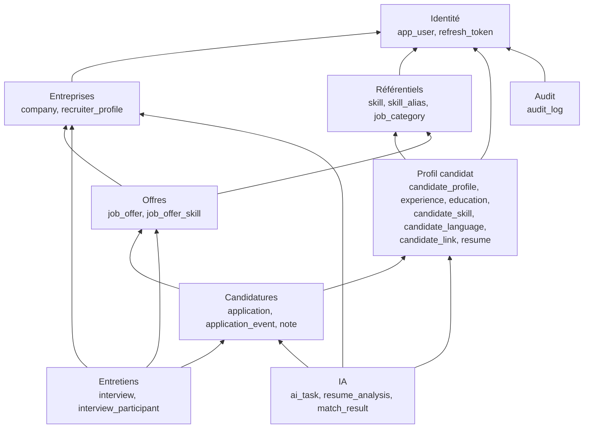
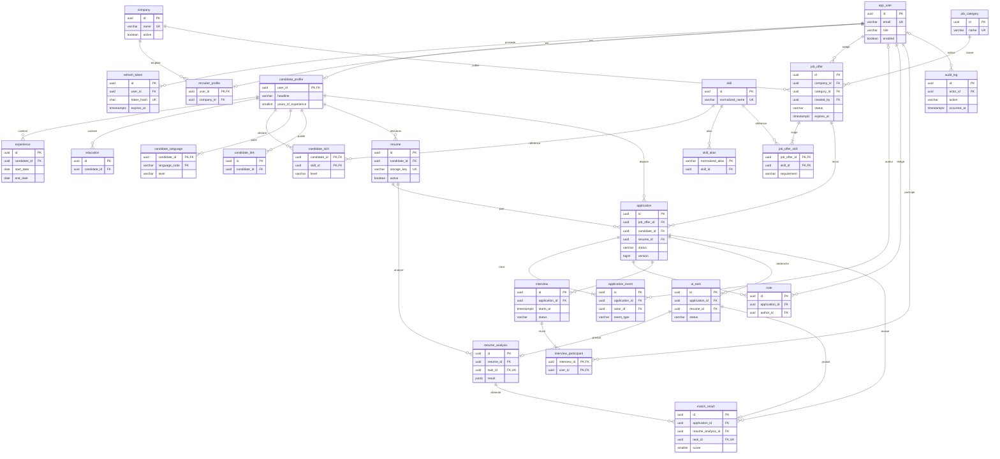

# SmartRecruit — Modèle de données

Oct 19, 2026 · @Hajar

## 0. Conventions

Le modèle compte 25 tables PostgreSQL 18 en troisième forme normale, réparties en 9 modules ; les quelques écarts à la normalisation (un score dénormalisé, des résultats IA en JSONB) sont volontaires et justifiés là où ils apparaissent.

| Sujet | Règle | Pourquoi |
| --- | --- | --- |
| Nommage | Tables et colonnes en `snake_case`, au singulier ; `app_user` au lieu de `user` | `user` est un mot réservé de PostgreSQL |
| Clés primaires | `id UUID DEFAULT uuidv7()` | Identifiants non devinables et sans fuite de volume, mais ordonnés dans le temps, donc efficaces en index ; fonction native depuis PostgreSQL 18 ([source](https://medium.com/@sergeyprokhorenko777/postgresql-gains-a-built-in-uuidv7-generation-function-for-primary-keys-c062c867face)) |
| Clés des tables d'association | Clé composite des deux clés étrangères | Interdit les doublons sans index supplémentaire |
| Profils 1–1 | `candidate_profile` et `recruiter_profile` ont pour clé `user_id` | Garantit au plus un profil par utilisateur |
| Dates-heures | `TIMESTAMPTZ`, en UTC (RG-32) ; `DATE` pour les dates sans heure | Aucune ambiguïté de fuseau |
| Audit technique | `created_at`, `updated_at` sur toute table modifiable | Diagnostic et tri |
| Énumérations | `VARCHAR` + contrainte `CHECK` sur la liste des valeurs | Plus simple à faire évoluer qu'un type `ENUM` PostgreSQL ; correspond à `@Enumerated(STRING)` en JPA |
| Concurrence | Colonne `version BIGINT` sur les tables modifiées par plusieurs personnes | Verrouillage optimiste (`CONCURRENT_MODIFICATION`) |
| Suppressions | Aucune suppression physique des données métier, sauf brouillons et éléments de profil ; notes en suppression logique (`deleted_at`) | Traçabilité ; l'historique ne pointe jamais vers une ligne disparue |
| Clés étrangères | `ON DELETE RESTRICT` par défaut ; `CASCADE` seulement pour les éléments possédés (rubriques d'un profil, compétences d'une offre) | Une suppression accidentelle échoue au lieu de détruire en chaîne |
| Montants | `NUMERIC(12,2)` + devise ISO 4217 | Jamais de flottant pour de l'argent |
| Migrations | Flyway, un script versionné par changement, jamais modifié une fois appliqué | Schéma reproductible (US-02) |

La limitation des tentatives de connexion (US-12) n'a pas de table : en V1 avec une seule instance, un compteur en mémoire suffit. Il faudra le déplacer (base ou cache partagé) le jour où plusieurs instances tourneront.

## 1. Vue d'ensemble

Les 25 tables se regroupent en 9 modules qui préfigurent les paquets du backend (Étape 9) ; chaque flèche va du module qui porte la clé étrangère vers le module référencé.

*(Phase 12)* Schéma redessiné d'après les migrations V1 à V14. Deux clés de plus que dans la conception initiale : `interview` et `ai_task` portent aussi `company_id` (et `interview` porte `job_offer_id`), des copies immuables qui servent au contrôle d'entreprise sans joindre les candidatures, et aux entretiens à venir par entreprise (index `ix_interview_company_starts`).

Les dépendances vont toutes dans le même sens, du métier vers les données de base : Identité ne dépend de rien et les Référentiels seulement d'Identité. C'est ce qui rendra le monolithe modulaire découpable plus tard ; l'IA, par exemple, ne dépend que des candidatures et des CV. Le schéma omet les liens vers `app_user` portés par presque toutes les tables (auteur, demandeur), pour rester lisible.

## 2. ERD complet

Ce diagramme Mermaid liste les 25 tables avec leurs clés et toutes les relations ; il ira tel quel dans `docs/diagrams/erd.md`, où GitHub l'affiche. Notation : `||` exactement un, `o|` zéro ou un, `|{` un ou plusieurs, `o{` zéro ou plusieurs.

Les libellés des relations sont sans accents : certaines versions de Mermaid les acceptent mal dans les identifiants.

## 3. Identité et entreprises

Quatre tables : l'utilisateur porte son rôle en colonne, ses sessions sont des refresh tokens hachés, et un recruteur est rattaché à une entreprise par son profil.

### app\_user

| Colonne | Type | Contraintes | Remarque |
| --- | --- | --- | --- |
| id | UUID | PK, défaut `uuidv7()` |  |
| email | VARCHAR(254) | NOT NULL, unique sur `lower(email)` | Normalisé en minuscules par l'application (RG-01) |
| password\_hash | VARCHAR(100) | NOT NULL | BCrypt fait 60 caractères ; la marge permet le préfixe d'algorithme et un changement futur |
| first\_name | VARCHAR(80) | NOT NULL |  |
| last\_name | VARCHAR(80) | NOT NULL |  |
| role | VARCHAR(16) | NOT NULL, CHECK ADMIN, RECRUITER, CANDIDATE | Un seul rôle (RG-02) |
| enabled | BOOLEAN | NOT NULL, défaut true | Désactivation (RG-03) |
| session\_version | INTEGER | NOT NULL, défaut 0, ≥ 0 | *(V14)* Incrémentée à la désactivation ou au changement d'entreprise : les access tokens d'une version antérieure sont refusés tout de suite (US-48) |
| must\_change\_password | BOOLEAN | NOT NULL, défaut false | Mot de passe temporaire (US-11, US-47) |
| privacy\_accepted\_at | TIMESTAMPTZ | CHECK obligatoire si role = CANDIDATE | Preuve du consentement |
| last\_login\_at | TIMESTAMPTZ |  |  |
| created\_at, updated\_at | TIMESTAMPTZ | NOT NULL |  |
| version | BIGINT | NOT NULL, défaut 0 |  |

### refresh\_token

| Colonne | Type | Contraintes | Remarque |
| --- | --- | --- | --- |
| id | UUID | PK |  |
| user\_id | UUID | NOT NULL, FK → app\_user |  |
| token\_hash | CHAR(64) | NOT NULL, UNIQUE | Empreinte SHA-256 du jeton |
| expires\_at | TIMESTAMPTZ | NOT NULL | Création + 7 jours |
| revoked\_at | TIMESTAMPTZ |  | Rempli à la rotation, à la déconnexion ou en cas de vol suspecté |
| revocation\_reason | VARCHAR(20) | CHECK ROTATED, LOGOUT, PASSWORD\_CHANGED, REUSE\_DETECTED, ACCOUNT\_DISABLED ; non nul si et seulement si `revoked_at` l'est (`ck_refresh_token_revocation`) | Ajoutée par V8 : seul un jeton **tourné** qui revient trahit un vol |
| created\_at | TIMESTAMPTZ | NOT NULL |  |
| created\_ip | INET |  |  |
| user\_agent | VARCHAR(255) |  |  |

Pourquoi une cause de révocation : avant V8, tout jeton révoqué présenté de nouveau déclenchait la révocation de toutes les sessions. Or un onglet resté ouvert après une déconnexion sur un autre appareil présente lui aussi un jeton révoqué, sans aucun vol. Désormais, seul un jeton `ROTATED` réutilisé signifie qu'une copie circule (`REUSE_DETECTED` sur toutes les sessions) ; les autres causes donnent un simple 401.

Pourquoi SHA-256 et pas BCrypt pour ce jeton : il est long et aléatoire, donc impossible à deviner, et il faut le retrouver par égalité. Un hachage lent n'apporte rien ici, contrairement à un mot de passe choisi par un humain.

### company

| Colonne | Type | Contraintes | Remarque |
| --- | --- | --- | --- |
| id | UUID | PK |  |
| name | VARCHAR(120) | NOT NULL, unique sur `lower(name)` |  |
| sector | VARCHAR(80) |  |  |
| size\_range | VARCHAR(16) | CHECK 1-10, 11-50, 51-200, 201-1000, 1000+ |  |
| city | VARCHAR(80) |  |  |
| country\_code | CHAR(2) |  | ISO 3166 |
| website | VARCHAR(255) |  | URL https |
| description | TEXT |  | 5 000 caractères maximum, contrôlé par l'application |
| timezone | VARCHAR(64) | NOT NULL, défaut 'Africa/Casablanca' | Calcul de l'expiration des offres (analyse 6.2) |
| active | BOOLEAN | NOT NULL, défaut true | RG-31 |
| created\_at, updated\_at | TIMESTAMPTZ | NOT NULL |  |
| version | BIGINT | NOT NULL |  |

### recruiter\_profile

| Colonne | Type | Contraintes | Remarque |
| --- | --- | --- | --- |
| user\_id | UUID | PK, FK → app\_user | Relation 1–1 |
| company\_id | UUID | NOT NULL, FK → company | Une seule entreprise (RG-05) |
| job\_title | VARCHAR(120) |  | Ex. « Chargée de recrutement » |
| created\_at, updated\_at | TIMESTAMPTZ | NOT NULL |  |

**Cardinalités** : un utilisateur a 0 ou 1 profil recruteur ; une entreprise a 0 à n recruteurs ; un utilisateur a 0 à n refresh tokens.

**Limite assumée** : la base ne peut pas vérifier qu'un `recruiter_profile` appartient bien à un utilisateur de rôle RECRUITER, car la règle porte sur deux tables. C'est le service de création de compte qui le garantit, et un test d'intégration le vérifie.

## 4. Profil candidat

Sept tables : un profil 1–1 avec l'utilisateur, cinq rubriques possédées par le profil (supprimées avec lui) et les CV versionnés, dont au plus un actif.

### candidate\_profile

| Colonne | Type | Contraintes | Remarque |
| --- | --- | --- | --- |
| user\_id | UUID | PK, FK → app\_user | Relation 1–1 |
| phone | VARCHAR(20) |  | Format E.164 |
| city | VARCHAR(80) |  |  |
| country\_code | CHAR(2) |  | ISO 3166 |
| headline | VARCHAR(120) |  | Titre professionnel, obligatoire pour postuler (RG-09) |
| summary | VARCHAR(2000) |  |  |
| years\_of\_experience | SMALLINT | CHECK 0 à 50 |  |
| created\_at, updated\_at | TIMESTAMPTZ | NOT NULL |  |
| version | BIGINT | NOT NULL |  |

### experience

| Colonne | Type | Contraintes | Remarque |
| --- | --- | --- | --- |
| id | UUID | PK |  |
| candidate\_id | UUID | NOT NULL, FK → candidate\_profile, CASCADE |  |
| job\_title | VARCHAR(120) | NOT NULL |  |
| company\_name | VARCHAR(120) | NOT NULL | Texte libre : l'employeur n'est pas forcément une entreprise de la plateforme |
| city | VARCHAR(80) |  |  |
| start\_date | DATE | NOT NULL |  |
| end\_date | DATE | CHECK end\_date ≥ start\_date | Vide = poste en cours |
| description | VARCHAR(2000) |  |  |

### education

| Colonne | Type | Contraintes | Remarque |
| --- | --- | --- | --- |
| id | UUID | PK |  |
| candidate\_id | UUID | NOT NULL, FK → candidate\_profile, CASCADE |  |
| degree | VARCHAR(120) | NOT NULL | Ex. « Diplôme d'ingénieur d'État » |
| school | VARCHAR(120) | NOT NULL |  |
| field\_of\_study | VARCHAR(120) |  |  |
| start\_year | SMALLINT | CHECK 1950 à 2100 |  |
| end\_year | SMALLINT | CHECK end\_year ≥ start\_year |  |

### candidate\_skill

| Colonne | Type | Contraintes | Remarque |
| --- | --- | --- | --- |
| candidate\_id | UUID | PK (1/2), FK → candidate\_profile, CASCADE |  |
| skill\_id | UUID | PK (2/2), FK → skill | La clé composite interdit les doublons |
| level | VARCHAR(16) | NOT NULL, CHECK BEGINNER, INTERMEDIATE, ADVANCED, EXPERT |  |
| years | SMALLINT | CHECK 0 à 50 |  |

### candidate\_language

| Colonne | Type | Contraintes | Remarque |
| --- | --- | --- | --- |
| candidate\_id | UUID | PK (1/2), FK → candidate\_profile, CASCADE |  |
| language\_code | VARCHAR(3) | PK (2/2) | ISO 639 (fr, en, ar, zgh…) |
| level | VARCHAR(8) | NOT NULL, CHECK A1, A2, B1, B2, C1, C2, NATIVE |  |

### candidate\_link

| Colonne | Type | Contraintes | Remarque |
| --- | --- | --- | --- |
| id | UUID | PK |  |
| candidate\_id | UUID | NOT NULL, FK → candidate\_profile, CASCADE | 5 liens maximum, contrôlé par l'application |
| type | VARCHAR(16) | NOT NULL, CHECK LINKEDIN, GITHUB, PORTFOLIO, OTHER |  |
| url | VARCHAR(255) | NOT NULL, CHECK commence par https:// |  |

### resume

| Colonne | Type | Contraintes | Remarque |
| --- | --- | --- | --- |
| id | UUID | PK |  |
| candidate\_id | UUID | NOT NULL, FK → candidate\_profile | Pas de CASCADE : un CV joint à une candidature doit survivre |
| storage\_key | VARCHAR(100) | NOT NULL, UNIQUE | Nom UUID du fichier dans le stockage, jamais exposé |
| original\_filename | VARCHAR(255) | NOT NULL | Nettoyé, uniquement affiché |
| content\_type | VARCHAR(64) | NOT NULL | application/pdf |
| size\_bytes | INTEGER | NOT NULL, CHECK 1 à 5 242 880 | 5 Mo (RG-07) |
| sha256 | CHAR(64) | NOT NULL | Intégrité ; détecte un même fichier téléversé deux fois |
| active | BOOLEAN | NOT NULL |  |
| uploaded\_at | TIMESTAMPTZ | NOT NULL |  |
| deactivated\_at | TIMESTAMPTZ |  |  |

**Contrainte clé** : index unique partiel `UNIQUE (candidate_id) WHERE active`. La base garantit qu'un candidat n'a jamais deux CV actifs (RG-08), même si deux téléversements arrivent en même temps.

**Cardinalités** : un utilisateur a 0 ou 1 profil candidat ; un profil a 0 à n expériences, formations, compétences, langues, liens et CV ; une compétence du référentiel est utilisée par 0 à n profils.

## 5. Référentiels

Trois tables partagées par tous les modules : les compétences et leurs alias (base du matching) et les catégories d'offres.

### skill

| Colonne | Type | Contraintes | Remarque |
| --- | --- | --- | --- |
| id | UUID | PK |  |
| name | VARCHAR(80) | NOT NULL | Forme affichée : « Spring Boot » |
| normalized\_name | VARCHAR(80) | NOT NULL, UNIQUE | Forme de comparaison : « spring boot » (minuscules, espaces réduits) |
| active | BOOLEAN | NOT NULL, défaut true | Désactivée au lieu d'être supprimée (RG-30) |
| created\_by | UUID | FK → app\_user | Utile pour repérer les créations à vérifier |
| created\_at | TIMESTAMPTZ | NOT NULL |  |

### skill\_alias

| Colonne | Type | Contraintes | Remarque |
| --- | --- | --- | --- |
| normalized\_alias | VARCHAR(80) | PK | « springboot », « spring-boot » |
| skill\_id | UUID | NOT NULL, FK → skill | Compétence cible |

Une fusion (US-51) crée un alias à partir de l'ancien nom, reporte toutes les références et désactive la compétence absorbée. L'IA et la saisie passent par les alias avant de chercher dans `skill`.

### job\_category

| Colonne | Type | Contraintes | Remarque |
| --- | --- | --- | --- |
| id | UUID | PK |  |
| name | VARCHAR(80) | NOT NULL, unique sur `lower(name)` |  |
| active | BOOLEAN | NOT NULL, défaut true | RG-30 |
| created\_at | TIMESTAMPTZ | NOT NULL |  |

## 6. Offres

Deux tables : l'offre, et ses compétences dans une seule table d'association qui distingue requises et souhaitées.

### job\_offer

| Colonne | Type | Contraintes | Remarque |
| --- | --- | --- | --- |
| id | UUID | PK |  |
| company\_id | UUID | NOT NULL, FK → company | Fixée depuis le token (RG-05) |
| category\_id | UUID | NOT NULL, FK → job\_category |  |
| created\_by | UUID | NOT NULL, FK → app\_user | Recruteur auteur |
| title | VARCHAR(150) | NOT NULL |  |
| description | TEXT | NOT NULL | 50 à 10 000 caractères, contrôlé par l'application |
| city | VARCHAR(80) | NOT NULL |  |
| country\_code | CHAR(2) | NOT NULL |  |
| work\_mode | VARCHAR(16) | NOT NULL, CHECK ON\_SITE, HYBRID, REMOTE |  |
| contract\_type | VARCHAR(16) | NOT NULL, CHECK CDI, CDD, INTERNSHIP, FREELANCE, APPRENTICESHIP |  |
| experience\_level | VARCHAR(8) | NOT NULL, CHECK JUNIOR, MID, SENIOR, LEAD |  |
| min\_years\_experience | SMALLINT | NOT NULL, défaut 0, CHECK 0 à 30 | Entrée du sous-score A |
| salary\_min, salary\_max | NUMERIC(12,2) | CHECK salary\_min ≤ salary\_max | Facultatifs |
| salary\_currency | CHAR(3) | défaut 'MAD' | ISO 4217 |
| salary\_period | VARCHAR(8) | CHECK MONTHLY, YEARLY |  |
| salary\_visible | BOOLEAN | NOT NULL, défaut false |  |
| status | VARCHAR(16) | NOT NULL, CHECK DRAFT, PUBLISHED, CLOSED, ARCHIVED |  |
| published\_at | TIMESTAMPTZ | CHECK non nul si status ≠ DRAFT |  |
| expires\_at | TIMESTAMPTZ | CHECK expires\_at > published\_at | Fin de journée dans le fuseau de l'entreprise, en UTC |
| search\_vector | TSVECTOR | Colonne générée (`GENERATED ALWAYS AS … STORED`) | `setweight(to_tsvector('french', immutable_unaccent(title)), 'A') || setweight(…description…, 'B')` |
| created\_at, updated\_at | TIMESTAMPTZ | NOT NULL |  |
| version | BIGINT | NOT NULL |  |

**Fonction `immutable_unaccent(text)`** (V10) : une colonne générée n'accepte que des fonctions `IMMUTABLE`, or `unaccent(text)` est seulement `STABLE` (elle lit le dictionnaire selon le `search_path`). Le wrapper SQL appelle `public.unaccent('public.unaccent'::regdictionary, $1)` avec le dictionnaire qualifié, ce qui rend le résultat indépendant de la session et autorise la déclaration `IMMUTABLE`.

La règle des 180 jours maximum (RG-19) est vérifiée par l'application : elle dépend de la date de publication, connue seulement au moment de publier.

### job\_offer\_skill

| Colonne | Type | Contraintes | Remarque |
| --- | --- | --- | --- |
| job\_offer\_id | UUID | PK (1/2), FK → job\_offer, CASCADE |  |
| skill\_id | UUID | PK (2/2), FK → skill |  |
| requirement | VARCHAR(10) | NOT NULL, CHECK REQUIRED, PREFERRED |  |
| min\_level | VARCHAR(16) | CHECK BEGINNER à EXPERT, NULL si PREFERRED | Niveau attendu pour une compétence requise |

Une seule table avec une colonne `requirement`, plutôt que deux tables : la clé composite interdit qu'une compétence soit à la fois requise et souhaitée, sans aucun code.

**Cardinalités** : une entreprise publie 0 à n offres ; une catégorie classe 0 à n offres ; une offre a 1 à n compétences requises et 0 à n souhaitées.

## 7. Candidatures

Trois tables : la candidature et ses contraintes métier, un journal d'événements qui remplace la simple « table d'historique des statuts », et les notes internes.

### application

| Colonne | Type | Contraintes | Remarque |
| --- | --- | --- | --- |
| id | UUID | PK |  |
| job\_offer\_id | UUID | NOT NULL, FK → job\_offer | RESTRICT : une offre avec candidatures ne se supprime pas (RG-18) |
| candidate\_id | UUID | NOT NULL, FK → candidate\_profile |  |
| resume\_id | UUID | NOT NULL, FK → resume | Version figée à l'envoi (RG-12) |
| status | VARCHAR(16) | NOT NULL, CHECK des 8 statuts |  |
| rejection\_reason | VARCHAR(32) | CHECK PROFILE\_MISMATCH, INSUFFICIENT\_EXPERIENCE, POSITION\_FILLED, CANDIDATE\_UNRESPONSIVE, OTHER |  |
| rejection\_comment | VARCHAR(1000) |  | Interne, jamais exposé au candidat |
| withdrawal\_comment | VARCHAR(1000) |  | Saisi par le candidat |
| last\_match\_score | SMALLINT | CHECK 0 à 100 | Copie du dernier score, pour filtrer la liste (voir ci-dessous) |
| submitted\_at | TIMESTAMPTZ | NOT NULL |  |
| status\_changed\_at | TIMESTAMPTZ | NOT NULL |  |
| created\_at, updated\_at | TIMESTAMPTZ | NOT NULL |  |
| version | BIGINT | NOT NULL | Verrouillage optimiste (US-32) |

**Contraintes métier en base**

- `UNIQUE (job_offer_id, candidate_id)` : une seule candidature par offre (RG-10), garantie même sous concurrence.
- `CHECK (status <> 'REJECTED' OR rejection_reason IS NOT NULL)` : pas de rejet sans motif (RG-14).
- Les transitions autorisées restent dans le code : une contrainte ne voit qu'une ligne, pas son état précédent.
- *(V11)* La contrainte est écrite `(status = 'REJECTED') = (rejection_reason IS NOT NULL)` : elle interdit aussi un motif sur une candidature non rejetée.
- *(V11)* Index `ix_application_resume (resume_id)` : « ce CV est-il joint à une candidature ? » (US-19).

**Pourquoi `last_match_score` est dénormalisé** : filtrer la liste par score sans cette colonne obligerait à joindre, pour chaque ligne, le dernier résultat de matching. La copie est mise à jour dans la même transaction que l'enregistrement du résultat ; la source de vérité reste `match_result`.

### application\_event

| Colonne | Type | Contraintes | Remarque |
| --- | --- | --- | --- |
| id | UUID | PK |  |
| application\_id | UUID | NOT NULL, FK → application |  |
| event\_type | VARCHAR(32) | NOT NULL, CHECK CREATED, STATUS\_CHANGED, NOTE\_ADDED, INTERVIEW\_SCHEDULED, INTERVIEW\_RESCHEDULED, INTERVIEW\_CANCELLED, INTERVIEW\_COMPLETED, AI\_ANALYSIS\_REQUESTED |  |
| from\_status | VARCHAR(16) |  | Pour STATUS\_CHANGED |
| to\_status | VARCHAR(16) |  | Pour CREATED et STATUS\_CHANGED |
| actor\_id | UUID | FK → app\_user | Vide si l'action vient du système |
| details | JSONB |  | Motif, anciennes et nouvelles dates d'entretien… |
| occurred\_at | TIMESTAMPTZ | NOT NULL |  |

Table en ajout seul (RG-24) : l'application n'a aucune requête de mise à jour ou de suppression dessus, et le déclencheur `trg_application_event_immutable` (V11) refuse tout UPDATE ou DELETE, même lancé depuis une console. La contrainte `ck_application_event_statuses` impose `from_status`/`to_status` selon le type d'événement. `from_status` et `to_status` sont de vraies colonnes, pas du JSON, car les indicateurs « embauches de la période » les interrogent (analyse 6.3).

### note

| Colonne | Type | Contraintes | Remarque |
| --- | --- | --- | --- |
| id | UUID | PK |  |
| application\_id | UUID | NOT NULL, FK → application |  |
| author\_id | UUID | NOT NULL, FK → app\_user | Seul l'auteur modifie |
| content | VARCHAR(5000) | NOT NULL |  |
| created\_at, updated\_at | TIMESTAMPTZ | NOT NULL | « modifiée » si updated\_at > created\_at |
| deleted\_at | TIMESTAMPTZ |  | Suppression logique |

**Cardinalités** : une offre reçoit 0 à n candidatures ; un candidat dépose 0 à n candidatures, au plus une par offre ; un CV est joint à 0 à n candidatures ; une candidature a 1 à n événements et 0 à n notes.

## 8. Entretiens

Deux tables : l'entretien, dont les contraintes CHECK encodent les règles de lieu et de clôture, et ses participants internes.

### interview

| Colonne | Type | Contraintes | Remarque |
| --- | --- | --- | --- |
| id | UUID | PK |  |
| application\_id | UUID | NOT NULL, FK → application |  |
| company\_id, job\_offer\_id | UUID | NOT NULL, FK | *(V12, écart)* Copies immuables de la candidature : agenda de l'entreprise et filtre par offre sans joindre le module Candidatures |
| scheduled\_by | UUID | NOT NULL, FK → app\_user |  |
| starts\_at | TIMESTAMPTZ | NOT NULL | UTC |
| duration\_minutes | SMALLINT | NOT NULL, CHECK 15 à 240 |  |
| type | VARCHAR(16) | NOT NULL, CHECK PHONE, VIDEO, ON\_SITE, TECHNICAL |  |
| meeting\_url | VARCHAR(500) | CHECK obligatoire si type = VIDEO |  |
| address | VARCHAR(255) | CHECK obligatoire si type = ON\_SITE |  |
| candidate\_instructions | VARCHAR(1000) |  | Visible par le candidat |
| status | VARCHAR(16) | NOT NULL, CHECK SCHEDULED, COMPLETED, CANCELLED |  |
| cancellation\_reason | VARCHAR(500) |  |  |
| feedback\_rating | VARCHAR(8) | CHECK POSITIVE, NEUTRAL, NEGATIVE ; obligatoire si COMPLETED | Interne (RG-23) |
| feedback\_comment | VARCHAR(2000) |  | Interne |
| completed\_at | TIMESTAMPTZ |  |  |
| created\_at, updated\_at | TIMESTAMPTZ | NOT NULL |  |
| version | BIGINT | NOT NULL |  |

### interview\_participant

| Colonne | Type | Contraintes | Remarque |
| --- | --- | --- | --- |
| interview\_id | UUID | PK (1/2), FK → interview, CASCADE |  |
| user\_id | UUID | PK (2/2), FK → app\_user | Recruteur de la même entreprise, vérifié par l'application |

**Cardinalités** : une candidature a 0 à n entretiens ; un entretien a 1 à n participants ; un recruteur participe à 0 à n entretiens.

*(V12)* Contraintes : `ck_interview_video_url` (lien commençant par `https://` pour VIDEO), `ck_interview_address`, `ck_interview_completion` (avis et date de clôture présents si et seulement si COMPLETED). Index `ix_interview_application (application_id, status)` pour RG-33 et `ix_interview_company_starts (company_id, starts_at)` pour l'agenda. La table `note` reçoit une colonne `version` et les contraintes `ck_note_content` (1 à 5 000 caractères non blancs) et `ck_note_dates`.

## 9. IA

Trois tables : les tâches asynchrones, les analyses de CV rattachées à une version de CV, et les résultats de matching rattachés à une candidature. Les résultats produits par le modèle sont en JSONB.

### ai\_task

| Colonne | Type | Contraintes | Remarque |
| --- | --- | --- | --- |
| id | UUID | PK |  |
| type | VARCHAR(16) | NOT NULL, CHECK RESUME\_ANALYSIS, MATCHING |  |
| application\_id | UUID | NOT NULL, FK → application | Contexte et contrôle d'accès |
| resume\_id | UUID | NOT NULL, FK → resume |  |
| requested\_by | UUID | NOT NULL, FK → app\_user | RG-27 |
| status | VARCHAR(16) | NOT NULL, CHECK PENDING, RUNNING, DONE, FAILED |  |
| error\_code | VARCHAR(32) | CHECK non nul si FAILED | AI\_UNAVAILABLE, AI\_INVALID\_RESPONSE, FILE\_UNREADABLE |
| created\_at | TIMESTAMPTZ | NOT NULL |  |
| started\_at, finished\_at | TIMESTAMPTZ |  | Mesure des temps d'analyse |

### resume\_analysis

| Colonne | Type | Contraintes | Remarque |
| --- | --- | --- | --- |
| id | UUID | PK |  |
| resume\_id | UUID | NOT NULL, FK → resume | Une analyse vaut pour une version de CV, quelle que soit l'offre |
| task\_id | UUID | NOT NULL, UNIQUE, FK → ai\_task |  |
| model\_name | VARCHAR(80) | NOT NULL | Ex. nom et version du modèle Ollama |
| prompt\_version | VARCHAR(16) | NOT NULL | Les prompts sont versionnés dans le code |
| input\_sha256 | CHAR(64) | NOT NULL | Empreinte du texte pseudonymisé envoyé |
| result | JSONB | NOT NULL | Compétences (avec skill\_id et extrait), expériences, formations, langues, synthèse |
| created\_at | TIMESTAMPTZ | NOT NULL |  |

### match\_result

| Colonne | Type | Contraintes | Remarque |
| --- | --- | --- | --- |
| id | UUID | PK |  |
| application\_id | UUID | NOT NULL, FK → application | Le matching compare le CV joint à l'offre de la candidature |
| resume\_analysis\_id | UUID | NOT NULL, FK → resume\_analysis | Données d'entrée utilisées |
| task\_id | UUID | NOT NULL, UNIQUE, FK → ai\_task |  |
| score | SMALLINT | NOT NULL, CHECK 0 à 100 | Calculé par le backend |
| required\_coverage | NUMERIC(4,3) | NOT NULL, CHECK 0 à 1 | C\_req |
| preferred\_coverage | NUMERIC(4,3) | CHECK 0 à 1 | C\_souh, vide si aucune compétence souhaitée |
| experience\_fit | NUMERIC(4,3) | NOT NULL, CHECK 0 à 1 | A |
| formula\_version | VARCHAR(16) | NOT NULL | Pour expliquer un ancien score après une évolution de la formule |
| matched\_skills, missing\_skills | JSONB | NOT NULL | Avec la source (profil ou CV) |
| explanation | JSONB | NOT NULL | Points forts, points faibles, synthèse |
| model\_name, prompt\_version | VARCHAR | NOT NULL | Pour la partie rédigée par le modèle |
| created\_at | TIMESTAMPTZ | NOT NULL |  |

*(V13, écarts)* `ai_task` reçoit `company_id` (copie immuable, contrôle d'accès sans joindre le module Candidatures) et `version` (deux exécuteurs ne prennent jamais la même tâche) ; `ck_ai_task_error` lie `error_code` au statut FAILED ; index partiel `ix_ai_task_active` sur les tâches PENDING ou RUNNING. `match_result.resume_analysis_id` peut être vide : un CV scanné donne un matching calculé sur le seul profil. `application` reçoit `last_matched_at`, écrite avec `last_match_score` par une mise à jour ciblée qui ne change pas la version.

**Pourquoi du JSONB ici et pas ailleurs** : ces résultats sont des documents produits d'un bloc, lus d'un bloc, jamais modifiés et dont la forme évoluera avec les prompts. Les éclater en tables apporterait des jointures sans aucune requête qui en profite. À l'inverse, tout ce qui est filtré ou agrégé (score, couvertures, statut) est en colonnes.

**Cardinalités** : une candidature a 0 à n tâches et 0 à n résultats de matching ; un CV a 0 à n analyses ; une analyse sert à 0 à n matchings.

## 10. Audit

Une table en ajout seul, volontairement peu liée au reste : elle doit rester lisible même si une ressource auditée change ou disparaît.

### audit\_log

| Colonne | Type | Contraintes | Remarque |
| --- | --- | --- | --- |
| id | UUID | PK |  |
| occurred\_at | TIMESTAMPTZ | NOT NULL |  |
| actor\_id | UUID | FK → app\_user, ON DELETE SET NULL | Vide pour un visiteur anonyme |
| actor\_email | VARCHAR(254) |  | Copie au moment de l'action, pour les connexions échouées à un email inconnu |
| action | VARCHAR(64) | NOT NULL | LOGIN, LOGOUT, TOKEN\_REUSE\_DETECTED, USER\_CREATED, USER\_DISABLED, RESUME\_DOWNLOADED, AI\_ANALYSIS\_REQUESTED, JOB\_PUBLISHED… |
| resource\_type | VARCHAR(32) |  | USER, COMPANY, JOB\_OFFER, APPLICATION, RESUME, SKILL |
| resource\_id | UUID |  | Pas de clé étrangère : la ressource peut être de n'importe quel type |
| result | VARCHAR(8) | NOT NULL, CHECK SUCCESS, FAILURE |  |
| ip\_address | INET |  |  |
| correlation\_id | VARCHAR(64) |  | Relie l'entrée aux logs applicatifs |
| details | JSONB |  | Jamais de mot de passe, de token ni de contenu de CV |

*(V14)* Le déclencheur `trg_audit_log_immutable` refuse tout UPDATE ou DELETE, même lancé depuis une console (RG-24, US-53). Seule exception : la mise à nul de `actor_id` par `ON DELETE SET NULL`, pour qu'un compte puisse un jour être supprimé (droit à l'effacement) sans perdre la trace. Index `ix_audit_log_result (result, occurred_at DESC)` pour le filtre par résultat.

La conservation de 12 mois sera appliquée par une purge planifiée en V2, par une fonction dédiée qui désactive le déclencheur le temps de la purge. Si le volume devenait important, la table pourrait être partitionnée par mois ; ce n'est pas justifié au volume de démonstration.

## 11. Index

PostgreSQL indexe automatiquement les clés primaires et les contraintes UNIQUE, mais pas les clés étrangères ; chaque index ci-dessous existe parce qu'une requête identifiée en a besoin.

| Table | Index | Requête servie |
| --- | --- | --- |
| app\_user | UNIQUE `(lower(email))` | Connexion, unicité de l'email |
| refresh\_token | `(user_id)` | Révoquer toutes les sessions d'un utilisateur |
| company | UNIQUE `(lower(name))` | Unicité du nom |
| recruiter\_profile | `(company_id)` | Recruteurs d'une entreprise, désactivation en cascade (RG-31) |
| experience, education, candidate\_link | `(candidate_id)` | Chargement du profil |
| candidate\_skill | `(skill_id)` | Fusion de compétences, filtre « compétence » côté recruteur |
| resume | UNIQUE partiel `(candidate_id) WHERE active` | CV actif, garantie RG-08 |
| job\_offer | `(status, expires_at)` | Recherche publique : offres ouvertes |
| job\_offer | GIN `(search_vector)` | Recherche plein texte (US-25) |
| job\_offer | `(company_id, status)` | Offres de l'entreprise, tableau de bord recruteur |
| job\_offer\_skill | `(skill_id, requirement)` | Filtre des offres par compétence |
| application | UNIQUE `(job_offer_id, candidate_id)` | RG-10 ; sert aussi « candidatures d'une offre » |
| application | `(resume_id)` | CV joint à une candidature (US-19) |
| application | `(job_offer_id, status)` | Liste et compteurs par statut |
| application | `(candidate_id, submitted_at DESC)` | « Mes candidatures » |
| application\_event | `(application_id, occurred_at DESC)` | Chronologie d'un dossier |
| application\_event | `(to_status, occurred_at)` WHERE event\_type = 'STATUS\_CHANGED' | Embauches de la période |
| note | `(application_id)` WHERE deleted\_at IS NULL | Notes visibles d'un dossier |
| interview | `(application_id, status)` | Entretiens d'un dossier ; RG-33 |
| interview | `(company_id, starts_at)` | Agenda de l'entreprise |
| interview\_participant | `(user_id)` | Agenda d'un recruteur |
| ai\_task | `(status)` WHERE status IN ('PENDING', 'RUNNING') | Rattrapage des tâches orphelines au démarrage |
| resume\_analysis | `(resume_id, created_at DESC)` | Dernière analyse d'un CV |
| match\_result | `(application_id, created_at DESC)` | Dernier matching d'une candidature |
| audit\_log | `(occurred_at DESC)`, `(actor_id, occurred_at DESC)`, `(action, occurred_at DESC)` | Consultation filtrée du journal |

Les index partiels (`WHERE …`) n'indexent que les lignes utiles : l'index des tâches en cours reste minuscule même après des milliers d'analyses.

Ces choix seront vérifiés avec `EXPLAIN ANALYZE` sur le volume de démonstration, pas supposés corrects.

### Migrations livrées

| Version | Contenu | Phase |
| --- | --- | --- |
| V1 à V3 | Extensions (`unaccent`, `pg_trgm`), audit, identité | 2-3 |
| V4 à V7 | Profil candidat, référentiels, sections du profil, données de départ (12 catégories, 48 compétences, 41 alias) | 4 |
| V8 | `refresh_token.revocation_reason` (correctif de la détection de vol, US-08) | 5 |
| V9 | `company`, `recruiter_profile` | 5 |
| V10 | `immutable_unaccent`, `job_offer` (avec `search_vector`), `job_offer_skill` | 5 |
| V11 | `application`, `application_event` (immuable par déclencheur) | 6 |
| V12 | `interview`, `interview_participant`, `note` | 7 |
| V13 | `ai_task`, `resume_analysis`, `match_result`, `application.last_matched_at` | 8 |
| V14 | `app_user.session_version`, motif de révocation `COMPANY_CHANGED`, déclencheur `trg_audit_log_immutable`, index `ix_app_user_role_enabled`, `ix_audit_log_result`, `ix_job_offer_category` | 10 |

Une migration publiée n'est jamais modifiée : le correctif de la phase 3 est une nouvelle version (V8), pas une retouche de V3.

## 12. Écarts par rapport à la liste du prompt

Ta liste de 15 entités est couverte ; deux sont transformées et onze tables s'ajoutent, chacune imposée par une règle ou un cas d'utilisation.

| Entité du prompt | Dans le modèle | Raison |
| --- | --- | --- |
| Role | Colonne `app_user.role` | Trois rôles fixes, un seul par utilisateur (G-3), droits définis dans le code : une table n'ajouterait qu'une jointure. Une table rôle + permissions reviendra si la V3 rend les droits configurables |
| ApplicationStatusHistory | `application_event` | Un seul journal pour tous les événements d'un dossier (statuts, notes, entretiens, IA) ; les changements de statut restent requêtables par colonnes |
| User, CandidateProfile, RecruiterProfile, Company, JobOffer, Skill, Experience, Education, Application, Interview, Note, Resume, AuditLog | Tables homonymes | — |

| Table ajoutée | Exigée par |
| --- | --- |
| refresh\_token | Rotation et révocation des sessions (US-08, US-09) |
| skill\_alias | Fusion des doublons et rattachement des compétences extraites par l'IA (US-51, matching) |
| job\_category | Catégories gérées par l'admin (US-50) |
| job\_offer\_skill | Compétences requises et souhaitées (RG-20, matching) |
| candidate\_skill, candidate\_language, candidate\_link | Rubriques multiples du profil (US-15, US-16) |
| interview\_participant | Plusieurs participants par entretien (F-INT-01) |
| ai\_task | Traitement asynchrone (G-7) |
| resume\_analysis, match\_result | Traçabilité des résultats IA (RG-27) |

## 13. Ce que tu dois savoir défendre

**« Pourquoi des UUID plutôt que des entiers auto-incrémentés ? »** Un entier révèle le volume (« candidature n° 1042 ») et se devine. Un UUID aléatoire (v4) disperse les insertions dans l'index et le ralentit. Le v7 commence par un horodatage : il garde l'unicité et l'opacité tout en s'insérant dans l'ordre, comme un entier. Attention : l'opacité n'est pas une sécurité, le contrôle de propriété reste obligatoire.

**« Qu'est-ce que la troisième forme normale, et où t'en écartes-tu ? »** Chaque colonne dépend de la clé, de toute la clé et de rien d'autre que la clé. Je m'en écarte une fois, avec `last_match_score`, pour filtrer sans jointure coûteuse ; la copie est mise à jour dans la même transaction que la source.

**« Quelles règles métier sont garanties par la base, et pourquoi pas toutes ? »** Celles qui portent sur une ligne ou un ensemble de lignes à un instant : unicité de la candidature, un seul CV actif, motif de rejet, lien obligatoire pour une visio. Les transitions de statut restent dans le code, car une contrainte ne connaît pas l'état précédent. La règle d'or : tout ce qui peut être violé par deux requêtes simultanées doit être garanti par la base.

**« Pourquoi pas de CASCADE partout ? »** Une suppression en cascade peut effacer un historique entier par erreur. RESTRICT fait échouer la suppression, ce qui est le comportement sûr. La cascade est réservée aux éléments qui n'ont aucun sens sans leur parent, comme les compétences d'une offre en brouillon.

**« Quand utilises-tu JSONB ? »** Pour des documents lus en entier, jamais filtrés et dont la forme évolue, comme les résultats IA. Dès qu'une valeur sert à filtrer, trier ou agréger, elle devient une colonne.

**« Une clé étrangère est-elle indexée automatiquement ? »** Non, dans PostgreSQL seule la clé primaire et les contraintes UNIQUE le sont. Sans index sur la clé étrangère, les jointures et les suppressions sur le parent deviennent lentes ; d'où la section 11.
