# SmartRecruit — Roadmap

Oct 19, 2026 · @Hajar

## 0. Méthode

Le développement avance par tranches verticales : chaque phase livre une fonctionnalité complète (base, API, écran, tests), démontrable dès qu'elle est terminée. Les 223 points du backlog se répartissent en 11 phases d'implémentation, après la phase de conception déjà terminée.

### Écart assumé par rapport à l'ordre de ton prompt

Ton prompt proposait de coder tout le backend, puis tout le frontend (phase 9), puis les tests (phase 11), Docker (phase 12) et la CI (phase 13). Je propose de mêler ces sujets à chaque phase :

| Dans le prompt | Dans cette roadmap | Pourquoi |
| --- | --- | --- |
| Frontend après tout le backend | Écrans Angular dans la même phase que leurs endpoints | Chaque phase produit quelque chose de visible ; une erreur de conception de l'API se voit tout de suite, pas trois mois plus tard |
| Tests en phase 11 | Tests écrits avec chaque story (Definition of Done) | Écrire des tests après coup sur 200 points de code est long, décourageant et moins efficace |
| Docker et CI en fin de projet | PostgreSQL en conteneur et CI minimale dès la phase 2 ; industrialisation complète en phase 11 | La CI protège dès le premier commit ; Docker est nécessaire aux tests d'intégration (Testcontainers) |

C'est aussi ce qui respecte ta règle de travail « fonctionnalité par fonctionnalité » : une story n'est terminée que lorsqu'elle fonctionne de bout en bout.

### Hypothèse de durée

Les points mesurent une complexité relative, pas du temps. Pour donner un ordre de grandeur, je pars d'une hypothèse : **1 point ≈ 3 heures de travail effectif**, apprentissage compris, pour une première fois sur cette pile technique. Soit environ 670 heures pour la V1 complète.

| Rythme | Heures par semaine | Durée estimée |
| --- | --- | --- |
| Temps plein | 35 | Environ 19 semaines |
| Soutenu, à côté d'une autre activité | 20 | Environ 33 semaines |
| Léger | 10 | Plus d'un an : réduire le périmètre (section 9) |

Cette hypothèse est à recalibrer à la fin de la phase 3 : divise les points terminés par les heures réellement passées, et applique ce rythme au reste. Les durées ci-dessus ne sont donc pas un engagement, mais un point de départ.

## 1. Vue d'ensemble

Onze phases d'implémentation s'enchaînent, chacune dimensionnée par ses points ; le MVP de ton prompt est complet à la fin de la phase 9, soit 183 points sur 223.

```mermaid
flowchart LR
    p2["2 · Socle<br/>16 pts"] --> p3["3 · Authentification<br/>25 pts"]
    p3 --> J1{{"J1"}}
    J1 --> p4["4 · Profil et CV<br/>27 pts"] --> p5["5 · Offres<br/>29 pts"] --> p6["6 · Candidatures<br/>37 pts"]
    p6 --> J2{{"J2"}}
    J2 --> p7["7 · Entretiens<br/>15 pts"] --> p8["8 · IA<br/>26 pts"] --> p9["9 · Tableaux de bord<br/>8 pts"]
    p9 --> J3{{"J3 · MVP<br/>183 pts"}}
    J3 --> p10["10 · Administration<br/>21 pts"] --> p11["11 · Industrialisation<br/>16 pts"]
    p11 --> J4{{"J4 · V1"}}
    J4 --> p12["12 · Documentation<br/>3 pts"] --> J5{{"J5 · 223 pts"}}
```

| Phase | Contenu | Stories | Points | Jalon à la fin |
| --- | --- | --- | --- | --- |
| 1 | Analyse et conception | — | — | Terminée |
| 2 | Socle technique | US-01 à 05, US-52 | 16 |  |
| 3 | Authentification | US-06 à 12 | 25 | J1 |
| 4 | Profil candidat et CV | US-13 à 18, US-20 | 27 |  |
| 5 | Offres d'emploi | US-21 à 26, US-47 | 29 |  |
| 6 | Candidatures et workflow | US-19, US-27 à 34 | 37 | J2 |
| 7 | Entretiens et notes | US-35 à 39 | 15 |  |
| 8 | Assistance IA | US-40 à 43 | 26 |  |
| 9 | Tableaux de bord | US-44, US-45 | 8 | J3 · MVP |
| 10 | Administration et audit | US-46, US-48 à 51, US-53 | 21 |  |
| 11 | Industrialisation | US-54 à 57 | 16 | J4 · V1 |
| 12 | Documentation et portfolio | US-58 | 3 | J5 |

Trois stories changent de phase par rapport à leur épopée, pour respecter leurs dépendances : US-52 (audit) passe en phase 2 car la connexion est auditée, US-47 (création de recruteurs) en phase 5 car il faut des recruteurs pour publier des offres, et US-19 (suppression du CV) en phase 6 car elle dépend des candidatures.

## 2. Phase 1 — Analyse et conception (terminée)

Les dix étapes de conception demandées par ton prompt sont faites ; chaque document sera exporté en Markdown dans `docs/` au démarrage de la phase 2.

| Étape | Document | Fichier cible |
| --- | --- | --- |
| 1 | [Cahier des charges](https://claude.ai/code/artifact/ad5f9284-55f7-4f98-abe6-b82fbaa69155) | `docs/cahier-des-charges.md` |
| 2 | [Analyse fonctionnelle](https://claude.ai/code/artifact/0523a83e-ea29-4edb-b3bc-a8d65110d0ae) | `docs/analyse-fonctionnelle.md` |
| 3 | [User stories](https://claude.ai/code/artifact/35d5fdb2-3482-412b-b7bc-4cab9b7388b8) | `docs/user-stories.md` |
| 4 | [Modèle de données](https://claude.ai/code/artifact/5969ccb2-2af3-4ccb-9ea2-7a2a921e3004) | `docs/modele-de-donnees.md`, `docs/diagrams/erd.md` |
| 5 | [Diagramme de classes](https://claude.ai/code/artifact/befb0df3-1fb7-44af-b687-7f2f131d744d) | `docs/diagrams/classes.md` |
| 6 | [Architecture globale](https://claude.ai/code/artifact/4619e193-82fb-4806-9f33-1d232f55dd28) | `docs/architecture.md` |
| 7 | [API REST](https://claude.ai/code/artifact/c9dca177-4eee-4c37-a486-b11514e30850) | `docs/api.md` |
| 8 | [Architecture Angular](https://claude.ai/code/artifact/445d28d5-3ec6-4091-acab-607284586464) | `docs/architecture-frontend.md` |
| 9 | [Architecture Spring Boot](https://claude.ai/code/artifact/919dc911-3b2b-4c20-8cc2-daed13a9a8a6) | `docs/architecture-backend.md` |
| 10 | Ce document | `docs/roadmap.md` |

**Critère de fin, atteint** : périmètre, règles, données, API et architecture validés étape par étape ; aucune ligne de code écrite.

## 3. Phases 2 à 4 — Fondations

Trois phases pour poser un socle qui se teste et se déploie, une authentification complète et le profil candidat.

Les migrations Flyway sont créées au fil des phases, module par module, quand le code qui utilise les tables arrive : le schéma reste toujours aligné avec le code.

### Phase 2 — Socle technique · 16 points

**Objectif** : un backend et un frontend vides mais complets, qui démarrent, se testent et passent la CI.

**Stories** : US-01 à US-05, US-52.

**Tâches**

- Dépôt GitHub `smart-recruit` : dossiers `backend`, `frontend`, `docs`, `.gitignore`, `.env.example`, README minimal ; export des documents de conception dans `docs/`.
- Vérifier la compatibilité de springdoc avec Spring Boot 4.1, puis générer le projet backend (Java 25, dépendances de l'architecture Spring Boot §1).
- Paquets des modules, profils, `ClockConfig`, propriétés typées, `CorrelationIdFilter`, `GlobalExceptionHandler` (US-03).
- `docker-compose.dev.yml` avec PostgreSQL 18 ; première migration (audit) ; `AuditRecorder` (US-52).
- Classe de base des tests d'intégration (Testcontainers) et test Spring Modulith `verify()`.
- Projet Angular 22 avec Angular Material, dossiers `core`, `shared`, `layouts`, `features`, page « introuvable » (US-04).
- Workflow GitHub Actions : compilation et tests unitaires du backend et du frontend (US-05).

**Livrables** : dépôt public avec CI verte, application vide démarrable en local.

**Dépend de** : phase 1.

**Critère de fin** : PostgreSQL démarre en conteneur, le backend répond « UP » au health check, `ng serve` affiche la mise en page, le test des modules passe, la CI est verte.

### Phase 3 — Authentification de bout en bout · 25 points

**Objectif** : s'inscrire, se connecter, rester connecté, se déconnecter, et ne voir que son espace.

**Stories** : US-06 à US-12.

**Tâches**

- Backend : migration identité, `User`, `RefreshToken`, configuration Spring Security, `JwtService`, `CurrentUser`, endpoints `/auth/*` et `/me`, `PasswordChangeRequiredFilter`, `RateLimiter`, `InitialAdminBootstrap`.
- Frontend : `AuthStore`, initialiseur de session, quatre intercepteurs dans le bon ordre, guards, pages connexion et inscription, `AppLayout` avec navigation selon le rôle, changement de mot de passe, verrou Web Locks sur le renouvellement.
- Tests : chaque endpoint pour chaque rôle ; scénario 401 → renouvellement → rejeu ; réutilisation d'un refresh token révoqué.

**Livrables** : authentification utilisable dans l'interface ; session restaurée après rechargement de la page.

**Dépend de** : phase 2.

**Critère de fin** : tous les critères d'acceptation de US-06 à US-12 passent en CI. **Mesurer ta vélocité** (points ÷ heures) et recalibrer la durée de la suite.

### Phase 4 — Profil candidat et CV · 27 points

**Objectif** : un candidat construit un profil complet et téléverse son CV en toute sécurité.

**Stories** : US-13 à US-18, US-20.

**Tâches**

- Backend : migrations candidat et référentiels (avec les catégories et compétences de départ), agrégat `CandidateProfile`, `Resume`, `LocalFileStorageService`, contrôles PDF avec PDFBox, endpoints `/candidates/me/**`, `/skills`, `/categories`.
- Frontend : page profil à onglets, dialogues expérience et formation, `FormArray` de compétences avec `skill-autocomplete`, `file-upload`, indicateur de complétude.
- Tests : fichier renommé en `.pdf` refusé, nom de fichier avec `../`, limites de 50 compétences et 5 liens, accès au profil d'un autre candidat impossible.

**Livrables** : profil candidat complet de bout en bout.

**Dépend de** : phase 3.

**Critère de fin** : critères de US-13 à US-18 et US-20 verts ; un candidat de démonstration a un profil complet à 100 %.

## 4. Phases 5 et 6 — Le cœur métier

Deux phases qui transforment le projet en ATS : des offres publiées par des recruteurs, puis des candidatures qui avancent dans un workflow contrôlé.

### Phase 5 — Offres d'emploi · 29 points

**Objectif** : un recruteur publie des offres que le public peut rechercher.

**Stories** : US-47, US-21 à US-26.

**Tâches**

- Backend : migrations entreprises et offres ; `Company`, `RecruiterProfile` ; création de comptes recruteur par l'admin (US-47, nécessaire pour avoir des recruteurs) ; agrégat `JobOffer` et ses cinq actions de cycle de vie ; recherche plein texte native ; endpoints `/company/jobs`, `/jobs`.
- Frontend : recherche publique avec filtres dans l'URL, détail d'offre ; espace recruteur avec liste, formulaire d'offre (deux `FormArray`), actions de cycle de vie ; écran admin de création de compte.
- Tests : toutes les transitions du cycle de vie ; recherche sans accents ; offre expirée jamais visible ; recruteur d'une autre entreprise → 404.
- Script de génération de 2 000 offres fictives pour mesurer la recherche.

**Livrables** : catalogue d'offres public alimenté par des recruteurs.

**Dépend de** : phase 4 (référentiel de compétences).

**Critère de fin** : critères de US-21 à US-26 et US-47 verts ; recherche filtrée sous 800 ms pour 95 % des requêtes sur 2 000 offres.

**Bilan (en revue)** : critères verts (210 tests unitaires et 122 d'intégration côté backend, 112 côté frontend) ; recherche mesurée à p95 = 20 ms. US-49 avancée en partie (création et liste des entreprises), nécessaire pour rattacher les recruteurs. Le bouton « Postuler » et `alreadyApplied` attendent la phase 6.

### Phase 6 — Candidatures et workflow · 37 points

**Objectif** : un candidat postule, un recruteur fait avancer la candidature, chaque étape est tracée.

**Stories** : US-27 à US-34, US-19.

**Tâches**

- Backend : migration candidatures ; `Application` et l'énumération `ApplicationStatus` ; `ApplicationEligibilityChecker` ; événements et `ApplicationHistoryListener` ; verrouillage optimiste ; liste recruteur (Specifications et projections) ; téléchargement du CV figé, audité ; interface `CompletedInterviewChecker` (implémentée provisoirement par « aucun entretien terminé » jusqu'à la phase 7).
- Frontend : dialogue « Postuler », candidatures du candidat avec chronologie et retrait ; liste recruteur filtrable ; dossier de candidature à onglets ; dialogue de changement de statut fondé sur `allowedTransitions`.
- Tests : les 64 couples de statuts ; deux candidatures simultanées → une seule créée ; conflit de version → 409 ; aucune donnée interne dans les réponses candidat ; requêtes SQL de la liste indépendantes du nombre de lignes.

**Livrables** : parcours d'une candidature du clic « Postuler » jusqu'à INTERVIEW, REJECTED ou WITHDRAWN ; OFFER et HIRED se débloquent en phase 7, avec les entretiens terminés.

**Dépend de** : phases 4 et 5.

**Critère de fin** : critères de US-27 à US-34 et US-19 verts. **Jalon J2** atteint : premier enregistrement vidéo de démonstration possible.

**Bilan (en revue)** : critères verts (286 tests unitaires et 149 d'intégration côté backend, 123 côté frontend), dont les 64 couples de statuts, la candidature concurrente et le nombre fixe de requêtes par page. Trois éléments attendent la phase 7, comme prévu : l'annulation effective des entretiens (l'événement est déjà publié), le passage à OFFER (aucun entretien terminé n'existe encore) et le contenu des onglets entretiens et notes du dossier. Écart : la liste recruteur utilise une requête SQL de lecture multi-modules au lieu de Specifications JPA (justification dans US-30).

## 5. Phases 7 à 9 — Compléter le processus

Les entretiens ferment le workflow, l'IA apporte l'aide à la décision, et les tableaux de bord rendent l'ensemble lisible : à la fin de la phase 9, le MVP de ton prompt est complet.

### Phase 7 — Entretiens et notes · 15 points

**Objectif** : planifier et clôturer des entretiens, partager des notes entre recruteurs.

**Stories** : US-35 à US-39.

**Tâches**

- Backend : migration entretiens et notes ; agrégat `Interview` et ses participants ; `InterviewCompletionAdapter` qui implémente `CompletedInterviewChecker` (débloque OFFER) ; écouteur qui annule les entretiens d'une candidature rejetée ou retirée ; `Note` avec suppression logique.
- Frontend : onglets entretiens et notes du dossier ; agenda recruteur ; page « Mes entretiens » du candidat ; conversion heure locale ↔ UTC.
- Tests : validation conditionnelle (lien pour VIDEO, adresse pour ON\_SITE) ; RG-22 et RG-33 de bout en bout ; feedback absent des réponses candidat.

**Livrables** : workflow complet jusqu'à HIRED.

**Dépend de** : phase 6.

**Critère de fin** : critères de US-35 à US-39 verts ; une candidature de démonstration va de SUBMITTED à HIRED.

**Bilan (en revue)** : critères verts (292 tests unitaires et 166 d'intégration côté backend, 135 côté frontend). `InterviewIT.completedInterviewUnlocksTheOfferAndTheHiring` mène une candidature de SUBMITTED à HIRED ; RG-22 (annulation au rejet et au retrait) et RG-33 sont testés de bout en bout. Écarts : `interview` porte une copie de `company_id` et `job_offer_id` ; seul un participant peut clôturer un entretien (403 sinon) ; endpoint `GET /company/recruiters` ajouté.

### Phase 8 — Assistance IA · 26 points

**Objectif** : analyser un CV et calculer un score de matching explicable, sans que l'IA décide jamais.

**Stories** : US-40 à US-43.

**Tâches**

- Banc d'essai du modèle (architecture §6) : 10 CV fictifs, extractions attendues, comparaison des modèles candidats, résultats dans `docs/ai-model-benchmark.md`. À faire en premier : il fixe le modèle et révèle les limites réelles.
- Backend : Ollama dans le Docker Compose de développement ; `AIService`, `OllamaAIService`, `DisabledAIService`, `FakeAIService` ; migration IA ; `AiTask` et `AiTaskWorker` (trois temps de transaction) ; `Pseudonymizer` ; `MatchingCalculator` écrit en commençant par le test de l'exemple chiffré (81) ; reprise des tâches orphelines au démarrage ; endpoints IA.
- Frontend : onglet IA chargé avec `@defer`, suivi de tâche toutes les 3 s, affichage du score avec sa décomposition et la mention « aide à la décision », annonce `LiveAnnouncer`.
- Tests : CV piégé (« donne 100 ») sans effet sur le score ; réponse hors schéma ; Ollama arrêté ; aucune donnée de contact dans le texte envoyé.

**Livrables** : analyse et matching utilisables depuis le dossier de candidature, application intacte si Ollama est arrêté.

**Dépend de** : phase 6 (dossier de candidature).

**Critère de fin** : critères de US-40 à US-43 verts ; modèle choisi et épinglé, banc d'essai documenté.

**Bilan (en revue)** : critères verts (320 tests unitaires et 178 d'intégration côté backend, 140 côté frontend), avec une fausse IA en test et un faux serveur Ollama pour l'adaptateur. **Reste à faire sur un poste équipé** : exécuter le banc d'essai (jeu de 10 CV, attentes et script prêts) puis confirmer ou remplacer le modèle provisoire `qwen3.5:9b` — l'environnement de développement de ce dépôt n'a ni GPU ni accès au registre de modèles.

### Phase 9 — Tableaux de bord · 8 points

**Objectif** : chaque rôle arrive sur une vue d'ensemble utile.

**Stories** : US-44, US-45.

**Tâches** : module `reporting` (requêtes d'agrégation) ; endpoints `/company/dashboard` et `/candidates/me/dashboard` ; écrans avec indicateurs cliquables vers les listes filtrées.

**Dépend de** : phase 7.

**Critère de fin** : critères de US-44 et US-45 verts ; indicateurs en moins d'une seconde. **Jalon J3** : MVP conforme à la section 31 de ton prompt.

**Bilan (en revue)** : critères verts ; indicateurs recruteur calculés en 14,47 ms (somme des médianes) sur 10 000 candidatures, soit bien sous la seconde, sans table de statistiques. Le module `reporting` lit les tables des autres modules en SQL, en lecture seule (exception documentée, comme US-30). **Jalon J3 atteint** : workflow complet, entretiens, IA et tableaux de bord — le MVP est démontrable de bout en bout. Seule réserve héritée de la phase 8 : le banc d'essai IA reste à exécuter sur un poste équipé.

## 6. Phases 10 à 12 — Livrer

Les trois dernières phases rendent la plateforme administrable, la font tourner en une commande, puis la présentent comme un projet professionnel.

### Phase 10 — Administration et audit · 21 points

**Objectif** : l'admin gère comptes, entreprises et référentiels, et consulte le journal d'audit.

**Stories** : US-46, US-48 à US-51, US-53.

**Tâches**

- Backend : endpoints `/admin/**` ; désactivation d'entreprise en cascade par événement (RG-31) ; fusion de compétences avec report des références et création d'alias ; consultation filtrée de l'audit ; tableau de bord admin avec l'état d'Ollama.
- Frontend : espace admin (utilisateurs, entreprises, catégories, compétences, audit, tableau de bord).
- Tests : dernier admin non désactivable ; fusion d'un profil qui avait les deux compétences ; aucun endpoint admin vers un CV.

**Dépend de** : phases 5 et 8.

**Critère de fin** : critères de US-46, US-48 à US-51 et US-53 verts.

**Bilan (en revue)** : critères verts (325 tests unitaires et 216 d'intégration côté backend, 156 côté frontend). Points saillants : la désactivation d'un compte coupe ses access tokens dès la requête suivante (version de session dans le token, contrôlée en mémoire) ; la désactivation d'une entreprise est prouvée atomique par un test qui la fait échouer au milieu ; la fusion de compétences reporte profils et offres en SQL dans chaque module propriétaire ; le journal d'audit est protégé par un déclencheur comme l'historique des candidatures. Écarts assumés : la liste des entreprises est désormais paginée (contrat de phase 5 modifié, frontend adapté) ; trois petits endpoints ajoutés (réactiver une catégorie, une compétence ; liste des actions d'audit).

### Phase 11 — Industrialisation · 16 points

**Objectif** : n'importe qui lance l'application complète en une commande, et chaque fusion sur `main` produit des images prêtes à déployer.

**Stories** : US-54 à US-57.

**Tâches**

- Dockerfiles multi-étapes du backend (JRE 25, utilisateur non root) et du frontend (Nginx) ; configuration Nginx (même origine, en-têtes de sécurité, taille maximale, retour à `index.html`).
- `docker-compose.yml` complet : quatre services, réseau interne, trois volumes, health checks.
- Pipeline GitHub Actions complète : tests d'intégration, couverture, analyse statique, analyse des dépendances et des secrets, tests Playwright, construction et publication des images.
- Profil `demo` et jeu de données de démonstration (entreprises, offres, candidatures à tous les statuts, entretiens, résultats IA).

**Dépend de** : phase 10.

**Critère de fin** : sur une machine neuve avec Docker, `cp .env.example .env` puis `docker compose up` donnent une application de démonstration complète ; pipeline verte de bout en bout. **Jalon J4** : V1 livrable.

**Bilan (en revue)** : critères verts dans la mesure de ce que l'environnement de développement permet. Fait et vérifié : données de démonstration cohérentes (test dédié, démarrages réels), Dockerfiles (hadolint), `docker-compose.yml` (`docker compose config`), image backend simulée depuis ses couches en profil `prod,demo`, vraie configuration Nginx devant le backend, 4 tests Playwright verts à travers elle, couverture 94,9 % sur les services avec un seuil qui fait échouer le build, SpotBugs sans constat, `npm audit` propre, pipeline validée par `actionlint`. **Non vérifiable ici** : la construction réelle des images et l'exécution sur GitHub, car les registres d'images sont bloqués et il n'y a pas de dépôt distant. Le jalon J4 sera atteint au premier passage vert de la pipeline sur `main`.

### Phase 12 — Documentation et portfolio · 3 points

**Objectif** : qu'un recruteur technique comprenne le projet en cinq minutes et le lance en dix.

**Stories** : US-58.

**Tâches**

- README complet (présentation, fonctionnalités, architecture, technologies, installation, tests, captures, API, IA, choix, améliorations futures), avec les identifiants de démonstration.
- Captures d'écran des écrans clés, en commençant par le dossier de candidature.
- Fiches ADR rédigées (registre de l'architecture §10) ; documents de `docs/` mis à jour avec ce qui a changé pendant le développement.
- Section « Préparation entretien technique » demandée par ton prompt (§35), qui rassemble et complète les questions de chaque document.
- Facultatif : courte vidéo de démonstration, ligne de CV et description LinkedIn du projet.

**Dépend de** : phase 11.

**Critère de fin** : dépôt public relu de bout en bout. **Jalon J5** : projet présentable.

**Avancement (en cours)** :

- Faits : README restructuré selon les rubriques d'US-58 ; 12 fiches ADR ([docs/adr/](adr/README.md)) ; [préparation à l'entretien](preparation-entretien.md) ; 7 diagrammes perdus redessinés en Mermaid. La relecture de `docs/` contre le code a aussi révélé l'absence de springdoc, désormais ajouté.
- À faire : captures d'écran ; vérifier springdoc (compilation, tests, Playwright).

Aucune vérification automatique n'a pu tourner pour l'instant : pas de JDK 25 sur le poste, et une connexion à moins de 20 Ko/s ([US-58](stories/US-58.md) §5).

## 7. Jalons

Cinq jalons, chacun démontrable à quelqu'un d'autre : c'est à eux que tu peux accrocher une date une fois ta vélocité mesurée.

| Jalon | Fin de phase | Points cumulés | Part du total | Heures estimées (hypothèse) | Ce qu'on peut montrer |
| --- | --- | --- | --- | --- | --- |
| J1 | 3 | 41 | 18 % | ≈ 120 h | Inscription, connexion, espaces séparés par rôle, CI verte |
| J2 | 6 | 134 | 60 % | ≈ 400 h | Un candidat postule, un recruteur fait avancer la candidature, historique complet |
| J3 | 9 | 183 | 82 % | ≈ 550 h | MVP du prompt : workflow complet, entretiens, IA, tableaux de bord |
| J4 | 11 | 220 | 99 % | ≈ 660 h | Application complète lancée en une commande, pipeline CI/CD complète |
| J5 | 12 | 223 | 100 % | ≈ 670 h | Dépôt public documenté, prêt à être présenté |

J2 est le jalon le plus important pour ta recherche d'emploi : à 60 % du travail, tu as déjà un ATS fonctionnel à montrer et à expliquer. Si le temps presse, c'est à partir de lui que le projet peut être présenté, en indiquant clairement ce qui est en cours.

## 8. Rituel par story

Chaque story suit le même cycle, celui que ton prompt impose (§34) ; une story à la fois, validée avant de passer à la suivante.

### Ce que je fournis pour chaque story

1. L'objectif en deux ou trois phrases, et les critères d'acceptation visés.
2. La liste des fichiers à créer ou modifier.
3. Le code complet et exécutable, fichier par fichier.
4. Les choix techniques expliqués, avec les alternatives écartées.
5. Les commandes pour lancer et tester.
6. Les tests (unitaires et d'intégration) qui prouvent les critères.
7. Les erreurs probables et comment les diagnostiquer.
8. Les questions d'entretien liées à ce que tu viens de coder.

Puis j'attends ton retour : « ça marche », une erreur à corriger, ou une question.

### Ce que tu fais pour chaque story

1. Créer une branche : `feat/us-27-postuler`.
2. Écrire ou coller le code, **le lire et le comprendre**, lancer les tests.
3. Commits au format Conventional Commits : `feat(application): create application with frozen resume`.
4. Ouvrir une pull request vers `main` ; la CI doit être verte.
5. Fusionner (squash), puis passer la story à « Terminé » dans la colonne Statut des user stories.
6. Noter le temps passé : c'est ce qui permettra de recalibrer l'estimation.

Lire et comprendre chaque fichier avant de le valider est la partie la plus importante : c'est elle qui te permettra de défendre le projet en entretien, et non le simple fait qu'il fonctionne.

## 9. Risques de planning et leviers

Le risque principal n'est pas technique : c'est de vouloir tout faire et de ne rien finir. Les leviers ci-dessous permettent de raccourcir sans abîmer le cœur du projet.

| Risque | Signe d'alerte | Parade |
| --- | --- | --- |
| Vélocité plus faible que prévu | Phase 3 nettement plus longue que 75 h | Recalibrer, puis activer les leviers ci-dessous dans l'ordre |
| Blocage sur un sujet nouveau (Spring Security, signals, Testcontainers) | Plus d'une journée sur la même erreur | Isoler le problème dans un petit projet d'essai ; me décrire l'erreur exacte et ce qui a été tenté |
| Dérive du périmètre | Envie d'ajouter une fonctionnalité V2 en cours de route | La noter dans la liste WON'T ; ne la commencer qu'après J4 |
| LLM local trop lent sur ta machine | Banc d'essai au-delà de 120 s par CV | Modèle plus petit ; à défaut, IA désactivée en démo et vidéo enregistrée sur une machine plus puissante |
| Montée de version d'une dépendance qui casse le build | CI rouge sans changement de ton code | Épingler les versions ; Dependabot avec mises à jour groupées et revues |

### Leviers pour réduire le périmètre, dans l'ordre

| Levier | Gain | Effet |
| --- | --- | --- |
| Retirer la story COULD (US-20, complétude) | 2 points | Aucun sur le parcours |
| Retirer les SHOULD hors sécurité (US-36, US-38, US-39, US-46, US-51) | 16 points | Ni reprogrammation d'entretien, ni notes, ni vue candidat des entretiens, ni tableau de bord admin, ni fusion de compétences |
| Retirer les autres SHOULD (US-11, US-12, US-19, US-57) | 13 points | Plus de changement de mot de passe, de limitation de débit, de suppression de CV ni de tests de bout en bout : à expliquer en entretien comme dette assumée |
| S'arrêter à J3 et faire directement la phase 12 | 24 points (le reste des phases 10 et 11) | Pas de Docker Compose complet ni de pipeline complète : le projet perd une partie de son intérêt pour un recruteur, à éviter si possible |

Les MUST des phases 2 à 9 forment le MVP défini par ton prompt et ne sont pas négociables ; ceux des phases 10 et 11 ne sautent qu'en tout dernier recours.

## 10. Points en attente et prochaine étape

Quelques décisions et mises à jour ont été repoussées volontairement au moment où elles deviennent concrètes ; elles sont rattachées ici à leur phase pour ne pas être oubliées.

| Point | Origine | Traité en |
| --- | --- | --- |
| Vérifier qu'une version de springdoc compatible avec Spring Boot 4.1 est publiée, sinon démarrer en 4.0.x | Architecture Spring Boot §0 | Phase 2, première tâche |
| Ajouter `INVALID_CURRENT_PASSWORD`, `INVALID_STATE` et `JOB_NOT_PUBLISHABLE` au catalogue d'erreurs | API REST §12 | Phase 2, à l'export de `docs/` |
| Choisir et épingler le modèle Ollama | Architecture §6 | Phase 8, banc d'essai |
| Fixer la date de chaque jalon | Cette roadmap §0 | Fin de phase 3, après mesure de la vélocité |
| Essayer les Signal Forms sur un formulaire isolé | Architecture Angular §0 | Facultatif, après J4 |

### Prochaine étape

La conception est terminée. Dès ta validation, nous commençons la **phase 2 par US-01, le squelette backend modulaire** : vérification de la compatibilité springdoc, génération du projet Spring Boot, paquets des modules et profils de configuration, en suivant le rituel de la section 8.

## 11. Ce que tu dois savoir défendre

**« Comment as-tu organisé ton projet ? »** Conception d'abord (dix documents validés étape par étape), puis développement en tranches verticales : chaque phase livre une fonctionnalité complète, testée, intégrée en continu. Le backlog est priorisé en MoSCoW, estimé en points, et suivi story par story.

**« Pourquoi des tranches verticales plutôt que backend puis frontend ? »** Une tranche verticale montre très tôt si l'API convient vraiment à l'écran qui l'utilise, et chaque phase produit quelque chose de démontrable. Coder tout le backend d'abord repousse de plusieurs mois la découverte des erreurs de conception.

**« Comment as-tu estimé la durée ? »** En points de complexité relative, puis avec une hypothèse de conversion en heures, recalibrée sur la vélocité réellement mesurée après les premières phases. Je n'ai pas donné de date ferme avant d'avoir cette mesure.

**« Que ferais-tu en cas de retard ? »** Réduire le périmètre, pas la qualité : retirer d'abord les stories COULD, puis les SHOULD, jamais les tests ni la sécurité des MUST. L'ordre des leviers est décidé à l'avance, pas dans l'urgence.

**« Quelle différence entre MVP et V1 ? »** Le MVP est le plus petit produit qui démontre la valeur (ici : candidature, workflow, IA, tableau de bord recruteur). La V1 y ajoute ce qui le rend exploitable : administration complète, déploiement en une commande, pipeline complète, documentation.
